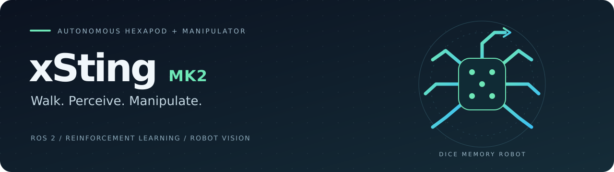

<div align="center">



<h1>xSting MK2</h1>
<p><strong>걷고, 인식하고, 기억한 대로 배치하는 자율 로봇.</strong></p>
<p>6족 보행과 매니퓰레이터를 하나의 ROS 2 스택으로 연결합니다.</p>

<p>
  
  
  
  
</p>

<p>
  <a href="#quick-start">빠른 시작</a> &nbsp; · &nbsp;
  <a href="#packages">패키지 안내</a> &nbsp; · &nbsp;
  <a href="project2/docs/architecture.md">시스템 설계</a> &nbsp; · &nbsp;
  <a href="project2/README.md">실험과 제출 자료</a> &nbsp; · &nbsp;
  <a href="#team">팀 소개</a>
</p>

</div>

---

**xSting MK2**는 6족 보행(18축)과 매니퓰레이터(5축 팔 + 그리퍼)를 결합한 자율 로봇이며, 이 저장소는 그 ROS 2 소프트웨어 스택입니다.
로봇이 경기장을 걸어 다니며 신호(신호등·바코드)를 읽고, 퍽을 집어 등의 적재함에 싣고, 주사위 눈 모양의 3×3 격자에 다시 내려놓는 **주사위 기억 로봇(Dice Memory Robot)** 미션을 수행합니다.

- **플랫폼**: ROS 2 Lyrical · Ubuntu 26.04 · NVIDIA Jetson Orin (Isaac ROS)
- **센서**: RealSense D435(전면), ArduCam 글로벌 셔터(팔 끝), COIN-D4 2D LiDAR, IMU, 초음파
- **구동부**: OpenCR 보드 3개(앞다리 · 뒷다리 · 팔) + Dynamixel X 시리즈

## 한눈에 보기

| 보행과 접근 | 인지와 판단 | 조작과 검증 |
|---|---|---|
| 18축 6족 보행 · RL 정책 | RGB-D · LiDAR · 팔 카메라 | 5축 팔 + 그리퍼 · 12칸 적재함 |
| 전역 주행 → 상자 전면 2 cm 도킹 | 신호등·바코드 해독 → 계약 가드 | 퍽 기립·적재 → 3×3 배치 → 탑뷰 재관측 |
| [주행](xsting_nav/README.md) · [보행](xsting_walk/README.md) · [접근](xsting_approach/README.md) | [미션 통합](xsting_mission/README.md) · [DOPE](training/dope/README.md) | [픽앤플레이스](xsting_pick_place/README.md) · [MoveIt](xsting_moveit_config/README.md) |

## 미션 흐름


상위 판단기(`llm_commander`, LLM 또는 스크립트)가 `RobotCommand`를 내리면 `robot_command_server`가 계약·안전 조건을 검사하고, `mission_bridge`가 이를 주행·비전·매니퓰레이션 액션으로 나눠 실행합니다.
실행 결과는 `signal.json`, `allocation.json`, `verification.json`과 영상으로 자동 기록됩니다.

<a id="quick-start"></a>

## 빠른 시작

### 시뮬레이션: 가짜 경기장에서 미션 실행

ROS 2 Lyrical과 `colcon`, `rosdep`이 설치된 환경에서 시작합니다. 로봇과 API 키 없이 가짜 경기장과 스크립트 판단기를 실행할 수 있습니다. 전체 환경은 [설치](#installation)를 참고하세요.

```bash
# 처음 받는 경우
mkdir -p ~/mk2_ws/src
cd ~/mk2_ws/src
git clone https://github.com/hsmint/xSting.git
cd ~/mk2_ws

# 미션 시뮬레이션에 필요한 패키지만 설치하고 빌드
source /opt/ros/lyrical/setup.bash
rosdep install --from-paths src/xSting/xsting_interfaces src/xSting/xsting_mission --ignore-src -r -y
colcon build --packages-select xsting_interfaces xsting_mission
source install/setup.bash
ros2 launch xsting_mission mission.launch.py backend:=fake commander:=true decider:=script
```

가짜 경기장 화면은 `http://localhost:8765`, 실행 기록은 `~/xsting_logs/run_<시각>/`에서 확인합니다. `rosdep`을 처음 사용하는 환경은 [의존성 설치](#installation) 단계에서 초기화하세요.

아래 모델 표시와 실기체 실행 예제는 필요한 패키지를 [전체 빌드](#installation)한 뒤 사용합니다.

<details>
<summary><strong>로봇 모델 표시 · 실기체 실행 예제</strong></summary>

### 로봇 모델 확인

```bash
ros2 launch xsting_description display.launch.py pose:=stand
```

### 실기체: 전체 시스템 실행

```bash
ros2 launch xsting_bringup full_system.launch.py
```

`with_hardware`, `with_vision`, `with_nav`, `with_approach`, `with_pick_place`, `with_mission` 인자로 계층을 하나씩 켜고 끌 수 있습니다. 예를 들어 하드웨어 없이 인지 스택만 확인하려면:

```bash
ros2 launch xsting_bringup full_system.launch.py with_hardware:=false with_nav:=false \
  with_approach:=false with_pick_place:=false with_mission:=false
```

</details>

### 테스트

전체 스택 빌드 후 패키지 테스트를 실행합니다.

```bash
colcon test --packages-select xsting_nav xsting_walk xsting_pick_place xsting_mission \
  --event-handlers console_direct+
colcon test-result --verbose
```

<a id="packages"></a>

## 패키지 구성

| 계층 | 패키지 | 역할 |
|---|---|---|
| 공통 인터페이스 | [`xsting_interfaces`](xsting_interfaces) | 미션·작업·제어용 액션(`RobotCommand`, `RunTask`, `LoadBox`, `ApproachBox`, `PickPlace` 등)과 메시지 |
| 기구·하드웨어 | [`xsting_description`](xsting_description/README.md) | 6족 + 팔 URDF/STL, Isaac Sim용 USD, 관절 순서 |
| | [`xsting_hardware`](xsting_hardware) | OpenCR 3보드 `ros2_control` 플러그인(200 Hz), IMU·초음파 브로드캐스터 |
| | [`firmware`](firmware) | OpenCR Arduino 펌웨어(`mk2_arm`, `mk2_leg`, `mk2_motor`; `mk1_*`은 이전 버전) |
| 인지·SLAM | [`xsting_vision`](xsting_vision) | 카메라 드라이버, YOLOv8 + Depth PCA 3D 검출, 신호등·바코드 해독, LiDAR 오도메트리 |
| | [`xsting_yolo`](xsting_yolo) | YOLOv8 학습 및 ONNX / TensorRT FP16 변환 스크립트 |
| | [`xsting_bringup`](xsting_bringup) | cuVSLAM · nvblox 통합 런치, 전체 시스템 런치, Foxglove 레이아웃 |
| 주행·정밀접근 | [`xsting_nav`](xsting_nav/README.md) | 41D RL 보행 정책 + 삼각보행 IK, 장애물 대기·우회, LiDAR-ESDF 전역 정합 |
| | [`xsting_approach`](xsting_approach/README.md) | 상자 전면 2 cm 정밀 도킹 액션 서버(`/approach_box`) |
| | [`xsting_walk`](xsting_walk/README.md) | 전방향 카펫 보행 RL 정책과 보행 캘리브레이션 도구 |
| 매니퓰레이션 | [`xsting_moveit_config`](xsting_moveit_config/README.md) | MoveIt 2 SRDF, 관절 한계, cuMotion 충돌 모델 |
| | [`xsting_pick_place`](xsting_pick_place/README.md) | 탑뷰 정렬 · 퍽 기립 · 적재 · 하역 · 관측(`/pick_place`) |
| 상위 미션 | [`xsting_mission`](xsting_mission/README.md) | 판단기, 명령 서버·안전 가드, 액션 브릿지, 가짜 경기장 시뮬레이터, 결과 기록기 |
| 학습 | [`training`](training) | DOPE 퍽 자세 추정, YOLO 학습, 모델 검증 |

패키지별 상세 사용법은 각 디렉터리의 `README.md`를 참고하세요. 시스템 설계(노드·토픽·TF·상태기계)는 [`project2/docs/architecture.md`](project2/docs/architecture.md)에 정리되어 있습니다.

<a id="installation"></a>

## 설치

### 1. 사전 요구 사항

| 항목 | 버전 / 비고 |
|---|---|
| OS | Ubuntu 26.04 |
| ROS 2 | Lyrical (`/opt/ros/lyrical`) |
| NVIDIA | Jetson Orin + Isaac ROS(cuVSLAM, nvblox, TensorRT, YOLOv8, cuMotion) |
| 기타 | MoveIt 2, `ros2_control`, Dynamixel SDK, librealsense2, OpenCV, ZXing, Foxglove Bridge |
| 시뮬레이션(선택) | Isaac Sim 6.x |

> 실기체 없이 미션 로직만 확인하려면 Isaac ROS 없이 `xsting_interfaces`와 `xsting_mission`만 빌드해도 됩니다. [빠른 시작](#quick-start)을 보세요.

### 2. 워크스페이스 만들기

```bash
mkdir -p ~/mk2_ws/src && cd ~/mk2_ws/src
git clone https://github.com/hsmint/xSting.git
cd ~/mk2_ws
```

### 3. 의존성 설치

```bash
source /opt/ros/lyrical/setup.bash
sudo rosdep init   # 처음 한 번만
rosdep update
rosdep install --from-paths src --ignore-src -r -y
```

Isaac ROS 패키지는 rosdep으로 설치되지 않을 수 있습니다. NVIDIA Isaac ROS 설치 문서에 따라 먼저 설치하세요.

### 4. 빌드

```bash
colcon build --symlink-install --cmake-args -DCMAKE_BUILD_TYPE=Release
source install/setup.bash
```

`training`, `xsting_yolo`, `project2`는 `COLCON_IGNORE`로 빌드에서 제외되며, `firmware`는 ROS 패키지가 아니라 빌드 대상이 아닙니다.

### 5. 모델 가중치 받기 (선택)

DOPE 퍽 자세 추정 가중치(192 MB)는 용량 제한 때문에 GitHub Release에 있습니다.

```bash
cd src/xSting/training/dope
mkdir -p model
wget -O model/square_puck_dope_e60.pth \
  https://github.com/hsmint/xSting/releases/download/dope-square-puck-v1/square_puck_dope_e60.pth
```

RL 보행·접근 정책(`*/models/*.bin`)은 저장소에 포함되어 있습니다. YOLOv8 TensorRT 엔진은 [`xsting_yolo`](xsting_yolo)의 `export.sh`, `trtexec.sh`로 대상 장비에서 직접 생성합니다.

### 6. 펌웨어 업로드 (실기체)

Arduino IDE에 OpenCR 보드 패키지와 Dynamixel2Arduino 라이브러리를 설치한 뒤 각 보드에 업로드합니다.

| 보드 | 스케치 | USB Slave ID |
|---|---|---|
| 앞다리 | `firmware/mk2_leg` (`XSTING_IS_FRONT=1`) | 200 |
| 뒷다리 | `firmware/mk2_leg` (`XSTING_IS_FRONT=0`) | 201 |
| 팔 | `firmware/mk2_arm` | 202 |

앞/뒤 보드는 `firmware/mk2_leg/include/mk2_leg.h`의 `XSTING_IS_FRONT`로 선택합니다. 모터 ID와 통신 속도(1 Mbps, Protocol 2.0)는 업로드 전에 미리 설정해야 합니다. 자세한 내용은 [`firmware/mk2_motor/README.md`](firmware/mk2_motor/README.md)를 참고하세요.

<a id="validation"></a>

## 검증 현황

| 범위 | 기록된 결과 | 근거 |
|---|---|---|
| 단위 시험 | `colcon test` 12건 통과 | [기여·검증 기록](project2/docs/contributions.md) |
| 가짜 경기장 | 계약 가드가 잘못된 하역을 차단한 뒤 판단기가 순서를 수정해 완주 | [가드 on 실행 보고서](project2/xsting_logs/run_20261116_102220/report.md) |
| 통합 시험 | 실기·시뮬레이션·단위 시험 16건, 실패·미확인 항목 포함 | [시험 결과표](project2/results/test-results.csv) |
| 실물 경기장 전체 미션 | 전 구간 수행 미확인 · 공식 회차 기록 별도 | [공식 경기 기록서](project2/submission/official_match_results.md) |

측정 조건과 개발 중 실험은 [실험 기록](project2/experiments/README.md)에 정리되어 있습니다.

<a id="team"></a>

## 팀과 기여

### 팀원 및 담당 영역

| 팀원 | GitHub | 주 담당 |
|---|---|---|
| 홍석민 | [@hsmint](https://github.com/hsmint) | OpenCR 3보드 펌웨어, RL 주행·LiDAR-ESDF 전역 정합(`xsting_nav`), 정밀 도킹(`xsting_approach`), 픽앤플레이스(`xsting_pick_place`, `xsting_moveit_config`), 실기체 통합 |
| 김민식 | [@minsikim-42](https://github.com/minsikim-42) | URDF·USD 모델(`xsting_description`), `ros2_control` 하드웨어(`xsting_hardware`), 센서 보정·cuVSLAM/nvblox·통합 런치(`xsting_bringup`), 미션 안전 가드 |
| 김상화 | [@SangHwaKim09](https://github.com/SangHwaKim09) | 비전 파이프라인(`xsting_vision`): 3D 검출·신호등/바코드·LiDAR 오도메트리, YOLOv8 학습·TensorRT 변환(`xsting_yolo`) |
| 문태영 | [@Teewhy-M](https://github.com/Teewhy-M) | 공용 인터페이스(`xsting_interfaces`), 미션 플래너·판단기·시뮬레이터·결과 기록기(`xsting_mission`), 전방향 보행 RL(`xsting_walk`) |

PR·커밋·검증·리뷰 이력을 포함한 상세 기여 내역은 [`project2/docs/contributions.md`](project2/docs/contributions.md)에 있습니다.

<details>
<summary><strong>기여 방법과 개발 규칙</strong></summary>

### 기여 방법

1. **이슈 먼저**: 버그나 새 기능은 이슈로 먼저 공유하고 담당 패키지 소유자를 지정합니다.
2. **브랜치**: `develop`에서 기능 브랜치를 만듭니다. 이름은 영역을 드러내게 짓습니다(예: `vision`, `control`, `yolo`, `feat/nav-esdf`).
   ```bash
   git switch develop && git pull
   git switch -c feat/<짧은-설명>
   ```
3. **커밋**: 한 커밋에는 한 가지 변경만 담고, 메시지는 명령형으로 씁니다(예: `Add xsting_walk package for omnidirectional carpet locomotion`).
4. **확인**: PR 전에 변경한 패키지를 빌드하고 테스트를 통과시킵니다.
   ```bash
   colcon build --packages-up-to <패키지>
   colcon test --packages-select <패키지> && colcon test-result --verbose
   ```
   실기체로 확인한 경우 시험 조건과 로그(`mcap`, 결과 JSON 등) 위치를 PR에 적어 주세요.
5. **Pull Request**: `develop`으로 PR을 열고, 다른 담당 영역의 팀원 1명 이상에게 리뷰를 받은 뒤 병합합니다. `main`에는 검증이 끝난 `develop`만 병합합니다.

#### 규칙

- `xsting_interfaces`의 액션·메시지를 바꾸면 이를 쓰는 모든 패키지 담당자에게 알리고 함께 수정합니다.
- 100 MB가 넘는 모델 가중치나 데이터는 저장소에 커밋하지 말고 GitHub Release에 올립니다.
- C++ 코드는 Google 스타일을 따릅니다(`firmware/mk2_motor/.clang-format` 참고).
- 하드웨어를 움직이는 코드는 `dry_run:=true` 또는 `hardware:=mock`으로 먼저 확인합니다.

</details>

## 라이선스

패키지마다 라이선스가 다릅니다. 각 패키지의 `package.xml`과 `LICENSE`를 확인하세요.

- **MIT**: `xsting_interfaces`, `xsting_description`, `xsting_vision`, `xsting_bringup`, `xsting_mission`
- **Apache-2.0**: `xsting_hardware`, `xsting_nav`, `xsting_approach`, `xsting_walk`, `xsting_moveit_config`, `xsting_pick_place`
