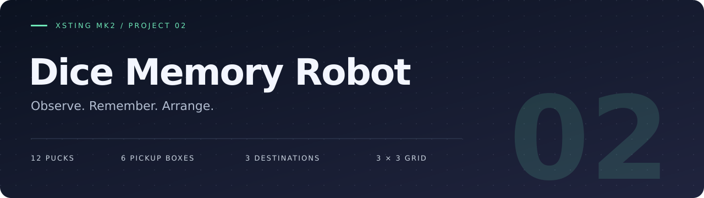
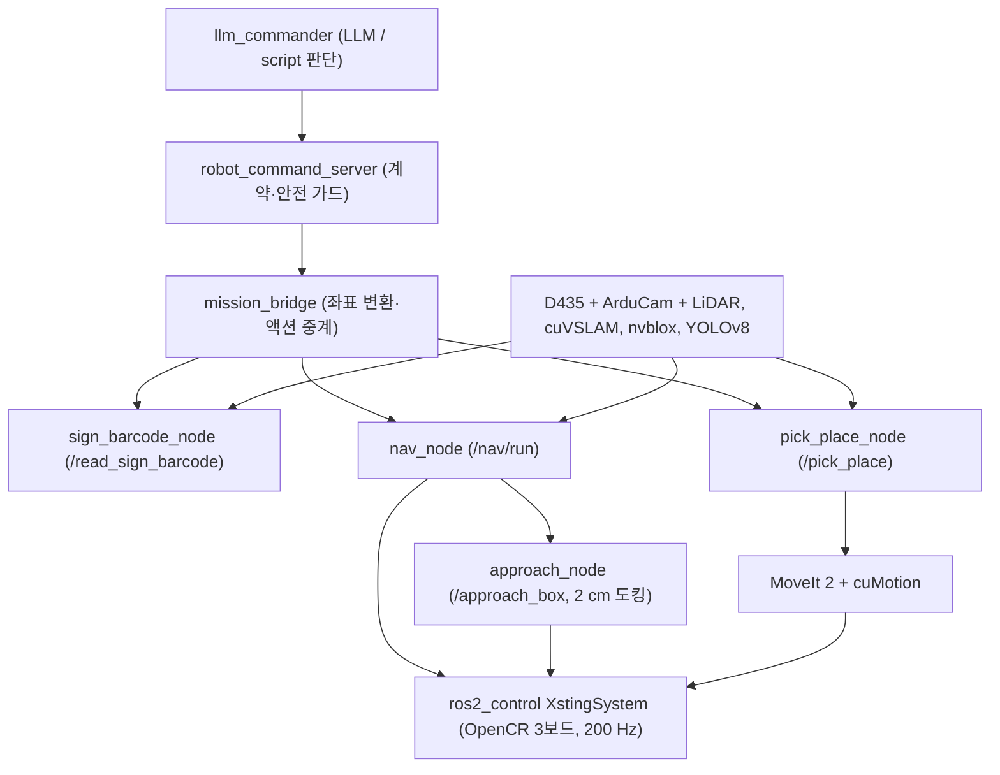

<div align="center">



<h1>주사위 기억 로봇</h1>
<p>Project 2 · 설계에서 실험, 검증과 제출까지.</p>
<p><a href="docs/architecture.md">시스템 설계</a> &nbsp; · &nbsp; <a href="experiments/README.md">실험 기록</a> &nbsp; · &nbsp; <a href="submission/presentation.md">발표 자료</a>
</p>

</div>

---

## 자료 둘러보기

<table>
<tr>
<td width="50%" valign="top"><h3>01 · 시스템 설계</h3><p>계층, 노드, 액션, TF와 미션 상태를 한곳에서 확인합니다.</p><a href="docs/architecture.md">아키텍처 →</a> · <a href="submission/code_and_config_manifest.md">코드·설정 명세 →</a></td>
<td width="50%" valign="top"><h3>02 · 실험과 검증</h3><p>충돌 형상, 카메라 보정, 영상 수신과 미션 판단기 비교.</p><a href="experiments/README.md">실험 노트 →</a> · <a href="results/test-results.csv">시험 결과표 →</a></td>
</tr>
<tr>
<td valign="top"><h3>03 · 발표 자료</h3><p>목표와 구현, 실패 분석, 결과와 다음 과제를 순서대로.</p><a href="submission/presentation.md">발표 원고 →</a> · <a href="submission/presentation_slides.html">브라우저 슬라이드 →</a></td>
<td valign="top"><h3>04 · 공식 경기</h3><p>1·2회차의 영상, 관측, 배치와 점수를 각각 기록합니다.</p><a href="submission/official_match_results.md">수행 기록서 →</a> · <a href="submission/scoring_sheet_100pt.md">100점 판정표 →</a></td>
</tr>
<tr>
<td valign="top"><h3>05 · 팀의 기여</h3><p>팀원 4인의 구현·검증·리뷰·설명과 근거 자료.</p><a href="docs/contributions.md">기여 내역 →</a></td>
<td valign="top"><h3>06 · 다시 실행하기</h3><p>환경과 버전을 확인하고 빌드·시험·실기 실행을 재현합니다.</p><a href="submission/reproduction_test_record.md">재현 시험 기록서 →</a> · <a href="../README.md#quick-start">빠른 시작 →</a></td>
</tr>
</table>

> [!NOTE]
> **기록 상태** · 개발 실험과 모의 미션 결과를 수록했습니다. 실물 경기장 전체 미션은 미확인이며, 공식 경기 결과와 채점표는 작성 양식입니다.

6족 보행(18축) + 6축 매니퓰레이터 로봇 **xSting MK2**로 주사위 기억 미션(발제 `v5`)을 수행하는 ROS 2 Lyrical 프로젝트의 제출 자료 모음입니다.
코드는 저장소 루트의 `xsting_*` 패키지에 있고, 이 폴더(`project2/`)에는 설계·기여·실험·시험 결과·제출 문서를 모았습니다.

> 미션 요약: 출발 구역에서 **바코드(`P2-01~04`)와 신호등 12회 점멸**을 읽고 → 시작 상자 `S1~S6`의 퍽 12개를 적재 → 정렬 규칙으로 정한 그룹을 하차 상자 `L1~L3`의 **주사위 눈 격자(3×3, 60 mm)**에 배치 → 탑뷰로 재검증 → `HOME`으로 복귀해 3초 정지.

---

<a id="section-1"></a>

## 1. 폴더 구성

<details>
<summary><strong>전체 폴더 구조 펼치기</strong></summary>

```text
project2/
├── README.md                     # 이 문서 (전체 안내)
├── docs/
│   ├── architecture.md           # 시스템 설계: 계층·노드·토픽·액션·TF·미션 단계·안전 상태기계
│   └── contributions.md          # 팀원 4인 구현·검증·리뷰·설명 기여
├── experiments/                  # 개발 중 실험 기록 → experiments/README.md
│   ├── collision_shape_accuracy.md
│   ├── arducam_calibration.md
│   ├── camera_stream_benchmark.txt
│   └── mission_sim_logs_20261117/  # 판단기 시뮬레이션 20회 (run_*)
├── results/
│   ├── test-results.csv          # 시험 16건 (실기·시뮬레이션·단위) 결과표
│   ├── signal.json, allocation.json  # 가드 on 모의 완주 산출물 예시
├── xsting_logs/                  # 2026-11-16 미션 실행 로그 (run_20261116_102220 = 가드 on 완주)
└── submission/
    ├── presentation.md / presentation_slides.html   # 최종 발표
    ├── code_and_config_manifest.md                  # 실행 노드·런치·설정 파일 명세
    ├── reproduction_test_record.md                  # 팀원 재현 시험 기록서 (작성 양식)
    ├── official_match_results.md                    # 공식 1·2회차 기록서 (작성 양식)
    ├── scoring_sheet_100pt.md                       # 100점 채점표
    ├── official_logs/round_1, round_2/              # 공식 회차 로그 보관 위치
    └── scripts/
        ├── collect_repro_info.sh                    # 재현 환경·버전·테스트 결과 자동 수집
        └── archive_official_run.sh                  # 공식 회차 로그 분리 보관 + 비밀정보 검사
```

</details>

---

<a id="section-2"></a>

## 2. 시스템 구성

5개 계층으로 나뉘며, 상위 판단기는 하위 모션 노드를 직접 부르지 않고 **계약 가드(`robot_command_server`)를 거쳐** 액션으로만 명령합니다. 상세 다이어그램·토픽·액션 표는 [docs/architecture.md](docs/architecture.md)에 있습니다.



### 패키지

| 계층 | 패키지 | 역할 | 패키지 문서 |
|---|---|---|---|
| 공통 | `xsting_interfaces` | `RobotCommand`, `ReadMissionInput`, `RunTask`, `LoadBox`, `UnloadPucks`, `ObserveLocation`, `ReadSignBarcode`, `ApproachBox`, `PickPlace` 액션·메시지 | — |
| 기구·하드웨어 | `xsting_description` | 6족 18축 + 팔 6축 + 센서 + 적재함 12칸 URDF/STL, Isaac Sim USD | [README](../xsting_description/README.md) |
| | `xsting_hardware` | OpenCR 3보드(ID 200 앞다리 / 201 뒷다리 / 202 팔) `ros2_control` 플러그인, IMU·초음파 브로드캐스터 | — |
| | `firmware/` | OpenCR 펌웨어 (`mk1_*`, `mk2_arm`, `mk2_leg`, `mk2_motor`) | [mk2_motor](../firmware/mk2_motor/README.md) |
| 인지·SLAM | `xsting_vision` | D435 에미터 분리, ArduCam 보정, 2D LiDAR 오도메트리, Depth PCA 3D 검출, 신호등·바코드 해독 | — |
| | `xsting_yolo`, `training/` | YOLOv8 학습·ONNX/TensorRT 변환, DOPE 사각 퍽 자세 추정 | [DOPE](../training/dope/README.md) |
| | `xsting_bringup` | GPU 비전·SLAM 컨테이너(`xsting.launch.py`), 전체 스택(`full_system.launch.py`) | — |
| 주행·접근 | `xsting_nav` | 41D RL 주행 정책 + 6족 보행 IK + 사람 대기/Dijkstra 우회 + LiDAR↔ESDF 전역 정합 | [README](../xsting_nav/README.md) |
| | `xsting_approach` | 상자 전면 2 cm 정밀 도킹 (`/approach_box`) | [README](../xsting_approach/README.md) |
| | `xsting_walk` | 74D 전방향 카펫 보행 정책, 텔레옵, 보행 보정 | [README](../xsting_walk/README.md) |
| 매니퓰레이션 | `xsting_moveit_config` | MoveIt 2 SRDF, cuMotion 구체 충돌 모델(`xsting.xrdf`) | [README](../xsting_moveit_config/README.md) |
| | `xsting_pick_place` | ArduCam 탑뷰 정렬, 누운 퍽 기립, 적재·하역·재검증 | [README](../xsting_pick_place/README.md) |
| 미션 | `xsting_mission` | 판단기, 계약 가드, 액션 중계, 가짜 경기장, 산출물 기록 | [README](../xsting_mission/README.md) |

---

<a id="section-3"></a>

## 3. 미션 수행 흐름

| 단계 | 상위 명령 | 완료 조건 | 산출물 |
|---|---|---|---|
| 1. 관측 | `READ_MISSION_INPUT` | 등록 바코드 ∧ 신호 12회 ∧ 색별 1~6회 ∧ 종료 3초 소등 | `signal.json` |
| 2. 계획 | `COMPARE_ROUTES` / `planner.assign` | R/G 수량 충족, Y 그룹 단일 모양, ID 중복·누락 0 | `allocation.json` |
| 3. 주행·도킹 | `GOTO` | 목표 도착 + 상자 전면 약 2 cm 정렬 + 팔 접힘 | `mission.jsonl` |
| 4. 적재·하역 | `LOAD` / `UNLOAD` | 상자 퍽 0개 / 배정 퍽 전량 배치 (중심 오차 ≤ 10 mm) | `allocation.json`, `decisions.json` |
| 5. 재검증 | `VERIFY_LOCATION` | 새 탑뷰 프레임으로 L1~L3 9칸 확인, 12개 중복·누락 없음 | `verification.json` |
| 6. 복귀 | `GOTO HOME` | 출발 구역 안에서 3초 이상 정지 → `phase=DONE` | `final_state.json`, `report.md` |

오류 처리는 ① 가드 사전 차단(로봇 미동작) → ② 입력·할당 무결성 정지 → ③ 주행·조작 내부 재시도 → ④ 적재·하역 중 불확실 시 즉시 정지 → ⑤ 기울기 38° 초과·하드웨어 고장·`TIME_UP(1800 s)` 비상 정지의 5단계입니다 ([architecture.md §5](docs/architecture.md)).

---

<a id="section-4"></a>

## 4. 빌드와 실행

기록된 검증 환경: Ubuntu 26.04, ROS 2 Lyrical, CUDA 13.2, MoveIt 2.15.2, cuVSLAM/nvblox 5.0.0 ([reproduction_test_record.md](submission/reproduction_test_record.md)).

```bash
# 저장소를 ~/mk2_ws/src/xSting에 둔 경우
cd ~/mk2_ws
source /opt/ros/lyrical/setup.bash
colcon build --symlink-install --cmake-args -DBUILD_TESTING=ON
source install/setup.bash

# 자동 단위 테스트
colcon test --packages-select xsting_nav xsting_pick_place xsting_mission
colcon test-result --verbose
```

```bash
# (1) 하드웨어 없이 가짜 경기장 + 스크립트 판단기 (API 키 불필요)
ros2 launch xsting_mission mission.launch.py backend:=fake commander:=true decider:=script

# (2) 실기체 전체 스택 (하드웨어 + 비전/SLAM + 주행 + 도킹 + 픽앤플레이스 + 미션)
ros2 launch xsting_bringup full_system.launch.py decider:=llm guard:=true record_media:=true
```

실행 로그는 `~/xsting_logs/run_<시각>/`에 저장됩니다. 패키지별 단독 실행·보정 방법은 위 표의 각 패키지 README를 참고하세요.

---

<a id="section-5"></a>

## 5. 실험 · 시험 결과 요약

### 개발 실험 ([experiments/](experiments/README.md))

| 실험 | 결과 |
|---|---|
| 팔 충돌 형상 (볼록 껍질 → CoACD 88조각) | 실제 메쉬와 일치 97.4% → **99.3%**, 실제 충돌 미검출 **0%** |
| ArduCam 광각 보정 | fisheye 모델 **RMS 0.482 px** 채택 (pinhole은 가장자리 발산) |
| RealSense 2대 × 4스트림 GPU 수신 | 전 스트림 **30 Hz**, 최대 지연 2.2 ms |
| 미션 판단기 시뮬레이션 20회 | 16회 `DONE`. 할당·방문 순서 오판 사례 → 계약 가드·prefetch 도입 근거 |

### 통합 시험 ([results/test-results.csv](results/test-results.csv), 16건)

| 구분 | 성공 | 실패 | 미확인 |
|---|---|---|---|
| 실제 장비 (T-REAL) | 3 | 3 | 3 |
| 시뮬레이션·모의 입력 (T-SIM) | 5 | 1 | 0 |
| 단위 시험 (T-UNIT) | 1 | 0 | 0 |

- 단위 시험: `colcon test` 12건 전부 통과 (RL 정책 PyTorch↔C++ 오차 `< 1e-5`, LiDAR-ESDF 정합 `< 2.5 cm / 0.03 rad`, 탑뷰 IK↔FK `< 1 mm` 등 — [contributions.md §1.2](docs/contributions.md))
- 가드 on 모의 완주: [`xsting_logs/run_20261116_102220`](xsting_logs/run_20261116_102220/report.md) — 18턴째 L2 분할 하역 시도를 가드가 거절, 판단기가 L1→L2로 순서를 고쳐 완주
- 실물 경기장 전 구간(신호 인식, 자율 주행·도킹, 12개 퍽 배치)은 아직 미확인이며, 공식 회차 결과는 [official_match_results.md](submission/official_match_results.md)에 기록합니다.

---

<a id="section-6"></a>

## 6. 팀

| 팀원 | 주 담당 |
|---|---|
| 홍석민 ([@hsmint](https://github.com/hsmint)) | OpenCR 펌웨어, RL 주행·LiDAR 정합(`xsting_nav`), 정밀 도킹(`xsting_approach`), 픽앤플레이스(`xsting_pick_place`, `xsting_moveit_config`), 통합 |
| 김민식 ([@minsikim-42](https://github.com/minsikim-42)) | URDF·USD(`xsting_description`), `ros2_control`(`xsting_hardware`), 보정·SLAM·통합 런치(`xsting_bringup`), 미션 가드 |
| 김상화 ([@SangHwaKim09](https://github.com/SangHwaKim09)) | 비전·센서(`xsting_vision`), YOLOv8 학습·TensorRT(`xsting_yolo`) |
| 문태영 ([@Teewhy-M](https://github.com/Teewhy-M)) | 인터페이스(`xsting_interfaces`), 미션 판단기·시뮬레이터(`xsting_mission`), 카펫 보행(`xsting_walk`) |

상세 기여(구현·검증·리뷰·설명)는 [docs/contributions.md](docs/contributions.md)를 참고하세요.
