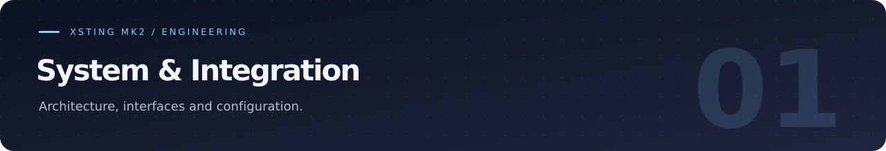
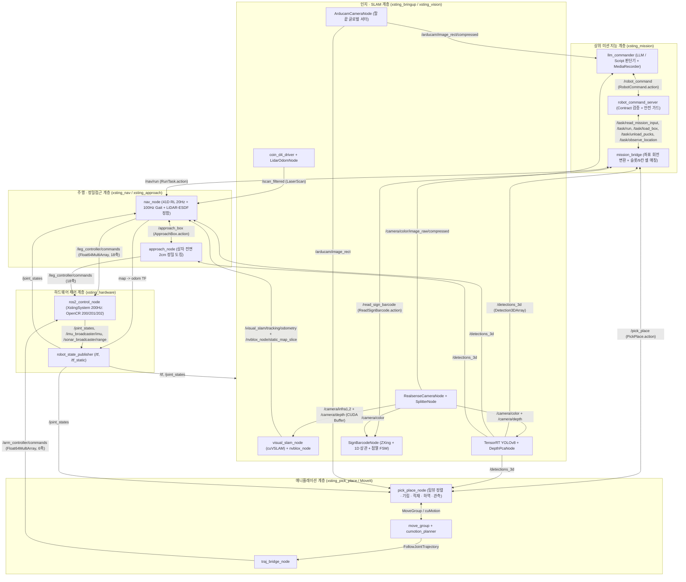
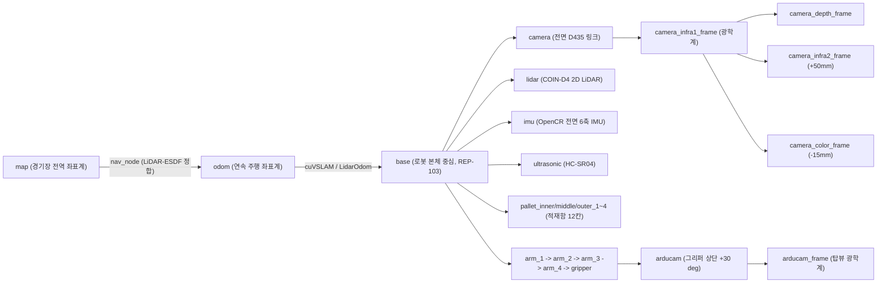
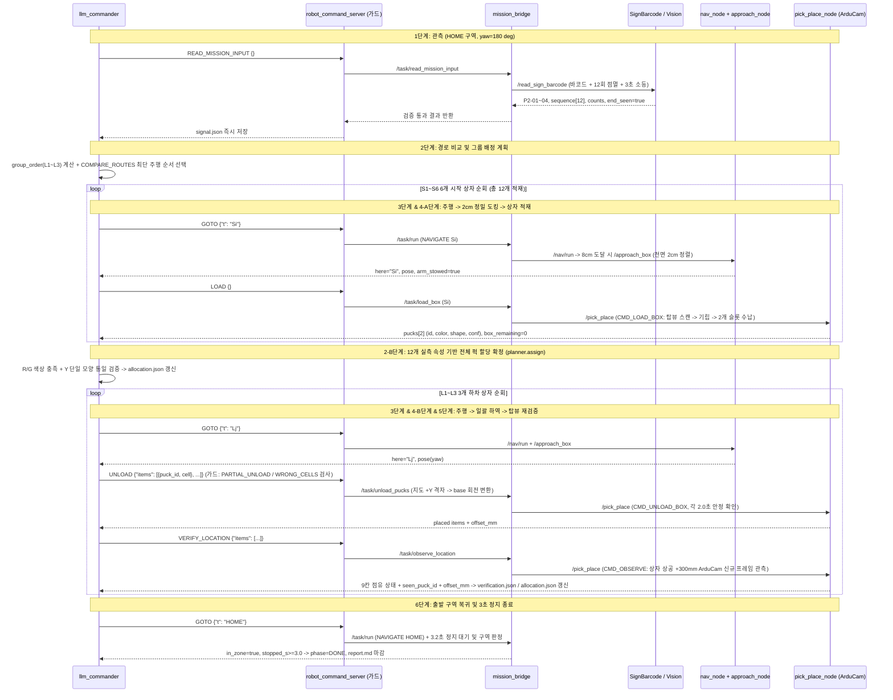
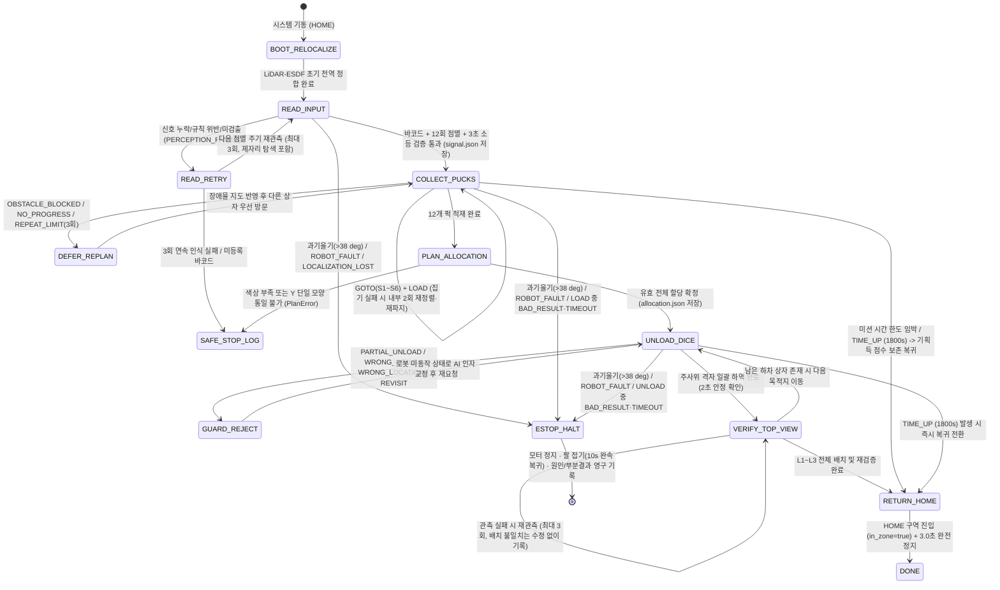

<h1>시스템 설계</h1>

인지부터 실행까지, 노드·인터페이스·좌표계와 오류 처리의 연결 구조.

<a href="../README.md">Project 2</a> &nbsp; · &nbsp; <a href="../experiments/README.md">실험 기록</a> &nbsp; · &nbsp; <a href="../submission/presentation.md">발표 자료</a>

---

<table>
<tr>
<td width="33%" align="center"><h3>05</h3>소프트웨어 계층</td>
<td width="33%" align="center"><h3>ROS 2</h3>노드 · 토픽 · 액션</td>
<td width="33%" align="center"><h3>TF</h3>로봇 · 지도 · 카메라</td>
</tr>
</table>

<strong>이 문서의 목차</strong>

01. [시스템 개요 및 패키지 계층 구조](#chapter-01)
02. [ROS 2 노드 · 토픽 · 액션 · 메시지 아키텍처](#chapter-02)
03. [로봇 · 지도 · 카메라 좌표계 및 변환 관계](#chapter-03)
04. [미션 수행 순서 및 단계별 입출력 · 완료 조건](#chapter-04)
05. [안전 정지 및 오류 처리 상태도](#chapter-05)

- **대상 시스템**: 6족 보행(18-DOF) + 6-DOF 매니퓰레이터 자율 로봇 **xSting MK2** (`ROS 2 Lyrical`)
- **과제 명세**: 주사위 기억 로봇 (Dice Memory Robot, 발제 `v5` 기준)
- **기준 저장소 / 코드 버전**: `https://github.com/hsmint/xSting` (`develop` 브랜치 커밋 `9a8c23b` 기반 + 통합 워크스페이스 `/home/pa03/Documents/FINAL/mk2_ws/src`)
- **작성 및 갱신일**: `2026-11-17` (중간 점검 기준 설계 및 시험 상태 반영)

---

## 1. 시스템 개요 및 패키지 계층 구조

xSting MK2 소프트웨어 스택은 **인지·SLAM**, **주행·정밀접근**, **매니퓰레이션**, **상위 미션 지능(LLM/규칙 판단 및 안전 가드)**, **실기체 하드웨어 제어**의 5개 계층(12개 핵심 패키지)으로 분리되어 동작합니다.

| 계층 | 패키지 | 버전 | 핵심 역할 |
|---|---|---|---|
| **공통 인터페이스** | `xsting_interfaces` | `0.0.0` | 상위 미션 명령(`RobotCommand`), 작업 프리미티브(`ReadMissionInput`, `RunTask`, `LoadBox`, `UnloadPucks`, `ObserveLocation`), 하위 제어(`ReadSignBarcode`, `ApproachBox`, `PickPlace`) 액션 및 에러·관측 메시지 정의 |
| **기구·하드웨어** | `xsting_description` | `0.1.0` | 6족(18축) + 팔·그리퍼(6축) + 센서 프레임 + 12칸 적재함(`pallet_*`) URDF/STL 및 관절 순서(`joint_order.yaml`) 정의 |
| | `xsting_hardware` | `0.1.0` | OpenCR 3-보드(앞다리 `ID 200`, 뒷다리 `ID 201`, 팔 `ID 202`) Dynamixel `ros2_control` 시스템 플러그인(`XstingSystem`), 200Hz 제어 루프, IMU·초음파 브로드캐스터 |
| **인지·SLAM** | `xsting_vision` | `0.0.0` | 전면 RealSense D435 드라이버/에미터 스플리터, 팔 끝 ArduCam 왜곡 보정, COIN-D4 2D LiDAR 오도메트리, YOLOv8+Depth PCA 3D 검출(`/detections_3d`), 신호등·바코드 해독(`/read_sign_barcode`) |
| | `xsting_bringup` | `0.0.0` | GPU 제로카피 비전·cuVSLAM·nvblox 통합 컨테이너(`xsting.launch.py`), 실기체 전체 스택 런치(`full_system.launch.py`), Foxglove 관제 통합 런치(`auto_drive.launch.py`) |
| **주행·정밀접근** | `xsting_nav` | `0.1.0` | 41D RL 보행 정책(20Hz) + 100Hz 6족 삼각보행 IK + 동적 장애물(사람) 10초 정지 대기 및 Dijkstra 우회 + **2D LiDAR ↔ 정적 경기장 ESDF 전역 정합(`map -> odom`)** |
| | `xsting_approach` | `1.0.0` | 전면 D435 3D 박스 검출·초음파 기반 상자 전면 **2 cm 정밀 도킹** 액션 서버(`/approach_box`) |
| | `xsting_walk` | `1.0.0` | 74D 전방향 카펫 보행 정책 및 IMU·관절·속도 실측 캘리브레이션 도구 |
| **매니퓰레이션** | `xsting_moveit_config` | `0.1.0` | MoveIt 2 SRDF, 관절 속도/위치 한계, Isaac ROS cuMotion 구체 충돌 모델(`xsting.xrdf`) |
| | `xsting_pick_place` | `0.1.0` | MoveIt + cuMotion + 팔 끝 ArduCam 탑뷰 YOLOv8 5클래스 검출·누운 사각 퍽 자동 기립(`RightPuck`)·적재(`CMD_LOAD_BOX`)·주사위 격자 하역(`CMD_UNLOAD_BOX`)·탑뷰 재검증(`CMD_OBSERVE`) |
| **상위 미션 지능** | `xsting_mission` | `0.1.0` | 상위 판단기(`llm_commander`), 계약·안전 가드(`robot_command_server`), 좌표 변환·액션 중계(`mission_bridge`), 시뮬레이션 백엔드(`fake_robot`) 및 제출 산출물(`signal.json`, `allocation.json`, `verification.json`, 영상) 자동 기록기 |

---

## 2. ROS 2 노드 · 토픽 · 액션 · 메시지 아키텍처

### 2.1 전체 데이터 흐름도

### 2.2 주요 ROS 2 토픽 명세

| 토픽 이름 | 메시지 타입 | 발행 노드 | 구독 노드 | 주기 / 특징 |
|---|---|---|---|---|
| `/camera/color/image_raw` | `sensor_msgs/msg/Image` | `realsense_camera_node` | `yolo_encoder`, `sign_barcode_node`, `media_recorder`(`compressed`) | 30Hz, GPU `rosidl::Buffer` 제로카피 지원 |
| `/camera/depth/image_rect_raw` | `sensor_msgs/msg/Image` | `realsense_splitter_node` | `nvblox_node`, `depth_pca_node` | 에미터 ON 프레임만 선별 전달 |
| `/camera/infra1/image_rect_raw`, `/camera/infra2/...` | `sensor_msgs/msg/Image` | `realsense_splitter_node` | `visual_slam_node` (`cuVSLAM`) | 에미터 OFF 스테레오 프레임 선별 전달 |
| `/arducam/image_rect` | `sensor_msgs/msg/Image` | `arducam_camera_node` | `pick_place_node`, `media_recorder`(`compressed`) | 팔 끝 글로벌 셔터 왜곡 보정 영상 |
| `/scan_filtered` | `sensor_msgs/msg/LaserScan` | `lidar_odom_node` (`COIN-D4`) | `nav_node` | 10Hz, 360°(`0.10~12.0 m`), 차체 가림 제거 스캔 |
| `/visual_slam/tracking/odometry` | `nav_msgs/msg/Odometry` | `visual_slam_node` | `nav_node` | 스테레오 + IMU(`200Hz`) VIO 오도메트리 |
| `/nvblox_node/static_map_slice` | `nvblox_msgs/msg/DistanceMapSlice` | `nvblox_node` | `nav_node` | 실시간 근거리 2D ESDF 거리장 슬라이스 |
| `/detections_3d` | `vision_msgs/msg/Detection3DArray` | `depth_pca_node` | `nav_node`, `approach_node`, `pick_place_node`, `mission_bridge` | 5클래스(`red_cylinder`, `red_square`, `green_cylinder`, `green_square`, `paper_box`) 3D 위치·주축 |
| `/joint_states` | `sensor_msgs/msg/JointState` | `joint_state_broadcaster` | `robot_state_publisher`, `nav_node`, `move_group`, `pick_place_node` | 200Hz, 다리 18축 + 팔·그리퍼 6축 단일 소유 |
| `/imu_broadcaster/imu` | `sensor_msgs/msg/Imu` | `imu_broadcaster` | `visual_slam_node`, `nav_node`, `approach_node` | 200Hz, OpenCR 전면 보드(`ID 200`) 6축 IMU |
| `/sonar_broadcaster/range` | `sensor_msgs/msg/Range` | `sonar_broadcaster` | `approach_node` | 15Hz, 전방 HC-SR04 초음파(`0.02~4.0 m`) |
| `/leg_controller/commands` | `std_msgs/msg/Float64MultiArray` | `nav_node` 또는 `approach_node` | `leg_controller` (`ros2_control`) | 100Hz, 18축 다리 목표 관절각(`rad`) |
| `/arm_controller/commands` | `std_msgs/msg/Float64MultiArray` | `traj_bridge_node` | `arm_controller` (`ros2_control`) | 100Hz, 6축 팔·그리퍼 목표 위치(`rad`, `m`) |
| `/mission/state`, `/mission/decision` | `std_msgs/msg/String` (JSON) | `llm_commander` | Foxglove / 웹 관제 UI | `TRANSIENT_LOCAL` QoS, 실시간 상태·판단 카드 |

### 2.3 주요 ROS 2 액션 및 커스텀 메시지 명세 (`xsting_interfaces`)

| 액션 / 메시지 | 서버 노드 | 클라이언트 노드 | 주요 요청(Goal) → 결과(Result) 필드 | 타임아웃(상위/하위) |
|---|---|---|---|---|
| `/robot_command` (`RobotCommand.action`) | `robot_command_server` | `llm_commander` | `name`, `args_json` → `success`, `result_json` (피드백: `phase`) | 행동별 `120~600s` |
| `/task/read_mission_input` (`ReadMissionInput.action`) | `mission_bridge` | `robot_command_server` | `timeout` → `barcode`(`P2-01~04`), `colors[12]`, `end_seen`, `error_code` | `600s` / `590s` (회당 `60s`, 최대 3주기) |
| `/task/run` (`RunTask.action`) | `mission_bridge` → `/nav/run`(`nav_node`) | `robot_command_server` | `operation="NAVIGATE"`, `place_id`, `destination` → `success`, `error_code`, `message` | `180s` / `170s` |
| `/task/load_box` (`LoadBox.action`) | `mission_bridge` | `robot_command_server` | `place_id`(`S1~S6`) → `LoadedPuck[] pucks`(`slot`, `tag_id`, `color`, `shape`, `confidence`), `box_remaining` | `180s` / `170s` |
| `/task/unload_pucks` (`UnloadPucks.action`) | `mission_bridge` | `robot_command_server` | `location_id`(`L1~L3`), `PlaceItem[] items`(`puck_id`, `cell`) → `PlacedItem[] items`(`ok`, `offset`), `stopped_at` | `420s` / `400s` |
| `/task/observe_location` (`ObserveLocation.action`) | `mission_bridge` | `robot_command_server` | `location_id`(`L1~L3`) → `CellObservation[9] cells`(`cell`, `state`, `tag_id`, `offset`) | `120s` / `110s` |
| `/read_sign_barcode` (`ReadSignBarcode.action`) | `sign_barcode_node` | `mission_bridge` | `timeout_sec` → `sequence`, `r_count`, `y_count`, `g_count`, `barcode`, `ascending` | `60s` |
| `/approach_box` (`ApproachBox.action`) | `approach_node` | `nav_node` / `mission_bridge` | `timeout_sec`, `dry_run` → `success`, `dist_m`, `yaw_deg`, `range_m` | `35s` |
| `/pick_place` (`PickPlace.action`) | `pick_place_node` | `mission_bridge` | `command`(`CMD_HOME=0`, `CMD_LOAD_BOX=1`, `CMD_UNLOAD_BOX=2`, `CMD_OBSERVE=4`), `slots`, `dice_eye`, `place_xy` → `handled_count`, `righted_count`, `used_slots`, `detected_classes`, `observed_box_xy`, `observed_puck_xyz` | 명령별 `30~400s` |

---

## 3. 로봇 · 지도 · 카메라 좌표계 및 변환 관계

### 3.1 TF 트리 구조

### 3.2 주요 좌표계 정의 및 장착 외부 파라미터 (`xsting.urdf` 기준)

1. **경기장 지도 좌표계 (`map`)**
   - **원점 `(0, 0, 0) mm`**: 경기장 좌하단 3030 기둥 중심, 바닥면 `Z = 0 mm`
   - **축 방향**: `+X` 오른쪽(`4403 mm`, 외곽 `4464 mm`), `+Y` 위쪽(`6306 mm`, 외곽 `6364 mm`), `+Z` 수직 상방
   - **주요 시설물 좌표 (`mm`)**:
     - `HOME` (출발·관측·복귀 구역): `(734, 950)`, 초기 자세 `yaw = 180°` (`-X` 벽면 응시)
     - 신호등 본체 하단: `(80, 950, 0)` (`+X` 방향 발광), 바코드 중심: `(80, 650, 450)` (`+X` 방향 부착)
     - 시작 상자 6곳(`205 × 205 × 70 mm`, 상자당 퍽 2개 `X ± 40 mm, Y = 0`): `S1(1468, 950)`, `S2(3670, 3152)`, `S3(2936, 5354)`, `S4(734, 5354)`, `S5(2202, 5354)`, `S6(3670, 3886)`
     - 하차 상자 3곳(퍽 바닥면 `Z = 70 mm`): `L1(3670, 950)`, `L2(2202, 3700)`(중앙 받침대 북쪽), `L3(3670, 5354)`
2. **로봇 본체 좌표계 (`base`)**
   - **축 방향 (REP-103)**: `+X` 전방, `+Y` 좌측, `+Z` 상방 (기본 6족 서기 자세에서 `base_z ≈ 0.068 m`)
   - **매니퓰레이터 기저 (`arm_yaw`)**: `xyz = [0.108, 0.0, 0.177722] m`
   - **12칸 적재함 (`pallet_*`)**: 내측 4칸(`z = 0.1627 m`), 중간 4칸(`z = 0.1727 m`), 외측 4칸(`z = 0.1847 m`)에 고정 배치 (`mission_bridge` 슬롯 `0~11` ↔ `pick_place_node` 슬롯 `1~12` 1:1 매핑)
3. **센서 및 카메라 광학 좌표계**
   - **전면 RealSense D435 (`camera` → `camera_infra1_frame`)**: `base` 대비 `xyz = [0.157793, 0.0175, 0.107498] m`, 광학 회전 `rpy = [-π/2, 0, -π/2] rad` (`+X_opt` 우측, `+Y_opt` 하방, `+Z_opt` 전방 심도축). 스테레오 베이스라인 `50 mm` (`camera_infra2_frame`), 컬러 오프셋 `-15 mm` (`camera_color_frame`).
   - **팔 끝 ArduCam (`gripper` → `arducam` → `arducam_frame`)**: `gripper` 대비 `xyz = [0.083032, 0.0, 0.04695] m`, `pitch = +30° (0.5236 rad)`, 광학 회전 `rpy = [-π/2, 0, -π/2] rad`. `SolveArducamIk`가 상자 중심 직상방 `z = 0.3487 m`(상자 상면 대비 약 `+280~300 mm`) 탑뷰 자세를 풀면 `arducam_frame`의 광학축 `+Z_opt`가 지면 수직 하방(`[0, 0, -1]_base`)과 일치하여 높이 차이에 의한 원근 시차를 제거하고 전면 D435 근거리 사각지대(`12~15 cm`) 및 전후열 퍽 가림을 해소합니다.
   - **2D LiDAR (`lidar`)**: `base` 대비 `xyz = [-0.004, -0.001, 0.0245] m`, `rpy = [π, 0, -0.045815] rad` (하단 데크 360° 스캔)
   - **IMU (`imu`) 및 초음파 (`ultrasonic`)**: `imu` `xyz = [0.08014, 0.0, 0.057917] m`, `ultrasonic` `xyz = [0.12718, 0.0, 0.024522] m`

### 3.3 주사위 3×3 격자 (`cell 0~8`) ↔ 로봇 `base` 좌표 변환

모든 하차 상자(`L1~L3`)의 주사위 눈 방향은 **지도 `+Y`가 위쪽**으로 고정됩니다(회전 대체 불가, 격자 간격 `p = 60 mm`). 로봇이 상자 어느 방향(접근 헤딩 $\psi = \text{yaw}$)에 정열하더라도 동일한 지도 방향 격자에 놓기 위해 `mission_bridge`는 다음 변환을 적용합니다.

- **셀 번호 $c \in \{0,\dots,8\}$의 지도 기준 상자 중심 오프셋** ($r = \lfloor c/3 \rfloor$, $k = c \bmod 3$):
  $$\Delta x_{\text{map}}(c) = (k - 1)\times 0.060\text{ m}, \quad \Delta y_{\text{map}}(c) = (1 - r)\times 0.060\text{ m}$$
- **하차(`UNLOAD`) 시 지도 오프셋 → 로봇 `base` 오프셋 회전 변환**:
  $$\begin{bmatrix}\Delta x_{\text{base}} \\ \Delta y_{\text{base}}\end{bmatrix} = \begin{bmatrix}\cos\psi & \sin\psi \\ -\sin\psi & \cos\psi\end{bmatrix} \begin{bmatrix}\Delta x_{\text{map}} \\ \Delta y_{\text{map}}\end{bmatrix}$$
- **재검증(`VERIFY_LOCATION`) 시 로봇 `base` 실측 오프셋 → 지도 오프셋 역변환**:
  $$\begin{bmatrix}\Delta \hat{x}_{\text{map}} \\ \Delta \hat{y}_{\text{map}}\end{bmatrix} = \begin{bmatrix}\cos\psi & -\sin\psi \\ \sin\psi & \cos\psi\end{bmatrix} \begin{bmatrix}\hat{x}_{\text{puck,base}} - \hat{x}_{\text{box,base}} \\ \hat{y}_{\text{puck,base}} - \hat{y}_{\text{box,base}}\end{bmatrix}$$
  셀 중심 대비 반경 `35 mm` 이내에 검출된 퍽을 해당 `cell`의 점유(`occupied`)로 매칭하고 중심 오차 `[dx_mm, dy_mm]`을 산출합니다(대회 성공 판정 기준: 중심 오차 `10 mm` 이내).

---

## 4. 미션 수행 순서 및 단계별 입출력 · 완료 조건

전체 미션은 **① 관측 → ② 계획 → ③ 주행 및 정밀 도킹 → ④ 조작(적재·일괄 하역) → ⑤ 하차 후 재검증 → ⑥ 복귀 및 종료**의 6단계로 수행됩니다.

### 단계별 상세 완료 조건표

| 순서 | 단계명 (상위 명령) | 입력 정보 | 핵심 처리 내용 | 단계 완료 조건 (다음 단계 전이 기준) | 기록 산출물 |
|---|---|---|---|---|---|
| **1** | **관측** (`READ_MISSION_INPUT`) | 전면 D435 컬러 영상 (`/camera/color/image_raw`) | ① 바코드 해독(ZXing 1차 → 파란배경 흰색 치환 2차 → 90모듈 Code 128B 블러 템플릿 상관 3차) ② YOLOv8 신호등 12회 점멸(1초 점등+1초 소등) 추적 및 12번째 뒤 **3.0초 연속 소등** 감시 | `barcode ∈ {P2-01..04}` ∧ `len(signal) == 12` ∧ 각 색상 `1 ≤ count(R,Y,G) ≤ 6` ∧ `sum == 12` ∧ `end_seen == true` | `signal.json` |
| **2** | **계획** (`COMPARE_ROUTES` / `planner.assign`) | `barcode`, `signal.counts`, 경기장 ESDF 지도, 12개 적재 퍽 속성 | ① 정렬 규칙(`P2-01/03: asc`, `P2-02/04: desc`, 동률 시 `R→Y→G` 유지)으로 `L1~L3` 그룹 확정 ② 통과 가능 경로 거리 비교로 방문 순서 수립 ③ 12개 퍽 적재 후 잉여 퍽(`spare_red`, `spare_green`)으로 `Y` 단일 형상(`cylinder` 또는 `box`) 통일 할당 | `planned.valid == true` (`R`/`G` 수량 충족 ∧ `Y` 그룹 전원 동일 모양 ∧ ID `0~11` 중복·누락 0건) | `allocation.json` (`planned` / `active_plan`) |
| **3** | **주행 및 도킹** (`GOTO`) | 목표 장소 ID(`S1~S6`, `L1~L3`, `HOME`), `/scan_filtered`, `/detections_3d`, VIO, IMU | ① LiDAR-ESDF 전역 정합으로 `map -> odom` 보정 ② 41D RL 정책(20Hz) + 100Hz 보행 제어(사람 감지 시 10초 정지 대기 후 Dijkstra 우회) ③ 상자 전방 `8 cm` 도달 시 제어권 양보 후 `/approach_box` 호출 | 상자 목표: 전면 거리 `≈ 2 cm`(`standoff 0.285~0.315 m`) 정밀 정렬 완료 + `arm_stowed == true` + `here == target` | `mission.jsonl`, 전후 스냅샷(`media/images/`) |
| **4** | **조작: 적재·하역** (`LOAD` / `UNLOAD`) | ArduCam 탑뷰 영상, 슬롯 점유표, 로봇 `yaw`, 목표 `{puck_id, cell}` 목록 | **[적재]** 상공 `+300 mm` 탑뷰 스캔 → 누운 사각 퍽 `RightPuck` 기립 → 2-Pass 무시차 정렬 파지 → 팔레트 슬롯 수납 **[하역]** 가드(`PARTIAL_UNLOAD`, `WRONG_CELLS`) 통과 후 지도 `+Y` 기준 주사위 칸에 일괄 배치 및 각 2초 안정 확인 | **[적재]** `box_remaining == 0` (6개 상자 완료 시 12슬롯 적재 완료 → `phase = UNLOAD`) **[하역]** 배정 개수 전량 `ok == true`, 중심 오차 `≤ 10 mm`, `stopped_at == null`, 팔 홈 복귀 | `allocation.json` (`placed`), `decisions.json` |
| **5** | **하차 후 재검증** (`VERIFY_LOCATION`) | 하차 상자 상공 `+300 mm` ArduCam **신규 촬영 프레임** (또는 `/detections_3d` 폴백) | 목표 상태를 복사하지 않고 새로 촬영한 탑뷰 영상에서 상자 중심 대비 9칸(`cell 0~8`) 점유 여부·퍽 ID·실측 오프셋(`offset_mm`) 계산 및 정합성 판정 | `L1~L3` 3곳 모두 `verified != null` ∧ `consistency.unique_count == 12` ∧ `duplicate_ids == []` ∧ `missing_ids == []` | `verification.json`, `allocation.json` (`consistency`) |
| **6** | **복귀 및 종료** (`GOTO HOME`) | `map -> base` TF, 출발 구역 경계, 정지 타이머 | `HOME(734, 950)` 복귀 주행 후 차체 전체가 출발 구역 내부에 위치한 상태로 3.0초 이상 정지 유지 확인 | `here == "HOME"` ∧ `in_zone == true` ∧ `stopped_s ≥ 3.0` ∧ `arm_stowed == true` → **`phase = DONE`** | `final_state.json`, `report.md`, 연속 영상 마감 |

---

## 5. 안전 정지 및 오류 처리 상태도

### 5.1 미션 · 오류 처리 · 비상 정지 통합 상태기계

### 5.2 계층별 오류 감시 · 복구 · 안전 정지 정책 요약

| 방어 계층 | 감지 조건 / 에러 코드 | 로봇 물리 영향 | 자동 복구 또는 안전 정지 동작 |
|---|---|---|---|
| **① 중계 노드 사전 가드** (`robot_command_server`) | `BAD_ARGS`, `WRONG_LOCATION`, `PARTIAL_UNLOAD`(분할 하역 시도), `WRONG_CELLS`(주사위 눈 격자 오기입), `REVISIT`(완료 장소 재방문), `REPEAT_LIMIT`(동일 명령 3회 연속 실패) | **없음** (명령 전송 전 차단) | 로봇을 움직이지 않고 즉시 거절 사유를 반환하여 상위 판단기(`llm_commander`)가 인자나 방문 순서를 즉시 교정하도록 유도 (실제 모의 시험 `run_20261116_102220` 18턴에서 `L2` 분할 하역 시도를 차단하고 `L1→L2` 순서 교정 성공 확인) |
| **② 입력·할당 무결성 정지** (`rules.py` / `planner.py`) | 12회 미만/초과, 색상 범위(`1~6`) 이탈, 3초 종료 소등 미확인(`END_DARK_NOT_SEEN`), 미등록 바코드, 색상 수량 부족·Y 모양 통일 불가(`PlanError`) | **관측만 수행** | 신호 오류 시 다음 주기를 최대 **3회**까지 재관측(중간 오류는 피드백 로그만 기록)하며, 3회 실패 또는 불가능 할당 판정 시 임의 추정 없이 즉시 안전 정지 및 에러 원인을 기록 |
| **③ 주행·조작 내부 복구** (`nav_node` / `pick_place_node`) | 동적 사람 장애물 조우, 상자 일시 미검출, 파지 미끄러짐(`GRASP_FAILED`), MoveIt 경로 계획 타임아웃 | 일부 동작 수행 | **[주행]** 사람 감지 시 최대 `10.0초` 정지 대기 후 미해소 시 실시간 Dijkstra 우회 재계획; 상자 미검출 시 `SearchingBox` 좌우 탐색; 정밀 접근·팔 조작 중 `map -> odom` TF 갱신 자동 동결 **[조작]** MoveIt 계획 실패 시 최대 3회 자동 재시도, 파지 실패 시 재정렬 후 최대 2회 재파지, 부분 적재·하역 결과(`pucks`, `stopped_at`)를 누락 없이 상위 상태에 반영 |
| **④ 비가역 상태 불확실성 정지** (`contract.py`) | `LOAD` 또는 `UNLOAD` 수행 중 `BAD_RESULT`(결과 규약 불일치) 또는 `TIMEOUT` 발생 | **동작 여부 불명** (퍽 중복 파지·충돌 위험) | 이미 퍽을 집었거나 하차 상자에 놓았을 가능성이 있으므로 재시도하지 않고 **즉시 미션을 정지(`halt`)**하여 퍽 낙하·중복 적치 사고를 방지 (`GOTO`, `READ`, `VERIFY`는 안전하므로 1회 재시도 허용) |
| **⑤ 하드웨어 비상 정지 (E-Stop)** (`nav_node` / `xsting_hardware`) | IMU 차체 기울기 **`> 38°`**, OpenCR 통신 두절·모터 과전류/가동범위 이탈(`ROBOT_FAULT`), 위치 추정 복구 불가(`LOCALIZATION_LOST`), 미션 제한시간 초과(`TIME_UP = 1800s`) | 비상 보호 | `TIME_UP` 시 기획득 점수 보존을 위해 `GOTO HOME`만 허용. 전도 위험(`> 38°`)·하드웨어 고장·위치 상실 시 즉시 보행 명령을 `0`으로 차단하고 `xsting_hardware` 비활성화 시 10초 완속 대기 자세 복귀로 기구 파손을 방지 |
