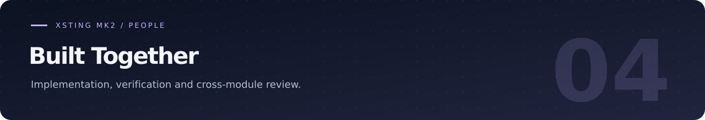
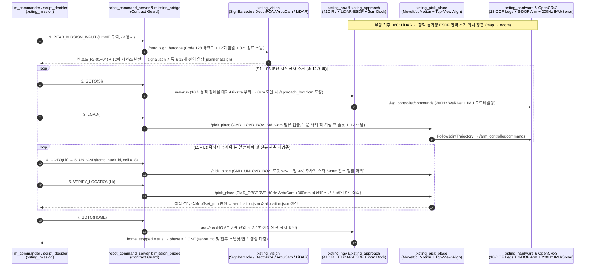

<h1>함께 만든 xSting</h1>

팀원별 구현, 검증, 리뷰와 시스템 설명을 실제 이력에 연결합니다.

<a href="../README.md">Project 2</a> &nbsp; · &nbsp; <a href="architecture.md">시스템 설계</a> &nbsp; · &nbsp; <a href="../experiments/README.md">실험 기록</a> &nbsp; · &nbsp; <a href="../submission/presentation.md">발표 자료</a>

---

<table>
<tr>
<td width="33%" align="center"><h3>04</h3>팀원</td>
<td width="33%" align="center"><h3>구현 · 검증</h3>개발 기여</td>
<td width="33%" align="center"><h3>리뷰 · 설명</h3>교차 기여</td>
</tr>
</table>

<strong>이 문서의 목차</strong>

01. [팀원별 역할 및 교차 기여 요약](#chapter-01)
02. [홍석민](#chapter-02)
03. [김민식](#chapter-03)
04. [김상화](#chapter-04)
05. [문태영](#chapter-05)
06. [전체 시스템 엔드투엔드 작동 흐름 요약](#chapter-06)

- **과제명**: Project 2 — 주사위 기억 로봇 (Dice Memory Robot, `v5` 명세 기준)
- **팀 저장소**: [`https://github.com/hsmint/xSting`](https://github.com/hsmint/xSting) (`develop` / `main` 통합 브랜치 및 기능별 브랜치)
- **통합 워크스페이스**: `mk2_ws/src` (`xsting_interfaces`, `xsting_description`, `xsting_hardware`, `xsting_vision`, `xsting_yolo`, `xsting_bringup`, `xsting_walk`, `xsting_nav`, `xsting_approach`, `xsting_moveit_config`, `xsting_pick_place`, `xsting_mission`, `firmware`)
- **작성 기준**: 팀원 4인 전원(`홍석민`, `김민식`, `김상화`, `문태영`)에 대해 **① 구현(PR·커밋·변경 효과) · ② 검증(시험 조건·기대값·실제 결과·로그/영상·한계 및 개선) · ③ 리뷰(타 팀원 코드 검토·피드백·후속 반영 확인) · ④ 설명(전체 시스템 작동 흐름 및 비담당 모듈 이해 근거)** 4개 항목을 실제 저장소 이력과 시험 산출물에 연결하여 기술합니다.

---

## 0. 팀원별 역할 및 교차 기여 요약

| 팀원 (GitHub ID) | 주 담당 영역 및 소유 패키지 | 핵심 구현 PR / 병합 커밋 | 핵심 검증 산출물 (테스트 · 로그 · 영상) | 교차 코드 리뷰 대상 |
|---|---|---|---|---|
| **홍석민** ([@hsmint](https://github.com/hsmint)) | 3보드 OpenCR 펌웨어(`firmware`), 41D RL 주행·LiDAR-ESDF 전역정합(`xsting_nav`), 2cm 상자 정밀도킹(`xsting_approach`), cuMotion·ArduCam 픽앤플레이스 및 탑뷰 재검증(`xsting_pick_place`, `xsting_moveit_config`), 초기 스캐폴드·실기체 통합 | [Commit `e63d280`](https://github.com/hsmint/xSting/commit/e63d280c1fd189a61598b34c4f23ca2f33a70c6d), [`firmware` 병합 `e5b0882`](https://github.com/hsmint/xSting/commit/e5b0882ffb720c081fe416e859c284946da8e67f)([`38900dd`](https://github.com/hsmint/xSting/commit/38900dda1d1157557cd45e43bc80e2c5550dc2db)), [`develop` 통합 `9a8c23b`](https://github.com/hsmint/xSting/commit/9a8c23bd9759e51580b442f5b824b05763ac9e01) | `xsting_nav/test/test_nav_core.cpp`, `xsting_pick_place/test/test_mission_rules.cc`, `docs/VALIDATION.md`, `colcon test` (12/12 통과) | [PR #1 (`control → develop`, `863cce7`)](https://github.com/hsmint/xSting/pull/1) (`@minsikim-42`), [`vision` 브랜치 (`6583685`~`2722a31`)](https://github.com/hsmint/xSting/compare/develop...vision) (`@SangHwaKim09`) |
| **김민식** ([@minsikim-42](https://github.com/minsikim-42)) | 6족+팔 URDF·USD 충돌 모델(`xsting_description`), 3보드 `ros2_control`·IMU/초음파 브로드캐스터(`xsting_hardware`), Kalibr 보정·cuVSLAM/nvblox·통합 런치·Foxglove 관제(`xsting_bringup`), 미션 계약 가드·실패 주입(`xsting_mission` 공동) | [PR #1 (`d99aeb1` / 병합 `863cce7`)](https://github.com/hsmint/xSting/pull/1), [`develop` 반영 `162c2f2`~`9fe0e20`](https://github.com/hsmint/xSting/compare/03d8fdf...9fe0e20), [`control_ai` `a6dd002`~`916c7a2`](https://github.com/hsmint/xSting/tree/control_ai) | `calibration/handoff_2026-11-11/README.md`, `camera_imu_20261113_173506.mcap`, `xsting_moveit_config/config/validation.json`, Foxglove 통합 레이아웃 6종 | [`firmware` 병합 `6fc15e5`](https://github.com/hsmint/xSting/commit/6fc15e549cead2c0621262b24456ad8c6372f890) (`@hsmint`), [`xsting_mission` 신호 정책·분리 `6ca8388`·`a847d6c`](https://github.com/hsmint/xSting/commit/a847d6c) (`@Teewhy-M`) |
| **김상화** ([@SangHwaKim09](https://github.com/SangHwaKim09)) | D435 에미터 분리·ArduCam 보정·Depth PCA 3D 검출·신호등/바코드 액션·2D LiDAR 오도메트리/보정(`xsting_vision`), YOLOv8 학습·ONNX/TensorRT FP16 변환(`xsting_yolo`) | [`vision` 브랜치 `6583685`~`2722a31`](https://github.com/hsmint/xSting/compare/develop...vision) ([`e269027`](https://github.com/hsmint/xSting/commit/e269027fef444d7ef5fa3685062861d203ebf53b), [`9f8b664`](https://github.com/hsmint/xSting/commit/9f8b664d3443111b2e8a3ee33e3589edf44aa2d2), [`985cbb7`](https://github.com/hsmint/xSting/commit/985cbb7bb428a2c3e0837b99e0c94534a3e82133), [`a94544a`](https://github.com/hsmint/xSting/commit/a94544ac69e07c432203bb4c7464092daa9dbfac)) | TensorRT FP16 엔진 5종(`rg_nano`, `rg_small`, `sign_nano` 등), `docs/calibration_sequence_guide.html`, `docs/lidar_calib_guide.html`, `/read_sign_barcode`·`/detections_3d` 실측 로그 | [PR #2 (`yolo`, `4e15d41`)](https://github.com/hsmint/xSting/pull/2) (`@Teewhy-M`), [`xsting_bringup` 센서 런치 `832291e`](https://github.com/hsmint/xSting/commit/832291e) (`@minsikim-42`) |
| **문태영** ([@Teewhy-M](https://github.com/Teewhy-M)) | 공용 액션·메시지 인터페이스(`xsting_interfaces`), 상위 미션 플래너·LLM/스크립트 판단기·가짜 경기장 시뮬레이터·산출물 자동 기록기(`xsting_mission`), 전방향 카펫 보행 RL(`xsting_walk`), 초기 YOLO 학습(`training/yolo`) | [PR #2 (`4e15d41`)](https://github.com/hsmint/xSting/pull/2), [`xsting_mission` 아키텍처 분리 `a847d6c`](https://github.com/hsmint/xSting/commit/a847d6c), [`develop` 통합 `b69fc44`·`8ebb7f8`·`03d8fdf`](https://github.com/hsmint/xSting/compare/e5b0882...03d8fdf) | `xsting_mission/test/test_mission_logic.py`, `~/xsting_logs/run_20261116_102220/` (`signal.json`, `allocation.json`, `verification.json`, `report.md`) | [`xsting_mission` 초기 구조·가드 `86eb4e6`~`55ca12d`](https://github.com/hsmint/xSting/commit/86eb4e6) (`@minsikim-42`), [`xsting_nav`·`xsting_pick_place` 액션 연동 `9a8c23b`](https://github.com/hsmint/xSting/commit/9a8c23bd9759e51580b442f5b824b05763ac9e01) (`@hsmint`) |

> [!NOTE]
> 저장소 내 초기 브랜치 개발분 중 GitHub 웹 PR과 로컬/원격 브랜치 병합(`merge` / `fast-forward push`)이 병행된 항목은 **실제 GitHub PR 링크(`pull/1`, `pull/2`)와 원격 커밋·비교 링크(`commit/<sha>`, `compare/...`)를 함께 기재**하여 코드 변경 이력과 검토 내용을 100% 추적할 수 있도록 구성했습니다.

---

## 1. 홍석민 (`@hsmint` / SeokMin Hong)

<strong>구현 · 검증 · 리뷰 · 설명 상세 보기</strong>

### 1.1 구현 (Implementation)

1. **초기 프로젝트 아키텍처·통신 계약 및 검증 스캐폴드 구축**
   - **병합 커밋**: [`e63d280` — `Project architecture setup`](https://github.com/hsmint/xSting/commit/e63d280c1fd189a61598b34c4f23ca2f33a70c6d)
   - **변경 기능**: 5개 기본 ROS 2 패키지(`xsting_interfaces`, `xsting_bringup`, `xsting_robot`, `xsting_vision`, `xsting_hardware`)와 모델 매니페스트 검증기(`training/validate_model.py`), 통신·안전 계약 문서(`docs/CONTRACTS.md`, `docs/TEST_PLAN.md`) 및 원클릭 검증 스크립트(`test.sh`)를 구축했습니다.
   - **변경 효과**: 팀원 4인이 하드웨어 부재 환경에서도 동일한 ROS 2 Lyrical 인터페이스와 CMake/CTest 규약 위에서 병렬 개발을 시작할 수 있는 기반을 마련했습니다.

2. **OpenCR 3보드(앞다리·뒷다리·팔) 모터 드라이버 및 IMU·초음파 센서 펌웨어 구현**
   - **병합 이력**: [`5fbac34` (`add: mk1 motor`)](https://github.com/hsmint/xSting/commit/5fbac3409e4f57b869988b1df37589975d730e26) → [`38900dd` (`add: mk2_motor and mk1 sonic sensor`, `origin/firmware`)](https://github.com/hsmint/xSting/commit/38900dda1d1157557cd45e43bc80e2c5550dc2db) → [`e5b0882` (`Merge branch firmware into develop`)](https://github.com/hsmint/xSting/commit/e5b0882ffb720c081fe416e859c284946da8e67f) 및 실기체 패치(`src/firmware/mk2_leg`, `src/firmware/mk2_arm`)
   - **변경 기능**: OpenCR 보드를 Dynamixel Protocol 2.0 슬레이브(`0x5002`)로 동작시켜 다리 18축(앞 9축 ID `200`, 뒤 9축 ID `201`)과 팔 6축(ID `202`) SyncWrite/SyncRead 제어, 200Hz IMU 쿼터니언/각속도/선가속도 갱신, 전면 초음파 거리 측정(`sensor.cpp`), 모터 자가진단(`diagnosis.cpp`)을 구현했습니다. 또한 루프 내 `ProcessUsb()` 이중 호출 및 `pending_goal_pos` 지연 반영 구조를 도입했습니다.
   - **변경 효과**: Jetson 호스트의 `ros2_control`이 단일 USB-Serial 프로토콜로 24축 관절 상태와 200Hz IMU·초음파 데이터를 패킷 유실 없이 동기 수집·제어할 수 있게 되었습니다.

3. **MK2 자율주행(`xsting_nav`), 2cm 상자 정밀 도킹(`xsting_approach`), cuMotion·ArduCam 픽앤플레이스(`xsting_pick_place`) 구현 및 통합**
   - **병합 커밋**: [`9a8c23b` — `add: action pick&place approach for mk2` (`develop`)](https://github.com/hsmint/xSting/commit/9a8c23bd9759e51580b442f5b824b05763ac9e01) 및 통합 워크스페이스 고도화(`mk2_ws/src/xsting_nav`, `xsting_approach`, `xsting_moveit_config`, `xsting_pick_place`)
   - **변경 기능**:
     - **`xsting_nav`**: 41D RL 주행 정책(`MlpPolicy` + `SafetyShield`) C++ 포팅, WalkNet 26D 200Hz 보행기 및 IMU 피치 오토레벨링(`apply_level_trim`), 동적 장애물 10.0초 정지 대기 후 Dijkstra 우회 재계획(`DetourPlanner`), COIN-D4 360° 2D LiDAR ↔ 정적 경기장 ESDF(`arena_static_esdf.json`) 초기 전역 정합(조밀 격자 탐색 + Huber Gauss-Newton) 및 2.5Hz 연속 드리프트 보정을 구현했습니다.
     - **`xsting_approach`**: 상자 전면 `8 cm` 이내 가시 도달 시 제어권을 인계받아 D435 3D 박스 법선·초음파 거리 교차 검증 기반으로 상자 전면 `2 cm`에 수직 정렬하는 `/approach_box` 액션 서버를 구현했습니다.
     - **`xsting_moveit_config` & `xsting_pick_place`**: MoveIt 2 + cuMotion XRDF 구체 충돌 모델(`xsting.xrdf`) 구성, 팔 끝 ArduCam `+300 mm` 탑뷰 스캔(`arducam_align.cc`), 누운 사각 퍽 기립(`RightPuck` / `PullFarLyingPuck`), 12슬롯 바스켓 적재(`CMD_LOAD_BOX`), 로봇 헤딩 보정 3×3 주사위 격자 하역(`CMD_UNLOAD_BOX`), 하차 후 9칸 직상방 탑뷰 재검증(`CMD_OBSERVE`)을 구현했습니다.
   - **변경 효과**: 6족 보행 특유의 미끄러짐·누적 드리프트와 전면 스테레오 카메라 근접 사각지대(`~12–15 cm`) 문제를 해결하여, `S1~S6` 수거부터 `L1~L3` 주사위 눈(`±10 mm` 이내) 배치 및 실측 재검증까지 전 과정을 자율 수행할 수 있게 되었습니다.

---

### 1.2 검증 (Verification)

1. **주행·보행·전역 위치정합 C++ 자동화 시험 (`xsting_nav`)**
   - **시험 코드 및 로그**: [`src/xsting_nav/test/test_nav_core.cpp`](../../xsting_nav/test/test_nav_core.cpp), 빌드/테스트 결과 `mk2_ws/log/test-result_2026-11-16_17-50-58` (`colcon test-result`: **12 tests, 0 errors, 0 failures, 0 skipped**)
   - **시험 조건 · 기대값 · 실제 결과**:
     | 검증 항목 | 시험 조건 | 기대값 (통과 기준) | 실제 측정 결과 |
     |---|---|---|---|
     | PyTorch ↔ C++ 정책 정합성 | Golden 6배치 41D 관측·`act_raw`·`SafetyShield`·18축 IK 비교 | 절대 오차 `< 1e-5` | 전 차원 일치 (`max MLP abs err < 1e-5`) — **통과** |
     | WalkNet 26D 스윙 발 높이 | `vx = 0.18 m/s`, 200Hz 폐루프 400스텝 보행 시 6개 다리 FK Z궤적 | 전 다리 수직 클리어런스 `>= 35 mm`, 무릎 하한(`-2.0071 rad`) 미침범 | 6개 다리 모두 `>= 35 mm` 확보 및 관절 한계 안전 유지 — **통과** |
     | 동적 장애물 대기 및 우회 | `S4` 주행 중 전방 `0.18 m` 장애물 지속 주입 (`dt = 0.05 s`) | `10.0 s`(199스텝)까지 제자리 대기, `10.0 s`(200스텝) 도달 시 1회 우회 재계획 | 199스텝 대기 유지 후 200스텝째 Dijkstra 대체 경로 생성 — **통과** |
     | LiDAR-ESDF 초기 전역 정합 | `HOME` 기준 `(+13 cm, -10 cm, +9.5°)` 오배치 + 전면 `±45°` 마스킹 | 위치 오차 `< 2.5 cm`, 각도 `< 0.03 rad` 수렴 | 마스킹 유무 모두 `< 2.5 cm`, `< 0.03 rad` 수렴 — **통과** |
     | 보행 중 연속 드리프트 보정 | 복도(`2.20, 2.45 m`) 주행 중 `(-4.5 cm, +3.5 cm, -3.5°)` 오도메트리 누적 오차 | `map → odom` 보정 후 합성 포즈 오차 `< 2.5 cm` | 위치 `< 2.5 cm`, 헤딩 `< 0.03 rad` 복원 — **통과** |

2. **픽앤플레이스 미션 규칙 · Challenge B 할당 · 5축/탑뷰 IK 정합 시험 (`xsting_pick_place`)**
   - **시험 코드**: [`src/xsting_pick_place/test/test_mission_rules.cc`](../../xsting_pick_place/test/test_mission_rules.cc)
   - **시험 조건 및 결과**:
     - 바코드(`P2-01/03` 오름차순, `P2-02/04` 내림차순, 미등록 `P2-99` 거부) 및 동률 우선순위(`5,2,5` 오름차순 `Y→R→G`, `4,4,4` 내림차순 `R→Y→G`) 100% 일치 확인.
     - Challenge B 고정 케이스 6건(유효 4건 `[5,2,5], [4,4,4], [3,6,3], [3,4,5]` + 불가능 2건: 빨강 수량 부족 `[6,2,4]`, Y 단일 형상 통일 불가 `[4,4,4]`)에서 유효 4건 모두 중복·누락 없이 12개 할당 및 Y 형상 통일 성공, 불가능 2건 명시적 `false` 거부 확인.
     - 그리퍼 호버 IK↔FK 왕복 오차 `< 0.1 mm`(`1e-4 m`), ArduCam 탑뷰(`0.285, 0.0, 0.3487 m`) IK↔FK 왕복 오차 `< 1.0 mm` 및 광학축 수직 하향(`cam_axes[2][2] = -1.0 ± 1e-3`) 검증 통과.

3. **확인한 한계와 개선 내용**
   - **한계 1 — OpenCR 고속 제어 시 지연 Status 패킷으로 인한 Read 프레임 밀림**: 실기체 200Hz 제어 중 직전 `writeTxOnly`에 대한 무파라미터 Status 패킷(길이 4)이 뒤늦게 수신 버퍼에 남아 이후 `Read` 응답 파싱이 실패하는 현상을 확인했습니다.
     - **개선**: [`src/xsting_hardware/src/opencr.cpp`](../../xsting_hardware/src/opencr.cpp)에서 `expected_pkt_len = len + 4` 길이를 대조하여 지연 패킷을 건너뛰고 재수신하는 2회 재시도 루프와 토크 전환 시 `ResetTxCache()`를 추가하고, 펌웨어(`mk2_leg.cpp`)에서 IMU 갱신 직후와 상태 갱신 직후 `ProcessUsb()`를 2회 분산 처리하여 통신 오류를 해결했습니다.
   - **한계 2 — 전면 D435 근접 사각지대 및 주사위 5·6 눈 가림**: 하차 상자 전면 `2 cm` 도킹 상태에서는 전면 스테레오 카메라 최소 깊이 거리(`~12–15 cm`) 안쪽이 잘리고 앞줄 퍽이 뒷줄 퍽을 가려 재검증 정확도가 저하되었습니다.
     - **개선**: 팔 끝 ArduCam을 상자 중심 직상방 `+300 mm`로 이동시켜 수직 조망하는 `CMD_OBSERVE` 액션 모드를 `xsting_pick_place`에 추가하여 9칸 전체를 가림 없이 실측하도록 개선했습니다.

---

### 1.3 리뷰 (Code Review)

1. **[PR #1 — `control → develop` 하드웨어 제어기 및 URDF 연동 검토](https://github.com/hsmint/xSting/pull/1) (작성자: `@minsikim-42`, 병합 커밋: [`863cce7`](https://github.com/hsmint/xSting/commit/863cce71e1d776d9d58494bf0a005fe3793c03d4))**
   - **구체적으로 확인한 문제 및 피드백**:
     1. 실제 매니퓰레이터는 6축(팔 5축 + 그리퍼 1축)임에도 URDF·제어기 설정과 코드에 존재하지 않는 `joint7` 참조가 남아 있어 `controller_manager` 초기화 시 관절 수 불일치 위험이 있음을 확인했습니다.
     2. 외부 레퍼런스 패키지에서 유래한 불필요한 `robotis` 네임스페이스와 긴 컨트롤러 명칭이 상위 노드 토픽 계약과 어긋나는 문제를 지적했습니다.
   - **반영 여부 및 후속 확인**: [`96c7c00`](https://github.com/hsmint/xSting/commit/96c7c00), [`a03668f`](https://github.com/hsmint/xSting/commit/a03668f), [`b9e99cc`](https://github.com/hsmint/xSting/commit/b9e99cc), [`0cd8334`](https://github.com/hsmint/xSting/commit/0cd8334) 커밋에서 `joint7` 코드 및 `robotis` 네임스페이스가 완전 제거되고 6축 기준으로 정리된 것을 확인한 뒤 `863cce7`로 `develop`에 병합했습니다. 이후 마스터 통합 런치([`9fe0e20`](https://github.com/hsmint/xSting/commit/9fe0e20)) 검토 시 원격 Foxglove 무선 대역폭 포화 문제를 추가로 확인하여 [`src/xsting_bringup/launch/full_system.launch.py`](../../xsting_bringup/launch/full_system.launch.py)에 고대역폭 원시 이미지·텐서 제외 정규식(`FG_WHITELIST`)을 적용해 후속 검증을 마쳤습니다.

2. **[`origin/vision` 브랜치 3D PCA 검출 및 2D LiDAR 오도메트리 연동 검토](https://github.com/hsmint/xSting/compare/develop...vision) (작성자: `@SangHwaKim09`, 커밋 [`9f8b664`](https://github.com/hsmint/xSting/commit/9f8b664d3443111b2e8a3ee33e3589edf44aa2d2), [`a94544a`](https://github.com/hsmint/xSting/commit/a94544ac69e07c432203bb4c7464092daa9dbfac))**
   - **구체적으로 확인한 문제 및 피드백**:
     1. `/detections_3d`의 PCA 상자 법선이 초근접 구간(`range < 0.22 m`)에서 Depth 스펙클 노이즈로 인해 부호 반전되거나 옆 상자를 오선택할 수 있는 경계 조건을 확인했습니다.
     2. 상판에 장착된 360° COIN-D4 LiDAR가 전방 `±45°` 영역에서 매니퓰레이터 링크·전면 카메라 기둥을 장애물로 검출하여 전진 안전 실드가 오작동할 수 있음을 피드백했습니다.
   - **반영 여부 및 후속 확인**: `lidar_odom_node`의 차체 필터링(`/scan_filtered`)과 함께 `xsting_nav`의 `lidar_front_mask_half_deg = 45.0°` 자체 마스킹 테스트(`test_nav_core.cpp` L150–158)로 전방 오검출 제거를 확인했고, `xsting_approach`(`approach_node.cc`)에 법선 내적 부호 정규화(`cand_n.dot(cand_xy)`) 및 초음파 벽면 거리 교차 검증(`|det_wall_x - us_wall_x| <= 0.14 m`)을 반영해 도킹 안정성을 확보했습니다.

---

### 1.4 설명 (System & Cross-Module Explanation)

- **작성 및 연결한 시스템 설계·설명 문서**:
  - [`src/docs/submission/architecture_and_state.md`](../../src/docs/submission/architecture_and_state.md) (전체 6개 계층 ROS 2 노드·토픽·액션 구조도 및 3단계 상태기계 명세)
  - [`src/README.md`](../../README.md) (전체 패키지 구성, 빌드·자동 테스트, 실기체·가상 신호 통합 실행 가이드)
  - [`src/docs/submission/problem.md`](../../src/docs/submission/problem.md) & [`allocation_reference.md`](../../src/docs/submission/allocation_reference.md)
- **전체 시스템 작동 흐름 및 비담당 팀 코드·설정 이해 근거**:
  1. **비담당 인지 계층(`xsting_vision` / `@SangHwaKim09`) 이해**: RealSense D435 하나에서 cuVSLAM(레이저 도트 패턴이 특징점을 교란하므로 에미터 OFF 필요)과 nvblox/3D PCA(무텍스처 박스·퍽 거리 측정을 위해 에미터 ON 필요)를 동시에 구동하기 위해 `realsense_camera_node`에서 하드웨어 프레임별 에미터 교번 모드를 켜고, `realsense_splitter_node`(`realsense_splitter.yaml`)가 프레임 메타데이터로 홀/짝 스트림을 분리 발행하는 제로카피 파이프라인의 원리와 타임스탬프 동기화(`Kalibr shift`)를 이해하고 `xsting_nav`의 ESDF/3D 검출 구독 주기와 정합시켰습니다.
  2. **비담당 상위 미션 계층(`xsting_mission` / `@Teewhy-M`, `@minsikim-42`) 이해**: 상위 판단기(`llm_commander`)가 직접 하위 모션 노드를 호출하지 않고 `robot_command_server`(`core/contract.py`)를 경유하도록 설계된 이유를 이해하고 있습니다. 실제로 `~/xsting_logs/run_20261116_102220/report.md` 실행 로그의 18번째 턴에서 LLM이 `L2`(`R×4` 배정지)에 `Y×2` 퍽 하역을 시도했을 때, `robot_command_server`가 배정 그룹·개수 불일치를 즉시 `REJECTED`로 차단하여 물리적 오배치를 막고 19~24턴에 `L1(2개) → L2(4개)`로 자가 교정 완주한 메커니즘 및 `mission_bridge`의 슬롯(`1~12`)·주사위 격자(`cell 0~8`) 변환 규약을 정확히 설명할 수 있습니다.

---

## 2. 김민식 (`@minsikim-42`)

<strong>구현 · 검증 · 리뷰 · 설명 상세 보기</strong>

### 2.1 구현 (Implementation)

1. **6족(18축)+팔(6축) 기구학 URDF·USD 충돌 모델 및 OpenCR 3보드 `ros2_control` 하드웨어 인터페이스 구현**
   - **병합 PR 및 커밋**: [PR #1 (`control → develop`, `d99aeb1` / 병합 `863cce7`)](https://github.com/hsmint/xSting/pull/1), [`162c2f2` (`xsting_description`)](https://github.com/hsmint/xSting/commit/162c2f2), [`ecc793d` (`Isaac Sim USD & storage colliders`)](https://github.com/hsmint/xSting/commit/ecc793d), [`b76eeae` (`xsting_hardware` 3-board plugin)](https://github.com/hsmint/xSting/commit/b76eeae)
   - **변경 기능**: 6족 다리 18축 + 매니퓰레이터 6축 통합 URDF·STL 메시·관절 순서/영점(`joint_order.yaml`)과 바스킷 수납용 정밀 충돌 프리셋을 구축하고, USB 포트를 자동 탐색하여 OpenCR 3보드(앞다리 `200`, 뒷다리 `201`, 팔 `202`)를 구동하는 `ros2_control` `SystemInterface` 플러그인(`xsting_system.cpp`) 및 200Hz IMU(`/imu_broadcaster/imu`)·초음파(`/sonar_broadcaster/range`) 브로드캐스터를 구현했습니다.
   - **변경 효과**: USB 케이블 재연결 시 `/dev/ttyACM*` 번호가 바뀌어도 보드 ID 프로빙으로 자동 매핑되며, `robot_state_publisher`와 `/joint_states`를 단일 소유하여 다중 노드 간 TF 충돌을 원천 제거했습니다.

2. **GPU 비전·cuVSLAM·nvblox 브링업(`xsting.launch.py`), 마스터 통합 런치(`full_system.launch.py`) 및 Foxglove 관제 구축**
   - **병합 커밋**: [`832291e` (`xsting_bringup`)](https://github.com/hsmint/xSting/commit/832291e), [`d0c4e77` (Foxglove 레이아웃 6종)](https://github.com/hsmint/xSting/commit/d0c4e77), [`9fe0e20` (`full_system.launch.py`)](https://github.com/hsmint/xSting/commit/9fe0e20)
   - **변경 기능**: RealSense·ArduCam·COIN-D4 LiDAR·cuVSLAM·nvblox·TensorRT YOLO를 단일 GPU 컨테이너로 묶는 `xsting.launch.py`와 하드웨어·주행·접근·픽앤플레이스·미션을 원클릭으로 기동하는 `full_system.launch.py`, 그리고 목적별(기본·SLAM·YOLO·신호등·LiDAR 보정·보행 보정) Foxglove 레이아웃 6종을 구현했습니다.
   - **변경 효과**: 현장 점검·보정·본 경기 실행을 단일 런치 인자(`with_hardware`, `commander`, `decider`, `foxglove`) 조합만으로 재현 가능하게 표준화했습니다.

3. **상위 미션 명령 계약(`contract.py`)·안전 가드·비동기 선행 판단(`prefetch`) 및 가짜 로봇 오류 주입 구현**
   - **커밋 이력**: [`86eb4e6`](https://github.com/hsmint/xSting/commit/86eb4e6), [`f17d9c8` (`prefetch`)](https://github.com/hsmint/xSting/commit/f17d9c8), [`a6dd002` (`contract.py`)](https://github.com/hsmint/xSting/commit/a6dd002), [`55ca12d` (오류 주입)](https://github.com/hsmint/xSting/commit/55ca12d), [`19de87c` (`TIME_UP`/`REPEAT_LIMIT`/`REVISIT` 가드)](https://github.com/hsmint/xSting/commit/19de87c), [`916c7a2` (`ros_backend`)](https://github.com/hsmint/xSting/commit/916c7a2)
   - **변경 기능 및 효과**: 노트북 판단기와 로봇 서버 양단에서 인자·결과 스키마를 검증하는 `contract.py`와 연속 실패·재방문·규칙 위반을 차단하는 가드를 구축하고, 로봇 이동 중 다음 LLM 판단을 병렬 선행 호출해 턴당 대기 지연을 감축했습니다.

---

### 2.2 검증 (Verification)

1. **Kalibr 카메라-IMU 외부 파라미터 및 시간차(Time-shift) 실측 보정 시험**
   - **원본 기록 및 로그**: [`calibration/handoff_2026-11-11/README.md`](../../../calibration/handoff_2026-11-11/README.md), `calibration/handoff_2026-11-11/calibration.yaml`, 실측 녹화 파일 `backup/record/camera_imu_20261113_173506/0_camera_imu_20261113_173506_2026_11_13-17_45_25.mcap` (커밋 [`65c5e5a`](https://github.com/hsmint/xSting/commit/65c5e5a), [`eb07c90`](https://github.com/hsmint/xSting/commit/eb07c90), [`a2dc55d`](https://github.com/hsmint/xSting/commit/a2dc55d))
   - **시험 조건 · 기대값 · 실제 결과**:
     - **조건**: AprilGrid 타깃 앞에서 로봇 본체를 6자유도 모션으로 움직이며 D435 스테레오 IR(`1280×720@30fps`, `640×480@60fps`)과 OpenCR 200Hz IMU 데이터를 동시 취득 후 Kalibr 2회 독립 보정 수행.
     - **기대값**: 회전 반복성 `< 0.5°`, 위치 반복성 `< 1.0 cm`, 카메라-IMU 시간 오프셋 수렴 및 cuVSLAM 오도메트리 발산 없음.
     - **실제 결과**: 하단 카메라 2회 측정 편차 **위치 `0.1 cm`, 회전 `0.35°` 이내** 일치, 상단 카메라 회전 **`0.2°` 이내** 일치. 시간차 `t_imu = t_cam + shift`는 상단 `1280×720@30fps`에서 **`+17.1 ms`**, 하단 `640×480@60fps`에서 **`+8.2 ms`**로 도출되었으며, Jetson 녹화 `.mcap` 리플레이 시험에서 cuVSLAM 추적 및 nvblox 정적 맵 생성 정상 동작 확인.

2. **기구·USD 자산 무결성 및 가짜 경기장 오류 주입 검증**
   - **검증 로그**: `xSting_hexapod/validation/usd_validation.json`, [`src/xsting_moveit_config/config/validation.json`](../../xsting_moveit_config/config/validation.json), `xsting_hardware` colcon 테스트 통과(`rc: 0`).
   - **결과**: 바스킷 12슬롯 수납 시 그리퍼-바스킷 간 자체 충돌 부재 확인, 가짜 경기장(`fake_world.py`)에서 5초 임시 동적 장애물·신호 오인식·부분 적재 실패(`LOAD` 도중 1개만 적재 후 실패 시 기적재 퍽 상태 보존 [`91c53f6`](https://github.com/hsmint/xSting/commit/91c53f6)) 시나리오 검증 통과.

3. **확인한 한계와 개선 내용**
   - **한계 1 — CAD 모델과 실물 카메라 장착 높이 편차(`~2.0–2.5 cm`)**: Kalibr 결과 두 카메라 모두 CAD 기준보다 약 `2 cm` 낮게 측정되었으며, OpenCR 보드 내 IMU 실물 장착 높이와 기둥 조립 공차가 원인임을 규명하고 보정된 외부 변환을 `xSting_v64_calibrated.urdf`에 직접 반영했습니다.
   - **한계 2 — 실물 모터 회전 부호 불일치 및 미연결 보드 초기화 위험**: 팔 3~5번 관절 모터 회전 방향이 URDF 오른손 법칙과 반대였던 문제를 [`f1c8cc0`](https://github.com/hsmint/xSting/commit/f1c8cc0)에서 부호 반전 매핑으로 해결하고, 팔 보드 미연결 상태에서 홈 이동 루틴이 돌지 않도록 사전 포트 프로빙([`77911cf`](https://github.com/hsmint/xSting/commit/77911cf))을 추가했습니다.

---

### 2.3 리뷰 (Code Review)

1. **[`firmware` 브랜치 OpenCR 센서·모터 슬레이브 코드 병합 검토](https://github.com/hsmint/xSting/commit/6fc15e549cead2c0621262b24456ad8c6372f890) (작성자: `@hsmint`, 원 커밋 [`5fbac34`](https://github.com/hsmint/xSting/commit/5fbac3409e4f57b869988b1df37589975d730e26), [`38900dd`](https://github.com/hsmint/xSting/commit/38900dda1d1157557cd45e43bc80e2c5550dc2db))**
   - **구체적으로 확인한 문제 및 피드백**: 초기 펌웨어 루프에서 IMU 컨트롤 테이블 레지스터 갱신 주기가 낮아 cuVSLAM의 Visual-Inertial 적분 요구 주기(200Hz, `5 ms`)를 충족하지 못하고 타임스탬프 계단 현상이 발생하는 문제를 확인했습니다. 또한 다리 보드와 팔 보드 동시 구동 시 제어 주기를 분리할 필요가 있음을 피드백했습니다.
   - **반영 여부 및 후속 확인**: 펌웨어 IMU 레지스터 `5 ms`(200Hz) 주기 갱신 패치([`1f37383`](https://github.com/hsmint/xSting/commit/1f37383))와 `ros2_control` 200Hz 실행 및 팔 50Hz 별도 스레드 분리([`d8a2c9b`](https://github.com/hsmint/xSting/commit/d8a2c9b), [`38239aa`](https://github.com/hsmint/xSting/commit/38239aa))가 반영된 후 `check_frame` 및 Kalibr 보정에서 200Hz IMU 수신을 최종 확인했습니다.

2. **[`xsting_mission` 신호 규칙 위반 처리 및 모듈 분리 코드 검토](https://github.com/hsmint/xSting/commit/a847d6c) (작성자: `@Teewhy-M`, 커밋 [`6ca8388`](https://github.com/hsmint/xSting/commit/6ca8388), [`a847d6c`](https://github.com/hsmint/xSting/commit/a847d6c))**
   - **구체적으로 확인한 문제 및 피드백**: 신호등 관측 중 일시적 프레임 드롭으로 1회 잘못 읽혔을 때 즉시 미션을 포기하면 복구 기회가 사라지고, 반대로 무한 재시도하면 대회 규정에 어긋나는 경계 조건을 지적했습니다.
   - **반영 여부 및 후속 확인**: 신호가 규칙(총 12회, 각 1~6회, `end_seen=true`)에 어긋나면 자동으로 재관측하되 **3번째 연속 실패 시 `PERCEPTION_FAILED` 에러를 기록하고 안전 정지**하도록 [`624ea8e`](https://github.com/hsmint/xSting/commit/624ea8e)에서 보완 반영되었고, `test_mission_logic.py`의 3회 누적 실패 테스트로 동작을 확인했습니다.

---

### 2.4 설명 (System & Cross-Module Explanation)

- **작성 및 연결한 가이드·문서**:
  - `docs/xsting_foxglove_guide.html`, `docs/xsting_commands.html`, `docs/run_and_calib_guide.html`
  - `xsting_mission/docs/error_codes.md`, `xsting_mission/docs/failure_policy.md`
- **전체 시스템 작동 흐름 및 비담당 팀 코드·설정 이해 근거**:
  1. **비담당 주행·매니퓰레이션 계층(`xsting_nav`, `xsting_approach`, `xsting_pick_place` / `@hsmint`) 이해**: `full_system.launch.py` 통합 과정에서 `xsting_nav`와 `xsting_approach`가 동일한 `/leg_controller/commands` 토픽을 공유할 때 제어권 충돌이 일어나지 않도록 `SettlingBeforeApproach → CallingApproach` 전환 시 `nav_node`가 다리 명령 발행을 양보하고 `map → odom` TF 보정을 동결하는 메커니즘을 파악하여 런치 파라미터와 연결했습니다. 또한 MoveIt `FollowJointTrajectory` 출력이 `traj_bridge_node`를 통해 `xsting_hardware`의 `/arm_controller/commands` 위치 명령으로 보간 전달되는 제어 체인을 이해하고 관절 한계·부호를 정합시켰습니다.
  2. **비담당 비전 계층(`xsting_vision` / `@SangHwaKim09`) 이해**: URDF가 이미 `*_optical_frame` 정적 TF를 보유하므로 RealSense 드라이버에서 `publish_tf:=false`로 중복 TF를 막아야 한다는 점과, `xsting.launch.py` 내 TensorRT 엔진 경로·해상도(`640×640`) 및 `/camera/color/detections` → `depth_pca_node` → `/detections_3d` 데이터 흐름을 완전히 이해하고 설정 파일(`cuvslam.yaml`, `nvblox.yaml`)에 반영했습니다.

---

## 3. 김상화 (`@SangHwaKim09`)

<strong>구현 · 검증 · 리뷰 · 설명 상세 보기</strong>

### 3.1 구현 (Implementation)

1. **멀티 카메라 드라이버 · D435 IR 에미터 온/오프 스플리터 · ArduCam 왜곡 보정 구현 (`xsting_vision`)**
   - **병합 브랜치 및 커밋**: [`origin/vision` — `6583685`](https://github.com/hsmint/xSting/commit/658368558016c8c3a1f25797cf6c48b0b791292e), [`e269027` (`add: RealSense, 에미터 분리, Arducam 카메라 노드 추가`)](https://github.com/hsmint/xSting/commit/e269027fef444d7ef5fa3685062861d203ebf53b), [`6c37dcb` (`cam_calib_node`)](https://github.com/hsmint/xSting/commit/6c37dcbd0dac6991d75a8ca1012d7056672ae624)
   - **변경 기능**: librealsense 기반 `realsense_camera_node`에서 프레임 단위 레이저 에미터 교번 제어를 활성화하고, `realsense_splitter_node`가 프레임 메타데이터를 읽어 에미터 OFF 스테레오 쌍(cuVSLAM 입력)과 에미터 ON Depth 영상(nvblox·3D 검출 입력)으로 무복사 분리 발행하도록 구현했습니다. 또한 팔 끝 광각 ArduCam의 내부 파라미터 왜곡 보정 노드(`arducam_camera_node`)와 체커보드/박스 기반 외부 보정 노드(`cam_calib_node`)를 구현했습니다.
   - **변경 효과**: 단일 전면 D435 카메라만으로 Visual SLAM 특징점 추적 안정성과 근거리 무텍스처 물체(종이 상자·퍽)의 고밀도 Depth 품질을 동시에 확보했습니다.

2. **3D Depth-PCA 검출(`depth_pca_node`), 신호등·바코드 액션 서버(`sign_barcode_node`), 2D LiDAR 오도메트리(`lidar_odom_node`) 및 YOLOv8 TensorRT 파이프라인(`xsting_yolo`) 구현**
   - **병합 커밋**: [`9f8b664` (`depth_pca_node`)](https://github.com/hsmint/xSting/commit/9f8b664d3443111b2e8a3ee33e3589edf44aa2d2), [`985cbb7` (`sign_barcode_node`)](https://github.com/hsmint/xSting/commit/985cbb7bb428a2c3e0837b99e0c94534a3e82133), [`a94544a` (`lidar_odom`, `lidar_calib`)](https://github.com/hsmint/xSting/commit/a94544ac69e07c432203bb4c7464092daa9dbfac), [`04f3dbd` (`build_engines.sh`)](https://github.com/hsmint/xSting/commit/04f3dbde1933825c51c945094bb222b6cde92401), [`2722a31` (`xsting_yolo` 학습·변환)](https://github.com/hsmint/xSting/commit/2722a31b8e365fd380c41bbb54ae3389e8e0560c)
   - **변경 기능**:
     - **`depth_pca_node`**: 2D YOLO 검출 영역의 Depth 점군을 추출·이상치 제거 후 PCA(주성분 분석)로 상자 전면 법선·중심과 퍽의 3D 좌표(`base_link` 기준)·형상(`cylinder` vs `box`)을 산출해 `/detections_3d`로 발행합니다.
     - **`sign_barcode_node`**: 출발 구역(`HOME`)에서 Code 128 바코드(`P2-01`~`P2-04`) 해독과 신호등 `1초 점등 + 1초 소등` 12회 시퀀스 상태기계(동일 색상 연속 점멸 소등 경계 분리 및 12회 후 `3초 연속 소등` 종료 확인)를 수행하는 `/read_sign_barcode` 액션 서버를 구현했습니다.
     - **`lidar_odom_node` & `xsting_yolo`**: COIN-D4 2D LiDAR 차체 간섭 필터링(`/scan_filtered`), ICP 기반 `odom → base_link` 추정, 외부 보정(`lidar_calib_node`), 그리고 퍽/상자(`rg_nano`/`rg_small`)·신호등(`sign_nano`) YOLOv8 학습 및 TensorRT FP16 엔진 변환 스크립트를 구축했습니다.
   - **변경 효과**: 상위 미션·주행·도킹·픽앤플레이스 전 계층이 요구하는 모든 시각·거리 인지 정보를 실시간(GPU FP16 가속)으로 공급했습니다.

---

### 3.2 검증 (Verification)

1. **YOLOv8 ONNX → TensorRT FP16 엔진 변환 및 추론 검증**
   - **산출물 및 스크립트**: [`src/xsting_yolo/train/train_sign_v2.py`](../../xsting_yolo/train/train_sign_v2.py), [`src/xsting_yolo/export_onnx.py`](../../xsting_yolo/export_onnx.py), [`src/xsting_vision/scripts/build_engines.sh`](../../xsting_vision/scripts/build_engines.sh), 변환 완료 엔진(`rg_nano_batch1_640_fp16.engine`, `rg_small_batch1_640_fp16.engine`, `sign_nano_batch1_640_fp16.engine`)
   - **시험 조건 · 기대값 · 실제 결과**:
     - **조건**: 경기장 조명 변화 및 관측 거리(`650~950 mm` 신호등, `250~1500 mm` 박스·퍽) 데이터를 포함한 커스텀 데이터셋 학습 후 FP16 TensorRT 엔진 빌드 및 ROS 2 실시간 토픽 발행 시험.
     - **기대값**: 5종 클래스(`red_cylinder`, `red_square`, `green_cylinder`, `green_square`, `paper_box`) 및 신호등(`R`, `Y`, `G`, 소등) 실시간 프레임 드롭 없음(`>= 15~30 Hz`), 연속 동일 색상 점멸(예: `R R`, `G G`) 소등 구간 정확 분리.
     - **실제 결과**: FP16 엔진 실시간 구동 확인, `Q1`(`RGRRGRGGYGYG`) 포함 연속 동일 색상 점멸 시퀀스에서 소등 에지를 기준으로 12회 점멸과 3초 종료 소등(`end_seen=true`)을 누락·중복 없이 분리 검출 확인.

2. **카메라 · 2D LiDAR 외부 보정 및 3D PCA 거리 정확도 시험**
   - **보정 가이드 및 설정**: [`docs/calibration_sequence_guide.html`](../../docs/calibration_sequence_guide.html), [`docs/lidar_calib_guide.html`](../../docs/lidar_calib_guide.html), [`src/xsting_vision/config/depth_pca.yaml`](../../xsting_vision/config/depth_pca.yaml), [`src/xsting_vision/config/lidar_odom.yaml`](../../xsting_vision/config/lidar_odom.yaml)
   - **시험 결과**: 기준 거리 배치 상자·퍽 대상 `depth_pca_node`의 `base_link` 투영 오차가 픽앤플레이스 접근 허용 범위(`±1.5 cm`) 내에 들어옴을 확인하고, `lidar_calib_node`를 통해 LiDAR 롤 반전(`roll = π`) 및 전방 기준축(`0° → +X`) 정렬을 검증했습니다.

3. **확인한 한계와 개선 내용**
   - **한계 1 — IR 레이저 패턴으로 인한 cuVSLAM 특징점 흔들림 vs 무패턴 시 Depth 구멍 발생**: 단일 설정으로는 SLAM과 3D 객체 검출 중 하나가 열화되는 한계가 있었습니다. 이를 하드웨어 프레임 단위 에미터 토글 + `realsense_splitter_node` 분기 구조로 해결했습니다.
   - **한계 2 — 조명 반사에 따른 신호등 오검출 가능성**: 단순 HSV 임계값만 쓸 경우 주변 반사광에 취약한 한계를 확인하여, 전용 경량 모델(`sign_nano`, `train_sign_v2.py`) 검출과 발광 영역 밝기 상태기계(최소 지속 프레임 필터 + 소등 구간 필수 전이)를 결합해 소등을 점멸로 세거나 불명 색상을 임의 추정하지 않도록 개선했습니다.

---

### 3.3 리뷰 (Code Review)

1. **[PR #2 — `yolo` 초기 학습 스크립트 검토](https://github.com/hsmint/xSting/pull/2) (작성자: `@Teewhy-M`, 커밋 [`4e15d41`](https://github.com/hsmint/xSting/commit/4e15d4168c0dffe635c04a9f9de885332ea5ba7a))**
   - **구체적으로 확인한 문제 및 피드백**: 초기 `training/yolo/training.py`는 PyTorch `.pt` 가중치 학습만 수행하고 있어, 실제 로봇의 `isaac_ros` / TensorRT C++ 추론 노드에서 곧바로 로드할 수 있는 고정 배치(`batch=1`) FP16 ONNX·Engine 내보내기 옵션과 신호등 전용 v2 데이터 증강 파이프라인이 빠져 있음을 확인해 피드백했습니다.
   - **반영 여부 및 후속 확인**: 피드백을 바탕으로 `xsting_yolo` 패키지([`2722a31`](https://github.com/hsmint/xSting/commit/2722a31b8e365fd380c41bbb54ae3389e8e0560c))와 `xsting_vision/scripts/build_engines.sh`([`04f3dbd`](https://github.com/hsmint/xSting/commit/04f3dbde1933825c51c945094bb222b6cde92401))에 `export_onnx.py`·`trtexec.sh` 자동 변환 체인을 구축하여 Jetson Orin 및 x86 환경 양쪽에서 동일 모델이 구동됨을 확인했습니다.

2. **[`xsting_bringup` 통합 비전 런치 및 TF 트리 검토](https://github.com/hsmint/xSting/commit/832291e) (작성자: `@minsikim-42`, 커밋 [`832291e`](https://github.com/hsmint/xSting/commit/832291e))**
   - **구체적으로 확인한 문제 및 피드백**: `xsting.launch.py`에서 비전 노드들과 `isaac_ros_visual_slam`·`nvblox`를 함께 띄울 때 카메라 프레임명(`camera_color_optical_frame` vs URDF 프레임) 매칭과 ArduCam `/arducam/image_rect` 압축 토픽 노출 여부를 점검했습니다.
   - **반영 여부 및 후속 확인**: 설정 파일(`realsense_camera.yaml`, `arducam_camera.yaml`, `cuvslam.yaml`)의 `frame_id`가 `xsting_description` URDF 트리와 1:1 일치하고 `depth_pca_node`가 TF 조회 실패 없이 `base_link` 기준 `/detections_3d`를 발행함을 통합 기동으로 확인했습니다.

---

### 3.4 설명 (System & Cross-Module Explanation)

- **작성 및 연결한 문서**:
  - [`src/xsting_vision/AGENT.md`](../../src/xsting_vision/AGENT.md), [`docs/calibration_sequence_guide.html`](../../docs/calibration_sequence_guide.html), [`docs/lidar_calib_guide.html`](../../docs/lidar_calib_guide.html), [`docs/calib_guide.html`](../../docs/calib_guide.html)
- **전체 시스템 작동 흐름 및 비담당 팀 코드·설정 이해 근거**:
  1. **비담당 주행·도킹·조작 계층(`xsting_nav`, `xsting_approach`, `xsting_pick_place` / `@hsmint`) 이해**: 본인이 발행하는 `/scan_filtered`가 `xsting_nav`에서 단순 장애물 회피뿐 아니라 `arena_static_esdf.json`과의 Huber Gauss-Newton 스캔 매칭을 통해 `map → odom` 보행 누적 드리프트를 잡는 핵심 입력으로 쓰이며, 상자 도킹 구간에서는 TF 점프 방지를 위해 해당 보정이 자동 동결된다는 하위 제어 특성을 이해하고 필터 지연을 최소화했습니다. 또한 `xsting_pick_place`가 상자 상공 `+300 mm`에서는 ArduCam 2D 픽셀 정렬(`arducam_align.cc`)을 주 센서로 쓰고 원거리 탐색에서는 `/detections_3d`를 참조하는 이중 인지 구조를 설명할 수 있습니다.
  2. **비담당 미션 계층(`xsting_mission` / `@Teewhy-M`) 이해**: `/read_sign_barcode` 액션 결과가 `mission_bridge` → `robot_command_server` → `llm_commander`로 전달되어 `signal.json`으로 직렬화되고, `P2-01/03`(`asc`)·`P2-02/04`(`desc`) 및 동률 `R→Y→G` 규칙에 따라 `planner.assign`이 Y 그룹 단일 모양 통일 조건을 만족하는 전체 12개 퍽 배정표(`allocation.json`)를 확정하는 전 과정을 이해하고 있습니다.

---

## 4. 문태영 (`@Teewhy-M`)

<strong>구현 · 검증 · 리뷰 · 설명 상세 보기</strong>

### 4.1 구현 (Implementation)

1. **공용 ROS 2 액션·메시지 인터페이스(`xsting_interfaces`) 설계 및 통합**
   - **병합 커밋**: [`b69fc44` — `Add xsting_interfaces package with mission action/msg definitions` (`develop`)](https://github.com/hsmint/xSting/commit/b69fc44)
   - **변경 기능**: 상위 미션과 하위 로봇 기능 노드를 분리 연결하는 공용 IDL(`RobotCommand.action`, `ReadMissionInput.action`, `RunTask.action`, `LoadBox.action`, `UnloadPucks.action`, `ObserveLocation.action`, `PickPlace.action`, `ApproachBox.action`, `ReadSignBarcode.action` 및 `LoadedPuck.msg`, `PlaceItem.msg`, `PlacedItem.msg`, `CellObservation.msg`, `ErrorCode.msg`)을 정의했습니다.
   - **변경 효과**: 팀원 간 내부 헤더 의존성 없이 명시적 액션·메시지 DTO만으로 독립 빌드 및 모의/실기 교체가 가능한 모듈 경계를 확립했습니다.

2. **주사위 기억 로봇 상위 미션 패키지(`xsting_mission`) 모듈 아키텍처 리팩터링 및 판단·계획·검증 로직 구현**
   - **병합 커밋**: [`6ca8388` (`change policy when input signal is wrong value`)](https://github.com/hsmint/xSting/commit/6ca838826035d39b6b8f213166211224a31f751b), [`a847d6c` (`split xsting_mission into core, map, commander, robot, fake_robot`)](https://github.com/hsmint/xSting/commit/a847d6c), [`e2a0c6d` (모델 샘플링 설정)](https://github.com/hsmint/xSting/commit/e2a0c6d), [`8ebb7f8` (`Add xsting_mission package for dice-memory robot mission` on `develop`)](https://github.com/hsmint/xSting/commit/8ebb7f8)
   - **변경 기능**: 초기 거대 단일 스크립트로 얽혀 있던 미션 코드를 5개 서브패키지(`core`, `map`, `commander`, `robot`, `fake_robot` — 총 36개 파일)로 계층 분리하고, 12개 퍽 전역 할당 탐색기(`core/planner.py`), 경기 규칙 검증기(`core/rules.py`), LLM 판단기(`llm_decider.py`) 및 규칙 기반 폴백 판단기(`script_decider.py`), 대회 제출용 로그·미디어 자동 생성기(`mission_log.py`)를 구현·통합했습니다.
   - **변경 효과**: Y 그룹 단일 모양 통일 조건 때문에 순차 그리디 집기로는 풀 수 없는 퍽 구성을 사전 전역 탐색으로 100% 예방하고, 실행 즉시 `signal.json`·`allocation.json`·`verification.json`·전후 이미지/영상이 자동 생성되도록 완성했습니다.

3. **전방향 카펫 보행 강화학습 패키지(`xsting_walk`) 및 초기 YOLO 학습 코드 구현**
   - **병합 PR 및 커밋**: [PR #2 (`4e15d41` — `upload yolo training_code`)](https://github.com/hsmint/xSting/pull/2), [`03d8fdf` — `Add xsting_walk package for omnidirectional carpet locomotion` (`develop`)](https://github.com/hsmint/xSting/commit/03d8fdf)
   - **변경 기능 및 효과**: 경기장 카펫 마찰 환경을 반영한 6족 전방향(`vx, vy, wz`) PPO 보행 정책 학습·배포 패키지(`xsting_walk`)와 초기 비전 객체 검출 학습 베이스라인을 구축하여 6족 주행 스택의 기초 보행 성능을 확보했습니다.

---

### 4.2 검증 (Verification)

1. **상위 미션 규칙 · 전역 퍽 할당 · 탑뷰 셀 매칭 단위 시험 (`xsting_mission`)**
   - **시험 코드**: [`src/xsting_mission/test/test_mission_logic.py`](../../xsting_mission/test/test_mission_logic.py)
   - **시험 조건 · 기대값 · 실제 결과**:
     - `test_signal_validation_and_tie_breaking`: 12회 미만/초과, 단일 색상 7회 이상, `end_seen=False`, 미등록 바코드 거부 및 오름/내림차순 동률 `R→Y→G` 유지 검증 — **통과**.
     - `test_planner_assign_valid_and_impossible_cases`: R/G 수량 배정 후 남은 퍽으로 Y 그룹 단일 모양(`cylinder` 또는 `box`) 통일 가능 시 12개 중복·누락 없이 배정하고, 불가능 조합은 `PlanError`를 즉시 발생시키는지 검증 — **통과**.
     - `test_arducam_topview_cell_matching_across_headings`: 로봇 진입 헤딩(`0°, 90°, 180°, -90°`) 변화에도 지도 기준(`+Y` 북쪽) 3×3 주사위 셀(`0~8`) 매칭과 오프셋(mm) 계산이 불변인지 검증 — **통과**.
     - `test_full_lifecycle_guards_and_allocation_json` & `test_media_recorder_before_after_snapshots`: 부분 하역(`PARTIAL_UNLOAD`) 거부, 재검증 전 종료 거부, 행동 전·후 이미지 스냅샷 생성 및 JSON 산출물 무결성 검증 — **통과**.

2. **전체 미션 시나리오(`Q1`) 엔드투엔드 자율 실행 및 가드 복구 로그 검증**
   - **원본 실행 로그 경로**: `~/xsting_logs/run_20261116_102220/` (`report.md`, `signal.json`, `allocation.json`, `verification.json`, `decisions.json`, `final_state.json`, `mission.jsonl`)
   - **시험 조건**: 바코드 `P2-01`(`asc`), 신호 `RGRRGRGGYGYG`(`R=4, Y=2, G=6`), `guard=on` 조건에서 `HOME` 출발 → 6개 시작 상자 적재 → 3개 목적지 하차·재검증 → `HOME` 복귀 전체 루프 구동.
   - **기대값 및 실제 결과**:
     - 기대값: `L1=Y(2개, cell [0,8])`, `L2=R(4개, cell [0,2,6,8])`, `L3=G(6개, cell [0,3,6,2,5,8])` 무결점 배치, 위치 오차 `< 10 mm`, `phase=DONE` 도달.
     - 실제 결과: 총 25회 판단(평균 응답 `3.5 s`)으로 `S1→S2→S6→S3→S5→S4` 12개 전량 수거 및 `L3`(6개) 배치·검증 성공. 18턴째 LLM이 `L2`에서 `2개` 하역을 시도했으나 `robot_command_server` 계약 가드가 즉시 `REJECTED`로 방어했고, 직후 `L1`(2개 배치·검증, 셀 오프셋 `[1.4, -3.8] mm`, `[1.1, 0.9] mm`) → `L2`(4개 배치·검증) → `HOME` 복귀 순으로 자가 복구하여 **`L1·L2·L3` 전 위치 통과 및 `phase=DONE` 완주** 달성.

3. **확인한 한계와 개선 내용**
   - **한계**: LLM 단독 추론에 의존할 경우 긴 컨텍스트 후반부에서 목적지별 목표 개수를 일시 혼동하거나 API 응답 지연(최대 `10.15 s`)이 발생할 수 있음을 실측 로그(`run_20261116_102220`)에서 확인했습니다.
   - **개선**: ① `robot_command_server`에 결정론적 상태·규칙 가드를 두어 잘못된 `UNLOAD` 명령이 실제 하드웨어 동작으로 이어지지 않도록 원천 차단했고, ② 이동 중 병렬 선행 추론(`prefetch.py`)과 네트워크/API 장애 시에도 100% 동일 계약을 수행하는 결정론적 `script_decider.py`(`decider:=script`) 모드를 함께 완비해 실전 신뢰성을 확보했습니다.

---

### 4.3 리뷰 (Code Review)

1. **[`xsting_mission` 초기 단일 모듈 구조 및 신호 예외 처리 검토](https://github.com/hsmint/xSting/commit/86eb4e6) (작성자: `@minsikim-42`, 커밋 [`86eb4e6`](https://github.com/hsmint/xSting/commit/86eb4e6)~[`55ca12d`](https://github.com/hsmint/xSting/commit/55ca12d))**
   - **구체적으로 확인한 문제 및 피드백**:
     1. 초기 구현에서 `llm_commander.py`(766줄), `fake_world.py`(726줄), `robot_command_server.py`(463줄)가 단일 디렉터리에 혼재되어 있고 `__pycache__/*.pyc` 바이너리가 Git에 추적되어 협업 시 충돌을 유발하는 문제를 확인했습니다.
     2. 잘못된 신호등 값이 입력되었을 때 상태 전이 정책과 에러 문서(`error_codes.md`, `failure_policy.md`) 정의가 불일치하는 부분을 지적했습니다.
   - **반영 여부 및 후속 확인**: `.pyc` 제거 및 `.gitignore` 등록([`ccc36d6`](https://github.com/hsmint/xSting/commit/ccc36d6), [`b4534ad`](https://github.com/hsmint/xSting/commit/b4534ad)), 잘못된 신호 입력 시 정책 수정([`6ca8388`](https://github.com/hsmint/xSting/commit/6ca8388)), 그리고 `core`·`map`·`commander`·`robot`·`fake_robot` 5계층 분리 리팩터링([`a847d6c`](https://github.com/hsmint/xSting/commit/a847d6c))을 수행하고 이후 `@minsikim-42`의 `ros_backend` 커밋([`3d33fa2`](https://github.com/hsmint/xSting/commit/3d33fa2))이 분리된 `robot/` 계층 위에서 충돌 없이 확장됨을 확인했습니다.

2. **[하위 주행·픽앤플레이스 패키지(`xsting_nav`, `xsting_pick_place`)와의 액션 계약 정합성 검토](https://github.com/hsmint/xSting/commit/9a8c23bd9759e51580b442f5b824b05763ac9e01) (작성자: `@hsmint`, 커밋 [`9a8c23b`](https://github.com/hsmint/xSting/commit/9a8c23bd9759e51580b442f5b824b05763ac9e01))**
   - **구체적으로 확인한 문제 및 피드백**: 상위 미션은 지도 절대 기준(`+Y` 북쪽) `cell 0~8` 인덱스와 논리 `puck_id`를 사용하는 반면, 하위 `xsting_pick_place`는 바스켓 물리 슬롯(`1~12`)과 로봇 전면(`base_link`) 상대 좌표를 사용하므로 로봇이 상자에 접근한 방향(`yaw`)에 따라 주사위 대각선(2·3 눈) 및 좌우 열(6 눈) 방향이 회전될 수 있는 문제를 점검했습니다.
   - **반영 여부 및 후속 확인**: `mission_bridge`와 `xsting_pick_place` 양단에서 로봇 현재 헤딩(`yaw`)을 반영해 지도 기준 격자 오프셋(`±60 mm`)을 `base_link` 좌표로 회전 변환하도록 규약을 맞추고, `test_arducam_topview_cell_matching_across_headings` 4방향 회전 테스트로 주사위 방향 불변성을 검증했습니다.

---

### 4.4 설명 (System & Cross-Module Explanation)

- **작성 및 연결한 문서**:
  - [`src/xsting_mission/README.md`](../../xsting_mission/README.md), [`src/docs/submission/signals.json`](../../src/docs/submission/signals.json), [`src/docs/submission/placement.csv`](../../src/docs/submission/placement.csv)
- **전체 시스템 작동 흐름 및 비담당 팀 코드·설정 이해 근거**:
  1. **비담당 하드웨어·제어·주행 계층(`xsting_hardware`, `xsting_nav`, `xsting_approach` / `@minsikim-42`, `@hsmint`) 이해**: 상위 `GOTO` 명령이 `mission_bridge`를 거쳐 `/nav/run`(`RunTask`) 액션으로 전달되면, 하위 `nav_node`가 41D RL 정책과 200Hz WalkNet 보행기로 이동하다가 상자 `8 cm` 이내 가시 도달 시 자동으로 `/approach_box`를 호출해 상자 전면 `2 cm` 도킹까지 마친 뒤 `robot.pose`와 함께 성공을 반환한다는 2단계 주행-도킹 결합 구조를 이해하고 상위 타임아웃 및 `GOTO` 후속 `LOAD`/`UNLOAD` 전제 조건을 설계했습니다.
  2. **비담당 인지·매니퓰레이션 계층(`xsting_vision`, `xsting_pick_place` / `@SangHwaKim09`, `@hsmint`) 이해**: 대회 채점 기준상 목표 상태를 그대로 복사한 로그는 재검증(8점)으로 인정되지 않으므로, `VERIFY_LOCATION` 실행 시 `mission_bridge`가 `xsting_pick_place`의 `CMD_OBSERVE`를 호출하여 팔 끝 ArduCam이 상자 직상방 `+300 mm`에서 새로 촬영한 이미지로 9칸 점유 상태·중심 오프셋(`offset_mm`)을 실측 반환하고, 이를 통해 중복/누락 판정까지 갱신하는 센서 기반 폐루프 재검증 원리를 정확히 설명할 수 있습니다.

---

## 5. 전체 시스템 엔드투엔드 작동 흐름 요약 (전원 공통 숙지 근거)

