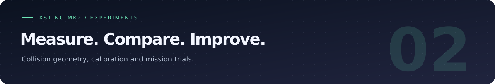

<h1>실험 노트</h1>

측정하고 비교한 결과, 그리고 그 결과로 바뀐 설계.

<a href="../README.md">Project 2</a> &nbsp; · &nbsp; <a href="../docs/architecture.md">시스템 설계</a> &nbsp; · &nbsp; <a href="../submission/presentation.md">발표 자료</a>

---

<table>
<tr>
<td width="33%" align="center"><h3>99.3%</h3>충돌 판정 일치 · 5,000자세</td>
<td width="33%" align="center"><h3>0.482 px</h3>ArduCam fisheye RMS</td>
<td width="33%" align="center"><h3>16 / 20</h3>모의 미션 DONE · 가드 off</td>
</tr>
</table>

> 수치는 아래에 기록된 실험 조건에 한정됩니다. `DONE`은 시스템 종료 상태이며, 할당·방문 순서 오판 사례는 상세 기록을 함께 확인하세요.

**바로 가기** &nbsp; [팔 충돌 형상 정확도](#section-1) · [ArduCam 카메라 보정](#section-2) · [RealSense GPU 스트림 수신 벤치마크](#section-3) · [상위 미션 판단기 시뮬레이션](#section-4)

xSting MK2 개발 중 수행한 단위 실험과 미션 시뮬레이션 실행 기록입니다.
공식 경기 기록은 [`../submission/official_match_results.md`](../submission/official_match_results.md), 최종 모의 시험 산출물은 [`../xsting_logs/`](../xsting_logs/)와 [`../results/`](../results/)에 있습니다.

| 날짜 | 실험 | 핵심 결과 | 문서 |
|---|---|---|---|
| 2026-10-21 | 팔 충돌 형상 정확도 (볼록 껍질 vs CoACD) | CoACD 88조각 + 손가락 처리로 실제 메쉬와 **99.3% 일치, 미검출 0%** | [collision_shape_accuracy.md](collision_shape_accuracy.md) |
| 2026-10-24 | ArduCam 광각 카메라 보정 (pinhole vs fisheye) | fisheye 모델 **RMS 0.482 px**, 네 모서리 정상 → 채택 | [arducam_calibration.md](arducam_calibration.md) |
| 2026-11 | RealSense 2대 GPU 영상 스트림 수신 벤치마크 | 8개 스트림 모두 **30 Hz**, 평균 지연 0.3–1.8 ms, 최대 2.2 ms | [camera_stream_benchmark.txt](camera_stream_benchmark.txt) |
| 2026-11-09 ~ 11 | 상위 미션 판단기(LLM/스크립트) 시뮬레이션 20회 | 20회 중 16회 `phase=DONE` (아래 표) | [mission_sim_logs_20261117/](mission_sim_logs_20261117/) |

---

## 1. 팔 충돌 형상 정확도 (2026-10-21)

- **목적**: 시뮬레이터 충돌 형상(볼록 도형)이 실제 메쉬 충돌과 얼마나 일치하는지 확인
- **방법**: python-fcl, 관절 범위 내 무작위 5000자세(seed 0), 67개 링크 쌍 비교

| 조건 | 일치 | 오검출 | 미검출 |
|---|---|---|---|
| v1: 부품당 볼록 껍질 1개 | 97.4% | 2.5% | 0.1% |
| v2a: CoACD 분할 (손가락 처리 전) | 95.8% | 4.2% | 0% |
| **v2: CoACD 88조각 + 손가락 자기 쪽만** | **99.3%** | **0.7%** | **0%** |

- v2 오검출 자세의 실제 간격 중앙값 0.8 mm → 약간 보수적인 판정
- Isaac Sim(PhysX) 충돌 각도가 메쉬 계산과 1–2° 이내로 일치
- 기둥·상판 충돌은 관절 범위가 아니라 자기 충돌로 차단 → `xsting_description`, `xsting_moveit_config` 충돌 모델에 반영

## 2. ArduCam 카메라 보정 (2026-10-24)

- **목적**: 팔 끝 ArduCam(광각) 왜곡 보정 파일 생성, 렌즈 모델 선택
- **방법**: 9×6 체커보드(25 mm, 모니터 표시), 사진별 오차 1 px 초과 제외

| 모델 | RMS | 모서리 |
|---|---|---|
| pinhole (Brown-Conrady) | 0.509 px | 광각 가장자리에서 발산 (−88°) |
| **fisheye (Kannala-Brandt)** | **0.482 px** | 네 모서리 정상 → 채택 |

- 최종 값: fx 860.7, fy 860.4, cx 710.7, cy 348.8 / 수평 화각 약 94.5° (좌우 비대칭)
- 결과 파일: `xsting_vision/config/arducam_1280x720_calibration.yaml` → `arducam_camera_node` 왜곡 보정에 사용

## 3. RealSense GPU 스트림 수신 벤치마크

전면·후면 RealSense의 color / depth / infra1 / infra2 8개 스트림을 `backend=cuda` 구독자로 4회 측정했습니다 (1280×720).

| 스트림 | 주기 | 대역폭 | 평균 지연 | 최대 지연 |
|---|---|---|---|---|
| color (rgb8) | 30 Hz | 79.1 MB/s | 0.96–1.80 ms | 2.22 ms |
| depth (16UC1) | 30 Hz | 52.7 MB/s | 0.32–0.85 ms | 2.10 ms |
| infra1 / infra2 (mono8) | 30 Hz | 26.4 MB/s | 0.59–1.26 ms | 2.13 ms |

→ GPU 제로카피 경로에서 프레임 누락 없이 30 Hz 유지, 지연은 한 프레임(33 ms)의 7% 미만.

## 4. 상위 미션 판단기 시뮬레이션 (2026-11-09 ~ 11-11)

`xsting_mission`의 `fake_robot` 백엔드(무작위 바코드·신호·퍽 배치, `problem.json`)에서 `llm_commander`를 반복 실행한 기록입니다.
이 시기에는 계약 가드(`guard`)가 모두 **off**였고, 이후 가드를 켠 실행이 [`../xsting_logs/run_20261116_102220`](../xsting_logs/run_20261116_102220/report.md)입니다.

<strong>미션 시뮬레이션 20회 상세 기록 펼치기</strong>

| # | 실행 폴더 | 판단기 (effort) | 입력 | 판단 수 | 평균/최대 응답 | 시스템 결과 | 실험자 메모 |
|---|---|---|---|---|---|---|---|
| 1 | `run_20261109_191155` | gpt-6.1-sol (low) | — | — | — | DONE | 첫 완주 · 통과 |
| 2 | `run_20261109_193123` | gpt-6-luna (low) | — | — | — | DONE | 첫 완주 · 통과 |
| 3 | `run_20261110_100936` | gpt-6.1-sol (low) | P2-01 `RRYRYYYGGGGY` | 10 | 2.3 / 4.7 s | 중단 (LOAD, CTRL_C) | S3 집기 실패 후 중단 |
| 4 | `run_20261110_121635` | script | P2-04 `RRRYYYRGYGYY` | 24 | 0 s | 중단 (UNLOAD, SCRIPT_END) | 고정행동 테스트 |
| 5 | `run_20261110_122103` | script | P2-03 `RYRRYYRGGYYY` | 24 | 0 s | DONE, L1–L3 통과 | 고정행동 + 자동할당 완주 |
| 6 | `run_20261110_123537` | gpt-6-luna (low) | P2-01 `GRRRGGGYGYYR` | 30 | 3.5 / 6.8 s | DONE, L1–L3 통과 | 바로 할당하다 실패 |
| 7 | `run_20261110_124628` | gpt-6-luna (low) | P2-03 `GRGYRGRGRYGG` | 16 | 2.8 / 4.0 s | 중단 (UNLOAD, API 400) | L1에서 오판 |
| 8 | `run_20261110_152814` | gpt-6-luna (low) | P2-03 `RGYYRYYRYRYG` | 28 | 4.1 / 12.2 s | DONE, L1–L3 통과 | 그룹순서 착각으로 L1·L3 패싱 후 통과 |
| 9 | `run_20261110_153722` | gpt-6-luna (low) | P2-04 `RYRRGRGRGGGY` | 15 | 4.0 / 13.3 s | 중단 (UNLOAD, PROMPT_FLAGGED) | 할당계획에서 차단 (reason 필드 의심) |
| 10 | `run_20261110_155608` | gpt-6-luna (low) | P2-03 `RGGRYYGRYRGG` | 28 | 4.2 / 13.6 s | DONE, L1–L3 통과 | reason 빼고 실행, 실패 |
| 11 | `run_20261110_160454` | gpt-6-luna (low) | P2-03 `GGYYGRYYYRGY` | 24 | 2.8 / 4.3 s | DONE, L1–L3 통과 | 반시계 방향으로 안 돎, 할당 이상 |
| 12 | `run_20261110_161536` | gpt-6-luna (low) | P2-04 `GRYGYYRGGYGG` | 24 | 4.1 / 11.8 s | DONE, L1–L3 통과 | — |
| 13 | `run_20261110_162116` | gpt-6-luna (low) | P2-04 `YYRGRRRGYYGR` | 24 | 3.3 / 6.8 s | DONE, L1–L3 통과 | — |
| 14 | `run_20261110_163739` | gpt-6-luna (low) | P2-03 `GGGRYRGRRGRR` | 30 | 3.2 / 8.3 s | DONE, L1–L3 통과 | — |
| 15 | `run_20261110_165759` | gpt-6-luna (medium) | P2-04 `GRYRYGGGYGYR` | 24 | 6.2 / 19.8 s | DONE, L1–L3 통과 | `luna_A* toolcall_medium` |
| 16 | `run_20261110_172019` | gpt-6-luna (medium) | P2-04 `GRRGRGGYRRRY` | 24 | 4.9 / 13.3 s | DONE, L1–L3 통과 | — |
| 17 | `run_20261110_193932` | gpt-6-luna (medium) | P2-03 `RGYRRRYYRYRG` | 24 | 6.2 / 14.7 s | DONE, L1–L3 통과 | 미리 판단(prefetch) 추가 |
| — | `run_20261110_200113` | gpt-6-luna (medium) | P2-04 `RYGRRRRYYYYY` | 24 | 6.3 / 15.6 s | DONE, L1–L3 통과 | — |
| — | `run_20261111_153417` | gpt-6-luna (medium) | P2-02 `YRGYRGYYRRGY` | 31 | 5.9 / 18.7 s | DONE, L1–L3 통과 | — |
| 18 | `run_20261111_155926` | gpt-6-luna (medium) | P2-02 `GYGYGRYRRYYY` | 35 | 5.8 / 12.9 s | DONE, L1–L3 통과 | 실패 주입 랜덤 재현 |

- **시스템 결과**는 `report.md`·`final_state.json` 기준, **실험자 메모**는 각 폴더의 `name.txt`입니다. 시스템상 DONE이어도 메모에 "실패"로 적힌 실행(#6, #10, #11)은 경로 순서·할당 판단이 의도와 달랐던 경우입니다.
- #1–#2는 초기 버전이라 `report.md`가 없습니다.

### 이 실험에서 얻은 개선점

1. **판단 실패는 로봇을 움직이기 전에 막아야 함** — #6–#11의 잘못된 할당·방문 순서 → `robot_command_server` 계약 가드(`PARTIAL_UNLOAD`, `WRONG_CELLS`, `REVISIT`, `REPEAT_LIMIT`) 도입. 가드 on 실행(`run_20261116_102220`)에서 L2 분할 하역 시도를 차단하고 자가 교정 완주.
2. **규칙 기반 할당을 함께 기록** — `planner.assign`이 계산한 규칙 기반 할당(`planned`)이 `allocation.json`에 함께 남아 LLM 할당(#6, #11처럼 어긋난 경우)과 비교할 수 있고, 스크립트 판단기도 같은 할당을 사용.
3. **응답 지연** — effort medium에서 평균 응답이 약 3 s → 6 s로 증가 → 이동 중 다음 판단을 미리 호출하는 `prefetch` 추가(#17).
4. **API 거절(400) 대응** — 프롬프트 차단으로 미션이 중단되는 경우(#7, #9) → 스크립트 판단기(`decider:=script`)를 API 없이 재현 가능한 대체 경로로 유지.

### 실행 폴더 파일 구성

| 파일 | 내용 |
|---|---|
| `problem.json` | 가상 경기장 문제 (바코드, 신호, 상자별 퍽 색·모양) |
| `meta.json` | 판단기 종류, 모델, effort, 가드 여부 |
| `mission.jsonl` | 턴별 판단 요청·응답·토큰 사용량 원본 로그 |
| `decisions.json` | 판단 순서 요약 |
| `signal.json` | 관측한 바코드·신호 |
| `verification.json` | 하차 상자별 재검증 결과 |
| `final_state.json` | 종료 시점 미션 상태 |
| `report.md` | 사람이 읽는 실행 요약 (입력, 검증 결과, 판단 표) |
| `name.txt` | 실험자 메모 |
