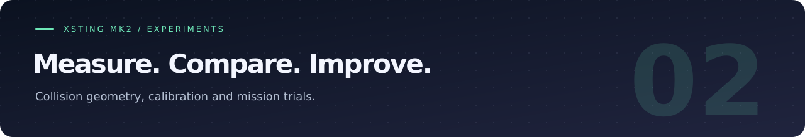

<h1>ArduCam 광각 보정</h1>

일반 모델과 어안 모델을 비교하고, 가장자리까지 확인한 보정 기록.

<a href="../README.md">Project 2</a> &nbsp; · &nbsp; <a href="../docs/architecture.md">시스템 설계</a> &nbsp; · &nbsp; <a href="README.md">실험 기록</a> &nbsp; · &nbsp; <a href="../submission/presentation.md">발표 자료</a>

---

<table>
<tr>
<td width="33%" align="center"><h3>0.482 px</h3>최종 fisheye RMS</td>
<td width="33%" align="center"><h3>1280 × 720</h3>보정 영상 해상도</td>
<td width="33%" align="center"><h3>2026.10.24</h3>실험일</td>
</tr>
</table>

<strong>이 문서의 목차</strong>

01. [목적](#chapter-01)
02. [조건](#chapter-02)
03. [결과](#chapter-03)
04. [결론과 다음 단계](#chapter-04)

- 날짜: 2026-10-24
- 프로젝트: xSting
- 태그: #실험

## 목적

- Arducam USB 2.0(광각) 영상의 왜곡을 측정하고 펴서, 물체 인식·위치 계산에 쓸 보정 파일을 만든다
- 일반(pinhole, Brown-Conrady) 모델과 어안(fisheye, Kannala-Brandt) 모델 중 맞는 것을 고른다

## 조건

| 항목 | 값 |
|---|---|
| 커밋 | `~/xSting` `vision` 브랜치, 커밋 전 (`xsting_vision/tools/calib/`) |
| 카메라 | Arducam USB 2.0 (UVC `0c45:6366`), MJPEG 1280×720 |
| 체커보드 | 안쪽 꼭짓점 9×6, 칸 25 mm, **모니터에 표시** (프린터 없음, 자로 실측) |
| 도구 | `calib_capture.py`(인식될 때만 저장), `calibrate.py`(사진별 오차 1 px 초과 제외 `--drop-above 1.0`) |
| 검증 | 알고 있는 렌즈 값으로 만든 합성 사진 39장 → fx 640→641, k1 −0.300→−0.302 회복 |

## 결과

| 조건 | 모델 | 재투영 오차 (RMS) | 비고 |
|---|---|---|---|
| 1차 202장, 제외 없음 | pinhole / fisheye | 0.839 / 0.825 px | 흐린 사진 포함 |
| 1차, 1 px 초과 35장 제외 | pinhole / fisheye | 0.509 / 0.485 px | **모서리에서 계산이 깨짐** (왼쪽 위 −90°) |
| 가장자리 38장 추가, 38장 제외 | pinhole | 0.509 px | 왼쪽 아래 모서리 −88° → 광각 가장자리에서 발산 |
| 〃 | **fisheye** | **0.482 px** | 네 모서리 정상 → **선택** |

최종 값 (`xsting_vision/config/arducam_1280x720_calibration.yaml`)

| 값 | |
|---|---|
| K | fx 860.7, fy 860.4, cx 710.7, cy 348.8 |
| D (fisheye) | −0.1223, −0.0405, 0.0408, −0.0183 |
| 화각 | 수평 약 94.5° (왼쪽 54.0°, 오른쪽 40.6°), 수직 약 49° |
| 45° 광선 위치 | 중심에서 619 px (왜곡 없는 렌즈라면 861 px) |

## 결론과 다음 단계

- 광각 렌즈는 **어안 모델**. 일반 모델은 tan θ 기반이라 가장자리에서 발산함
- 모서리·가장자리 사진이 없으면 그 부분 왜곡을 추정할 수 없음 → 촬영 화면에 범위 격자 표시가 효과적
- 화각이 좌우 비대칭: 두 모델이 같은 결과라 렌즈 중심이 센서 중심에서 오른쪽으로 약 70 px 어긋난 실제 특성으로 판단. Gazebo 그리퍼 카메라 가정(좌우 대칭 100°)은 이 값으로 바꿀 수 있음
- 다음: 학습 입력을 보정 영상으로 할지 결정, 해상도를 바꾸거나 초점 링을 돌리면 다시 보정
