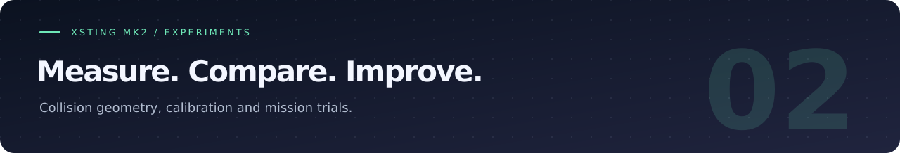

<h1>팔 충돌 형상 정확도</h1>

볼록 껍질과 CoACD 분할을 실제 메시 충돌 판정과 비교합니다.

<a href="../README.md">Project 2</a> &nbsp; · &nbsp; <a href="../docs/architecture.md">시스템 설계</a> &nbsp; · &nbsp; <a href="README.md">실험 기록</a> &nbsp; · &nbsp; <a href="../submission/presentation.md">발표 자료</a>

---

<table>
<tr>
<td width="33%" align="center"><h3>99.3%</h3>v2 판정 일치</td>
<td width="33%" align="center"><h3>5,000</h3>시험 자세 · seed 0</td>
<td width="33%" align="center"><h3>67</h3>비교 링크 쌍</td>
</tr>
</table>

<strong>이 문서의 목차</strong>

01. [목적](#chapter-01)
02. [조건](#chapter-02)
03. [결과](#chapter-03)
04. [결론과 다음 단계](#chapter-04)

- 날짜: 2026-10-21
- 프로젝트: xSting
- 태그: #실험

## 목적

- 팔이 움직일 때 **간섭(부딪힘) 판정이 실제 모양과 얼마나 같은지** 확인한다
- 시뮬레이터는 실제 메쉬가 아니라 충돌 형상(볼록 도형)으로 판정한다. 볼록 껍질은 오목한 부분까지 메우기 때문에 실제보다 크게 판정할 수 있다

## 조건

| 항목 | 값 |
|---|---|
| 커밋 | 없음 (git 저장소 아님, 2026-10-21 상태) |
| 스크립트 | `scripts/validate_collisions.py` (python-fcl), `scripts/decompose_collisions.py` (CoACD) |
| 정답 | 실제 visual 메쉬끼리의 충돌 (삼각형 교차) |
| 자세 | 관절 범위 안 무작위 5000개 (seed 0), joint1~7 |
| 비교 쌍 | 67쌍. 부모-자식 쌍은 제외 (시뮬레이터가 계산하지 않고, 관절 범위로 막음). 손가락끼리 쌍은 별도 확인 (링크 막대가 붙은 STL이라 정답이 틀림) |
| 판정 | 자세 하나에서 어느 쌍이라도 충돌하면 "간섭" |

## 결과

| 조건 | 판정 일치 | 오검출 (실제 안 닿음) | 미검출 (실제 닿음) | 비고 |
|---|---|---|---|---|
| v1: 부품당 볼록 껍질 1개 | 97.4% | 2.5% | 0.1% (3자세) | 손가락끼리 +1.86 mm부터 겹침 → 그리퍼가 못 닫힘 |
| v2a: CoACD 분할 (손가락 처리 전) | 95.8% | 4.2% | 0% | 손가락 가이드 판이 중심선을 넘어 손가락끼리 오검출 489회 |
| **v2: CoACD 88조각 + 손가락 자기 쪽만** | **99.3%** | **0.7%** (34자세) | **0%** | 그리퍼 이동 범위 전체에서 손가락끼리 안 겹침 |

v2 오검출 자세의 실제 메쉬 간격: 중앙값 **0.8 mm**, 90% 3.3 mm, 최대 8.9 mm → 거의 스치는 경우만 충돌로 판정 (약간 보수적).

쌍별로 크게 줄어든 것:
| 쌍 | v1 오검출 | v2 오검출 |
|---|---|---|
| base_link – link3 | 174 | 20 |
| link2 – link4 | 36 (실제 충돌 1) | 2 |
| base_link – link4 | 82 | 20 |

Isaac Sim(PhysX)에서 실제로 돌려 본 충돌 각도 (다른 관절 0°):
| 관절 → 명령 | 멈춘 각도 | 메쉬 계산 | 부딪힌 곳 |
|---|---|---|---|
| joint3 → −112° | −93.7° | −92° | 상판 |
| joint1 → ±69° | ±50.5° | ±49° | 기둥 |
| joint4 → +109° | +54.2° | 약 +53° | 바닥 (손가락) |

관절 범위 추정 (1 mm 격자, 다른 관절 0°, `estimate_joint_limits.py`):
| 관절 | 팔 자체 충돌 | 기둥·상판·베이스 충돌 | URDF에 넣은 범위 (3° 여유) |
|---|---|---|---|
| joint1 | 없음 | ±49° | ±180° |
| joint2 | 없음 | ±65° | ±180° |
| joint3 | −117 / +118° | +42°, −92° | −114 ~ +115° |
| joint4 | −91 / +117° | +60°, −53° | −88 ~ +114° |
| joint5 | −127 / +110° | +124° | −124 ~ +107° |
| joint6 | 없음 | 없음 | ±180° |

## 결론과 다음 단계

- CoACD 분할로 간섭 판정이 실제 모양과 99.3% 일치하고, **실제 충돌을 놓친 경우는 없다**
- 손가락은 STL에서 링크 막대가 붙어 있어 막대를 빼고, 가이드 판 때문에 자기 쪽(|y| ≥ 4.5 mm)만 충돌 형상으로 남겼다
- 기둥·상판 충돌은 자세마다 달라서 관절 범위가 아니라 **자기 충돌**로 막는다
- 다음: Isaac Lab에서 접촉 센서로 간섭을 보상에 반영
