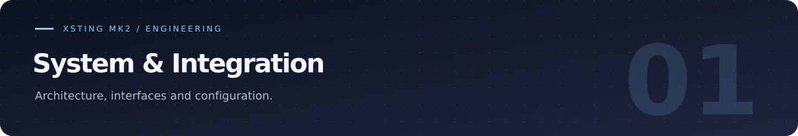

<h1>실행 코드와 설정</h1>

런치 인자부터 모델·센서 설정, OpenCR 보드 매핑까지.

<a href="../README.md">Project 2</a> &nbsp; · &nbsp; <a href="../docs/architecture.md">시스템 설계</a> &nbsp; · &nbsp; <a href="../experiments/README.md">실험 기록</a> &nbsp; · &nbsp; <a href="presentation.md">발표 자료</a>

---

<table>
<tr>
<td width="33%" align="center"><h3>LAUNCH</h3>실행 파일과 인자</td>
<td width="33%" align="center"><h3>CONFIG</h3>YAML · JSON · Engine</td>
<td width="33%" align="center"><h3>OpenCR × 3</h3>보드와 모터 ID</td>
</tr>
</table>

<strong>이 문서의 목차</strong>

01. [ROS 2 패키지 및 핵심 실행 파일 구성](#chapter-01)
02. [런치 파일 및 주요 실행 인자 정리](#chapter-02)
03. [동작에 필요한 주요 설정 파일](#chapter-03)
04. [OpenCR 3보드 모터 ID 및 통신 매핑 요약](#chapter-04)

본 문서는 `xSting MK2` 주사위 기억 로봇 시스템을 동일한 환경에서 재현하기 위해 필요한 **ROS 2 패키지, 실행 노드, 런치 파일, 핵심 파라미터 설정 파일, 펌웨어 구성**을 정리합니다.

---

## 1. ROS 2 패키지 및 핵심 실행 파일 구성

| 계층 | 패키지 경로 | 주요 실행 노드 / 바이너리 | 핵심 기능 |
|---|---|---|---|
| **공통 인터페이스** | `src/xsting_interfaces` | 메시지·액션 인터페이스 라이브러리 | `RobotCommand`, `ReadMissionInput`, `RunTask`, `LoadBox`, `UnloadPucks`, `ObserveLocation`, `PickPlace`, `ApproachBox`, `ReadSignBarcode` 정의 |
| **기구학 모델** | `src/xsting_description` | `robot_state_publisher`용 Xacro/URDF | 18-DOF 6족 다리 + 6-DOF 매니퓰레이터 + D435/ArduCam/LiDAR TF 링크 및 `joint_order.yaml` 정의 |
| **하드웨어 제어** | `src/xsting_hardware` | `xsting_hardware/XstingSystem` (`ros2_control` 플러그인) | OpenCR 3보드(`ID 200` 앞다리, `ID 201` 뒷다리, `ID 202` 팔) 자동 포트 탐색(`/dev/ttyACM*`), 저부하 수직 기립, IMU·초음파 발행 |
| **임베디드 펌웨어** | `src/firmware` | `front.opencr`, `back.opencr`, `arm.opencr` | Dynamixel Protocol 2.0 고속 SyncRead/SyncWrite 중계, 9축 IMU 쿼터니언 연산, 그리퍼 전류 제한 제어 |
| **비전 · 센서** | `src/xsting_vision` | `realsense_camera_node`, `arducam_camera_node`, `lidar_odom_node`, `depth_pca_node`, `sign_barcode_node` | D435 컬러/깊이/인프라 분리, ArduCam 왜곡 보정, 2D LiDAR 필터링(`/scan_filtered`), 3D 퍽·상자 PCA 검출(`/detections_3d`), 바코드·12회 신호등 해독(`/read_sign_barcode`) |
| **통합 브링업** | `src/xsting_bringup` | `full_system.launch.py`, `auto_drive.launch.py`, `xsting.launch.py` | GPU 제로카피 `vision` 컨테이너(`cuVSLAM` + `nvblox` + `YOLOv8 TensorRT`) 및 전 계층 무충돌 원클릭 런치 |
| **자율주행 · 정합** | `src/xsting_nav` | `nav_node` | 41D RL 보행 정책(20 Hz) + 100 Hz 삼각보행 IK + 10초 사람 대기/Dijkstra 우회 + **2D LiDAR ↔ 정적 경기장 ESDF 전역·연속 위치 정합** |
| **상자 정밀 도킹** | `src/xsting_approach` | `approach_node` | 전면 D435 깊이·초음파·RL 정책 융합 기반 상자 전면 **2 cm 간격(`0.315 m`)** 정밀 정렬(`/approach_box`) |
| **모션 플래닝 설정** | `src/xsting_moveit_config` | MoveIt 2 설정 + cuMotion XRDF | 6축 팔 SRDF, 관절 속도/가속도 한계, `isaac_ros_cumotion` 구체 충돌 모델 정의 |
| **GPU 모션 플래너** | `src/isaac_ros_cumotion`, `src/isaac_ros_cumotion_moveit` | `cumotion_planner_node`, MoveIt 플러그인 | GPU 병렬 충돌 회피 역기구학 및 궤적 최적화 (실패/미설치 시 OMPL 자동 폴백) |
| **픽앤플레이스** | `src/xsting_pick_place` | `pick_place_node`, `traj_bridge_node`, `calib_pick_place.py` | ArduCam 탑뷰 파지 정렬, 누운 사각 퍽 기립(`RightPuck`), 12슬롯 적재(`CMD_LOAD_BOX`), 주사위 격자 하역(`CMD_UNLOAD_BOX`), **새 관측 탑뷰 재검증(`CMD_OBSERVE`)** |
| **상위 미션 지능** | `src/xsting_mission` | `llm_commander`, `robot_command_server`, `mission_bridge` | 전역 12개 퍽 할당(`planner.assign`), 행동 계약 가드 검증, 하위 액션 중계, 제출용 JSON/스냅샷/영상 자동 기록 |

---

## 2. 런치 파일 및 주요 실행 인자 정리

### 2.1 마스터 자동 주행 런치 (`src/xsting_bringup/launch/auto_drive.launch.py`)

공식 실물 경기 및 무하드웨어 시뮬레이션 검증의 단일 진입점이며 내부적으로 `full_system.launch.py`를 호출합니다.

| 런치 인자 | 기본값 | 공식 경기 권장값 | 동작 설명 |
|---|---|---|---|
| `sim_fake` | `false` | `false` | `true` 시 실물 하드웨어·비전 없이 가상 경기장 백엔드로 전체 로직 시험 |
| `with_hardware` | `true` | `true` | OpenCR 3보드 `ros2_control` 및 `robot_state_publisher` 기동 |
| `with_vision` | `true` | `true` | D435, ArduCam, 2D LiDAR, cuVSLAM, nvblox, YOLOv8 컨테이너 기동 |
| `with_nav` | `true` | `true` | `xsting_nav` RL 주행 및 LiDAR-ESDF 전역 위치 정합 활성화 |
| `with_approach` | `true` | `true` | 상자 전면 2 cm 정밀 접근 액션 서버(`/approach_box`) 동시 기동 |
| `with_pick_place` | `true` | `true` | MoveIt 2 + cuMotion + ArduCam 픽앤플레이스 노드 기동 |
| `commander` | `true` | `true` | 상위 자율 미션 오케스트레이터(`llm_commander`) 자동 기동 |
| `decider` | `llm` | `llm` (또는 `script`) | `llm`(자율 판단 + 자가 복구) 또는 `script`(고정 시퀀스, API 키 불필요) |
| `guard` | `true` | `true` | `robot_command_server` 계약 가드 활성화 (오배정·부분 하역 사전 차단) |
| `start_paused` | `true` | `true` | 부팅 후 `/mission/start` 호출 전까지 출발 구역에서 안전 대기 |
| `virtual_sign` | `false` | **`false`** | 공식 경기에서는 반드시 `false`로 두어 실물 카메라로 신호·바코드 인식 |
| `record_media` | `true` | `true` | 행동 전후 스냅샷(`before/after.jpg`) 및 전 과정 연속 영상 자동 녹화 |
| `reboot` | `false` | 필요 시 `true` | 기동 시 Dynamixel 서보 과부하 에러 해제 리부트 수행 |
| `foxglove` | `true` | `true` | 포트 `8765`로 Foxglove Studio 원격 관제 WebSocket 브리지 실행 |

---

## 3. 동작에 필요한 주요 설정 파일 (YAML / JSON / Engine)

### 3.1 하드웨어 · 센서 · 비전 설정

| 파일 경로 | 주요 파라미터 및 역할 |
|---|---|
| `src/xsting_hardware/config/xsting_controllers.yaml` | `joint_state_broadcaster`, `leg_controller`(18축 위치), `arm_controller`(6축 위치/전류), `imu_broadcaster`, `sonar_broadcaster` 주기(100 Hz) 설정 |
| `src/xsting_vision/scripts/99-arducam.rules`, `99-lidar.rules` | USB 포트 위치와 무관하게 `/dev/arducam`, `/dev/lidar` 고정 매핑 |
| `src/xsting_vision/config/realsense_camera.yaml` | 전면 D435 해상도(`640×480`), FPS, 컬러·깊이·인프라 스트림 노출/이미터 설정 |
| `src/xsting_vision/config/arducam_camera.yaml` | 팔 끝 ArduCam 장치 경로(`/dev/arducam`) 및 광각 렌즈 왜곡 보정 행렬 |
| `src/xsting_vision/config/sign_barcode.yaml` | `expected_flashes: 12`, `conf_thres: 0.5`, `min_on_sec: 0.25`, `min_off_sec: 0.25`, `end_off_sec: 2.0`, 1회 성공 후 GPU 노드 자동 언로드 설정 |
| `src/xsting_vision/config/depth_pca.yaml` | YOLOv8 바운딩박스 + Depth 포인트클라우드 기반 3D 중심·장단축(누운 사각 퍽 판별) PCA 추출 파라미터 |
| `src/xsting_vision/model/x86_64/*.engine` | `rg_nano_batch1_640_fp16.engine`(퍽·상자), `sign_nano_batch1_640_fp16.engine`(신호등 R/Y/G) |
| `src/xsting_bringup/config/cuvslam.yaml`, `nvblox.yaml` | 스테레오 Visual-Inertial Odometry 및 실시간 2D/3D 정적·동적 ESDF 맵 생성 파라미터 |

### 3.2 자율주행 · 위치정합 · 정밀도킹 설정

| 파일 경로 | 주요 파라미터 및 역할 |
|---|---|
| `src/xsting_nav/config/nav.yaml` | `gait_freq_hz: 2.7`, `step_height_m: 0.042`, `pre_approach_tol_m: 0.08`(8 cm 도달 시 정밀 도킹 인계), `human_wait_timeout_s: 10.0`, `max_safe_tilt_deg: 38.0`, `enable_lidar_localization: true`, `loc_max_rmse_m: 0.065` |
| `src/xsting_nav/config/calibration.yaml` | 초기 경기장 출발 자세(`init_pose_arena: HOME`), 18축 다리 관절 방향·영점 오프셋, 오도메트리 스케일 보정값 |
| `src/xsting_nav/config/arena_static_esdf.json` | `4464 × 6364 mm` 경기장 외벽·내벽·고정 작업대 정적 ESDF 격자 (LiDAR 스캔 매칭 및 전역 경로계획 기준 맵) |
| `src/xsting_nav/config/mk2_nav_policy.json` | 41D 관측 → 3D 속도(`vx, vy, wz`) 강화학습 정책 가중치 |
| `src/xsting_approach/config/approach.yaml` | 상자 전면 2 cm 도킹용 RL 정책(`approach_policy_xsting.bin`), 초음파·깊이 타임아웃(`0.35 s`), 비활성 시 다리 제어권 양보(`stand_when_idle: false`) |

### 3.3 픽앤플레이스 · 미션 오케스트레이션 설정

| 파일 경로 | 주요 파라미터 및 역할 |
|---|---|
| `src/xsting_pick_place/config/pick_place.yaml` | 지면 높이(`ground_z: -0.0213 m`), 상자 기본 중심(`box_x: 0.263 m`), ArduCam 관측 고도(`arducam_look_dz: 0.235 m`), 그리퍼 개폐 폭(`grip_open_box: 0.0175 m`, `grip_loosen: 0.0094 m`, `grip_close: 0.0008 m`), 파지/배치/슬롯 오프셋 및 팔 처짐 계수(`droop_k: 0.022`) |
| `src/xsting_mission/config/arena.yaml` | `HOME`, `S1`~`S6`, `L1`~`L3` 공식 좌표(mm→m), 접근 방향(`yaw`), 3×3 주사위 격자(`±60 mm`) 오프셋 정의 |
| `src/xsting_mission/config/mission_bridge.yaml` | 하위 액션 매핑, 하차 후 안정 대기(`unload_hold_s: 2.0`), 재검증 관측 시간(`observe_wait_s: 3.0`), `snap_cardinal_yaw: true` |
| `src/xsting_mission/config/fixed_actions.yaml` | `decider:=script` 모드용 결정론적 순회 액션 테이블 (LLM API 없이 재현 시험 가능) |

---

## 4. OpenCR 3보드 모터 ID 및 통신 매핑 요약

| 보드 역할 | 프로토콜 ID | 연결 장치 | 담당 Dynamixel 모터 ID | 추가 센서 |
|---|---:|---|---|---|
| **앞다리 보드 (`front.opencr`)** | `200` | `/dev/ttyACM*` (자동 Ping 식별) | `1~3`(`leg1`), `4~6`(`leg2`), `10~12`(`leg4`) | 9축 IMU (`/imu_broadcaster/imu`), 전면 초음파 (`/sonar_broadcaster/range`) |
| **뒷다리 보드 (`back.opencr`)** | `201` | `/dev/ttyACM*` (자동 Ping 식별) | `7~9`(`leg3`), `13~15`(`leg5`), `16~18`(`leg6`) | — |
| **매니퓰레이터 보드 (`arm.opencr`)** | `202` | `/dev/ttyACM*` (자동 Ping 식별) | `11`(`arm_yaw`), `12`(`arm_shoulder`), `13`(`arm_elbow`), `14`(`arm_wrist`), `15`(`arm_roll`), `16`(`finger_l` 그리퍼) | 전류 제어 파지 상태 피드백 |
