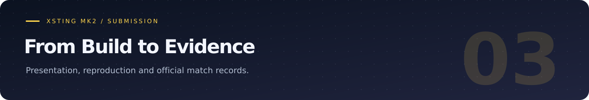

<div align="center">



<h1>공식 1회차 · 로그 보관소</h1>
<p>입력 → 할당 → 새 관측 검증 → 종료 기록</p>
<p><a href="../../../README.md">Project 2</a> &nbsp; · &nbsp; <a href="../../../docs/architecture.md">시스템 설계</a> &nbsp; · &nbsp; <a href="../../../experiments/README.md">실험 기록</a> &nbsp; · &nbsp; <a href="../../presentation.md">발표 자료</a>
</p>

</div>

---

<table>
<tr>
<td width="33%" align="center"><h3>SIGNAL</h3>바코드와 점멸</td>
<td width="33%" align="center"><h3>ALLOCATION</h3>12개 퍽 배정</td>
<td width="33%" align="center"><h3>VERIFICATION</h3>하역 후 새 관측</td>
</tr>
</table>

**바로 가기** &nbsp; [로그 보관](#section-1) · [산출물 목록](#section-2)

본 디렉토리(`submission/official_logs/round_1/`)는 **공식 1회차 실물 경기 단독 수행 로그**만 보관하는 전용 경로입니다(2회차 로그와 혼합 금지).

<a id="section-1"></a>

## 로그 보관

공식 1회차 종료 직후 아래 명령을 실행하면 자동 복사 및 비밀키 혼입 검사가 수행됩니다:
```bash
cd ~/mk2_ws/src/xSting/project2
bash submission/scripts/archive_official_run.sh 1 ~/xsting_logs/run_<1회차_시각>
```

<a id="section-2"></a>

## 산출물 목록

- `signal.json` : 실물 카메라 기반 바코드(`P2-01`~`P2-04`) 및 12회 점멸 순서·색상별 집계 기록
- `allocation.json` : 12개 퍽 인식 속성, `L1`~`L3` 그룹 배정, `Y` 모양 통일 및 중복·누락 검증 기록
- `verification.json` : **하차 후 새 관측(`CMD_OBSERVE` / ArduCam 탑뷰 & `/detections_3d`) 기반** `L1`~`L3` 9칸 ID·중심 오프셋(`offset_mm`) 실측 기록
- `final_state.json` / `report.md` / `mission.jsonl` : 출발 구역 `HOME` 3초 정지 완료 상태 및 전체 행동 타임라인
- `images/*.jpg` : 매 행동(`LOAD`, `UNLOAD`, `VERIFY_LOCATION`) 전후 스냅샷 이미지

> 전체 무편집 경기 영상 및 연속 카메라 영상(`.mp4`/`.avi`)은 용량 제한을 피하기 위해 누구나 열람 가능한 외부 링크로 업로드한 뒤 [`submission/official_match_results.md`](../../official_match_results.md)의 **1. 공식 1회차** 섹션에 기재합니다.
