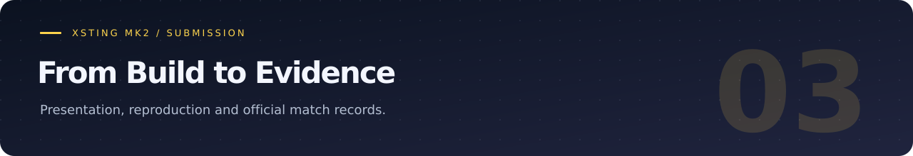

<h1>공식 경기 기록</h1>

회차마다 입력, 행동, 배치, 새 관측 검증과 영상을 함께 기록합니다.

<a href="../README.md">Project 2</a> &nbsp; · &nbsp; <a href="../docs/architecture.md">시스템 설계</a> &nbsp; · &nbsp; <a href="../experiments/README.md">실험 기록</a> &nbsp; · &nbsp; <a href="presentation.md">발표 자료</a>

---

<table>
<tr>
<td width="33%" align="center"><h3>ROUND 01</h3>공식 1회차 · 작성 대기</td>
<td width="33%" align="center"><h3>ROUND 02</h3>공식 2회차 · 작성 대기</td>
<td width="33%" align="center"><h3>EVIDENCE</h3>영상 · 센서 · 실행 로그</td>
</tr>
</table>

<strong>이 문서의 목차</strong>

01. [공식 1회차 수행 기록](#chapter-01)
02. [공식 2회차 수행 기록](#chapter-02)
03. [부록: 사전 검증 로그 포맷 레퍼런스](#chapter-03)

본 문서는 실물 공식 경기 **1회차**와 **2회차**의 전체 수행 영상 링크, 센서 기반 신호·바코드 관측 기록, 12개 퍽 할당 결과, **새 관측 기반(`CMD_OBSERVE`) 재검증 로그**, 그리고 성공·실패·미완료 지점과 그 물리적/소프트웨어적 근거를 **회차별로 완전히 분리하여** 기록합니다.

> **작성 및 검증 원칙 준수 사항**
> 1. **회차 분리**: 공식 1회차와 2회차의 영상·로그·점수·성공 항목을 절대 합치거나 섞지 않고 독립적으로 기록합니다.
> 2. **성공 및 실패·미완료 전수 기록**: 성공한 구간뿐 아니라 실패·재시도·정지·미완료된 항목과 그 정확한 원인 및 근거(로그 타임스탬프·영상 시점)를 함께 제출합니다.
> 3. **새 관측 기반 재검증**: 목표 배치 좌표를 그대로 복사한 로그가 아니라, 하차 이후 팔 끝 ArduCam 탑뷰(`/arducam/image_rect`) 또는 전면 D435(`/detections_3d`)에서 새로 획득한 프레임으로 실측한 `verification.json`을 제출합니다.
> 4. **공개 열람 링크 & 비밀 정보 배제**: 대용량 영상은 로그인·비밀번호 없이 누구나 열람 가능한 외부 링크로 첨부하며, API 토큰·비밀번호 등 비밀 정보는 일절 포함하지 않습니다.

---

## 1. 공식 1회차 (Official Round 1) 수행 기록

### 1.1 기본 메타데이터 및 전체 영상 링크

| 항목 | 공식 1회차 기록 |
|---|---|
| **수행 일시** | `2026-11-__ __:__ ~ __:__ (KST)` *(실물 공식 1회차 수행 시각 기입)* |
| **실행 런치 명령** | `ros2 launch xsting_bringup auto_drive.launch.py virtual_sign:=false start_paused:=true record_media:=true decider:=llm guard:=true` |
| **사용 Git 커밋** | `<git rev-parse --short HEAD 기입>` |
| **원본 로그 보관 경로** | [`submission/official_logs/round_1/`](official_logs/round_1/) (`run_YYYYMMDD_HHMMSS`) |
| **전체 무편집 외경 영상 링크** | `[공식 1회차 전체 경기 영상 (외부 공개 링크 입력 — 누구나 보기 가능 권한 확인)]` |
| **로봇 온보드 카메라 영상 링크** | `[공식 1회차 전면 D435 + 팔 ArduCam 연속 녹화본 공개 링크 입력]` |
| **최종 종료 상태** | `[ ] 자율 완주 (DONE)` / `[ ] 부분 수행 후 안전 정지` / `[ ] 비상정지·기권` |

### 1.2 공식 1회차 출제 조건 및 센서 인식 결과 (`round_1/signal.json` 대응)

| 구분 | 운영자 출제 정답 (Ground Truth) | 로봇 실제 센서 관측값 (`signal.json`) | 일치 여부 및 근거 |
|---|---|---|---|
| **바코드 (`Code 128`)** | `P2-0_` (`asc` / `desc`) | `P2-0_` (`asc` / `desc`, `valid: true/false`) | `[ ] 일치` / `[ ] 불일치` |
| **12회 점멸 순서** | `_ _ _ _ _ _ _ _ _ _ _ _` | `_ _ _ _ _ _ _ _ _ _ _ _` | `_ / 12` 시점 일치 |
| **색상별 횟수 (`R / Y / G`)** | `R=_, Y=_, G=_` (합계 12) | `R=_, Y=_, G=_` | `R:[ ] Y:[ ] G:[ ]` |
| **12개 시작 퍽 구성 (`S1`~`S6`)** | 빨강 `_`개(`cyl _ / box _`), 초록 `_`개(`cyl _ / box _`) | 적재 스캔 인식 `unique_count = _` | [`round_1/allocation.json`](official_logs/round_1/) |

### 1.3 공식 1회차 장소별 할당 · 배치 · 새 관측 재검증 결과 (`round_1/allocation.json` & `verification.json`)

| 목적지 | 배정 그룹 (목표 눈) | 목표 격자 (`cell`) | 실제 배치된 `puck_id` (색상/모양) | 새 관측 재검증 (`verification.json` 실측 오프셋 mm) | 성공 / 실패 판정 및 원인 |
|---|---|---|---|---|---|
| **`L1` `(3670, 950)`** | `_` 그룹 (눈 `_`) | `[ ... ]` | `_` | `seen_puck_id: _, offset_mm: [_, _], extra: []` | `[ ] 성공` / `[ ] 실패 (사유: )` |
| **`L2` `(2202, 3700)`** | `_` 그룹 (눈 `_`) | `[ ... ]` | `_` | `seen_puck_id: _, offset_mm: [_, _], extra: []` | `[ ] 성공` / `[ ] 실패 (사유: )` |
| **`L3` `(3670, 5354)`** | `_` 그룹 (눈 `_`) | `[ ... ]` | `_` | `seen_puck_id: _, offset_mm: [_, _], extra: []` | `[ ] 성공` / `[ ] 실패 (사유: )` |
| **전체 정합성 판정** | 중복 `0` / 누락 `0` | — | `duplicate_ids: []`, `missing_ids: []` | 신규 카메라 프레임 관측 시각(`stamp`) 확인 완료 | `[ ] 통과` / `[ ] 미통과` |

### 1.4 공식 1회차 단계별 타임라인 및 성공·실패·미완료 근거

| 단계 | 영상 시점 (`mm:ss`) | 수행 동작 | 결과 (`성공`/`실패`/`미완료`) | 상세 근거 (로그 파일·이벤트 턴·실패 시 물리/인지 원인) |
|---|---|---|---|---|
| **1. 신호·바코드 관측** | `00:00 ~ __:__` | `HOME`에서 바코드 및 12회 점멸 + 종료 소등 확인 | `[기입]` | `round_1/signal.json`, `mission.jsonl` Turn #1 |
| **2. 그룹 정렬·전역 할당** | `__:__ ~ __:__` | `L1~L3` 그룹 배정 및 `Y` 모양 통일 할당 계획 | `[기입]` | `round_1/allocation.json` |
| **3. 시작 박스 수거 (`S1`~`S6`)** | `__:__ ~ __:__` | 주행 + 2cm 도킹 + 퍽 12개 파지/기립/적재 | `[기입]` | 상자별 성공·누락·재시도 내역 및 스냅샷 경로 기록 |
| **4. 주사위 배치 (`L1`~`L3`)** | `__:__ ~ __:__` | 3×3 격자 일괄 하역(중심 오차 `≤10mm`, `2초` 안정) | `[기입]` | 각 장소 하역 전후 이미지(`media/images/*_UNLOAD_*.jpg`) |
| **5. 새 관측 재검증** | `__:__ ~ __:__` | ArduCam `+300mm` 탑뷰 신규 프레임 9칸 실측 | `[기입]` | `round_1/verification.json` (`stamp` 및 `offset_mm` 실측치) |
| **6. 출발 구역 복귀** | `__:__ ~ __:__` | `HOME` 차체 전체 진입 + `3.0초` 이상 완전 정지 | `[기입]` | `round_1/final_state.json` (`home_stopped`) |

- **1회차 실패·미완료 항목 상세 분석**:
  - **발생 지점 및 현상**: *(실패·미완료 항목이 있을 경우 해당 상자/단계와 현상을 숨김없이 기술, 전 항목 완주 성공 시 '해당 없음(전 단계 정상 완주)'으로 기록)*
  - **원인 근거 (로그/영상 대조)**: *(예: 특정 상자 접근 시 조명 반사로 인한 깊이 노이즈, 누운 퍽 기립 중 그리퍼 슬립, 신호 소등 구간 채터링 등 구체적 원인 기술)*

---

## 2. 공식 2회차 (Official Round 2) 수행 기록

> **주의**: 공식 2회차는 1회차 종료 후 전체 프로세스 재기동 및 경기장 초기화를 거쳐 독립 수행한 기록이며, 1회차 데이터와 혼합하지 않습니다.

### 2.1 기본 메타데이터 및 전체 영상 링크

| 항목 | 공식 2회차 기록 |
|---|---|
| **수행 일시** | `2026-11-__ __:__ ~ __:__ (KST)` *(실물 공식 2회차 수행 시각 기입)* |
| **실행 런치 명령** | `ros2 launch xsting_bringup auto_drive.launch.py virtual_sign:=false start_paused:=true record_media:=true decider:=llm guard:=true` |
| **사용 Git 커밋** | `<git rev-parse --short HEAD 기입>` |
| **원본 로그 보관 경로** | [`submission/official_logs/round_2/`](official_logs/round_2/) (`run_YYYYMMDD_HHMMSS`) |
| **전체 무편집 외경 영상 링크** | `[공식 2회차 전체 경기 영상 (외부 공개 링크 입력 — 누구나 보기 가능 권한 확인)]` |
| **로봇 온보드 카메라 영상 링크** | `[공식 2회차 전면 D435 + 팔 ArduCam 연속 녹화본 공개 링크 입력]` |
| **최종 종료 상태** | `[ ] 자율 완주 (DONE)` / `[ ] 부분 수행 후 안전 정지` / `[ ] 비상정지·기권` |

### 2.2 공식 2회차 출제 조건 및 센서 인식 결과 (`round_2/signal.json` 대응)

| 구분 | 운영자 출제 정답 (Ground Truth) | 로봇 실제 센서 관측값 (`signal.json`) | 일치 여부 및 근거 |
|---|---|---|---|
| **바코드 (`Code 128`)** | `P2-0_` (`asc` / `desc`) | `P2-0_` (`asc` / `desc`, `valid: true/false`) | `[ ] 일치` / `[ ] 불일치` |
| **12회 점멸 순서** | `_ _ _ _ _ _ _ _ _ _ _ _` | `_ _ _ _ _ _ _ _ _ _ _ _` | `_ / 12` 시점 일치 |
| **색상별 횟수 (`R / Y / G`)** | `R=_, Y=_, G=_` (합계 12) | `R=_, Y=_, G=_` | `R:[ ] Y:[ ] G:[ ]` |
| **12개 시작 퍽 구성 (`S1`~`S6`)** | 빨강 `_`개(`cyl _ / box _`), 초록 `_`개(`cyl _ / box _`) | 적재 스캔 인식 `unique_count = _` | [`round_2/allocation.json`](official_logs/round_2/) |

### 2.3 공식 2회차 장소별 할당 · 배치 · 새 관측 재검증 결과 (`round_2/allocation.json` & `verification.json`)

| 목적지 | 배정 그룹 (목표 눈) | 목표 격자 (`cell`) | 실제 배치된 `puck_id` (색상/모양) | 새 관측 재검증 (`verification.json` 실측 오프셋 mm) | 성공 / 실패 판정 및 원인 |
|---|---|---|---|---|---|
| **`L1` `(3670, 950)`** | `_` 그룹 (눈 `_`) | `[ ... ]` | `_` | `seen_puck_id: _, offset_mm: [_, _], extra: []` | `[ ] 성공` / `[ ] 실패 (사유: )` |
| **`L2` `(2202, 3700)`** | `_` 그룹 (눈 `_`) | `[ ... ]` | `_` | `seen_puck_id: _, offset_mm: [_, _], extra: []` | `[ ] 성공` / `[ ] 실패 (사유: )` |
| **`L3` `(3670, 5354)`** | `_` 그룹 (눈 `_`) | `[ ... ]` | `_` | `seen_puck_id: _, offset_mm: [_, _], extra: []` | `[ ] 성공` / `[ ] 실패 (사유: )` |
| **전체 정합성 판정** | 중복 `0` / 누락 `0` | — | `duplicate_ids: []`, `missing_ids: []` | 신규 카메라 프레임 관측 시각(`stamp`) 확인 완료 | `[ ] 통과` / `[ ] 미통과` |

### 2.4 공식 2회차 단계별 타임라인 및 성공·실패·미완료 근거

| 단계 | 영상 시점 (`mm:ss`) | 수행 동작 | 결과 (`성공`/`실패`/`미완료`) | 상세 근거 (로그 파일·이벤트 턴·실패 시 물리/인지 원인) |
|---|---|---|---|---|
| **1. 신호·바코드 관측** | `00:00 ~ __:__` | `HOME`에서 바코드 및 12회 점멸 + 종료 소등 확인 | `[기입]` | `round_2/signal.json`, `mission.jsonl` Turn #1 |
| **2. 그룹 정렬·전역 할당** | `__:__ ~ __:__` | `L1~L3` 그룹 배정 및 `Y` 모양 통일 할당 계획 | `[기입]` | `round_2/allocation.json` |
| **3. 시작 박스 수거 (`S1`~`S6`)** | `__:__ ~ __:__` | 주행 + 2cm 도킹 + 퍽 12개 파지/기립/적재 | `[기입]` | 상자별 성공·누락·재시도 내역 및 스냅샷 경로 기록 |
| **4. 주사위 배치 (`L1`~`L3`)** | `__:__ ~ __:__` | 3×3 격자 일괄 하역(중심 오차 `≤10mm`, `2초` 안정) | `[기입]` | 각 장소 하역 전후 이미지(`media/images/*_UNLOAD_*.jpg`) |
| **5. 새 관측 재검증** | `__:__ ~ __:__` | ArduCam `+300mm` 탑뷰 신규 프레임 9칸 실측 | `[기입]` | `round_2/verification.json` (`stamp` 및 `offset_mm` 실측치) |
| **6. 출발 구역 복귀** | `__:__ ~ __:__` | `HOME` 차체 전체 진입 + `3.0초` 이상 완전 정지 | `[기입]` | `round_2/final_state.json` (`home_stopped`) |

- **2회차 실패·미완료 항목 상세 분석**:
  - **발생 지점 및 현상**: *(실패·미완료 항목이 있을 경우 구체적으로 기록, 전 항목 완주 성공 시 '해당 없음(전 단계 정상 완주)'으로 기록)*
  - **원인 근거 (로그/영상 대조)**: *(1회차 대비 변경점 또는 발생한 오류 원인 기술)*

---

## 부록: 사전 검증 로그 포맷 레퍼런스 (비공식 시뮬레이션 통합 검증 — 공식 경기 점수 미반영)

> **명확한 구분 고지**: 아래 내역은 공식 실물 경기가 아니라 개발 단계(`2026-11-16 10:22 KST`, `~/xsting_logs/run_20261116_102220`)에서 가상 신호·가상 백엔드 환경으로 수행한 **사전 파이프라인 통합 검증 로그 예시**입니다. 규정(`시뮬레이션 결과를 실물 성공으로 표기하지 않습니다`)에 따라 공식 점수에는 일절 반영하지 않으며, 로그 자동 생성기(`llm_commander`)의 검증 산출물 구조 확인용으로만 수록합니다.

- **검증 입력 (`signal.json`)**: 바코드 `P2-01` (`asc`), 시퀀스 `R G R R G R G G Y G Y G` (`R=4, Y=2, G=6`, `valid=true`).
- **오류 차단 및 자가 복구 사례 (`mission.jsonl` Turn #18)**:
  - AI 판단기가 `L2`(정답 `R×4` 구역)에 `Y×2`(`puck_id 6, 5`) 하역을 시도했으나, **`robot_command_server` 계약 가드가 개수·그룹 불일치를 사전 감지하여 `REJECTED` 반환** → 실제 물리 오배치 발생 없이 Turn #19에서 `L1`으로 즉시 수정 이동하여 `L1(눈 2: [0,8])`, `L2(눈 4: [0,2,6,8])`, `L3(눈 6: [0,3,6,2,5,8])` 배치를 모두 통과함.
- **재검증 출력 포맷 (`verification.json`)**:
  - `L1`: `puck 5 → cell 0 (offset [+1.4, -3.8] mm)`, `puck 6 → cell 8 (offset [+1.1, +0.9] mm)`, `extra: []` (`box` 단일 형상 통일)
  - `L2`: `puck 1, 2, 8, 11 → cell 0, 2, 6, 8` (최대 오프셋 `3.8 mm ≤ 10 mm`), `extra: []`
  - `L3`: `puck 0, 7, 3, 9, 4, 10 → cell 0, 2, 3, 5, 6, 8` (최대 오프셋 `3.3 mm ≤ 10 mm`), `extra: []`
