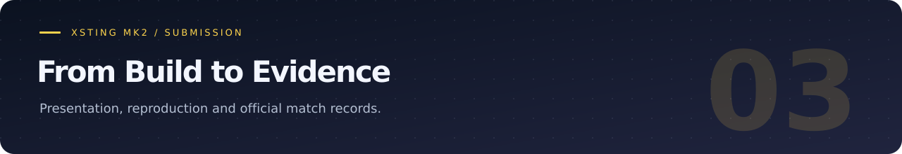
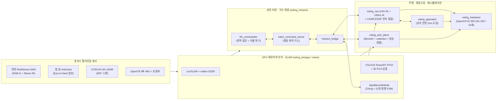
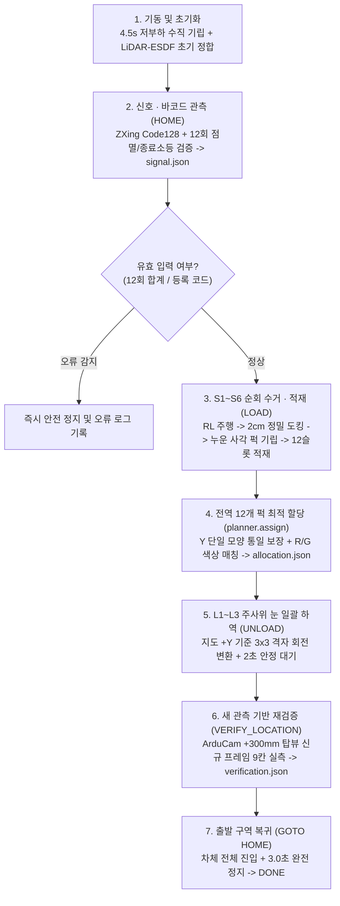

<h1>주사위 기억 로봇 · 최종 발표</h1>

프로젝트 목표에서 구현, 검증과 개선 과정까지.

<a href="../README.md">Project 2</a> &nbsp; · &nbsp; <a href="../docs/architecture.md">시스템 설계</a> &nbsp; · &nbsp; <a href="../experiments/README.md">실험 기록</a>

---

<table>
<tr>
<td width="33%" align="center"><h3>OVERVIEW</h3>로봇과 미션</td>
<td width="33%" align="center"><h3>ENGINEERING</h3>구현과 실패 분석</td>
<td width="33%" align="center"><h3>EVIDENCE</h3>시험과 공식 기록</td>
</tr>
</table>

<strong>이 문서의 목차</strong>

01. [프로젝트 개요 및 미션 목표](#chapter-01)
02. [전체 하드웨어 · ROS 2 시스템 아키텍처](#chapter-02)
03. [엔드투엔드 미션 수행 흐름](#chapter-03)
04. [핵심 구현 기능 요약](#chapter-04)
05. [실제 수행 결과 요약](#chapter-05)
06. [실패 원인 · 개선 과정](#chapter-06)
07. [시스템의 한계 및 향후 개선 방향](#chapter-07)

> 브라우저 슬라이드 버전: [`submission/presentation_slides.html`](presentation_slides.html) (더블클릭 후 `←` / `→` 키로 슬라이드 전환, `Ctrl+P`로 PDF 출력 지원)

---

## Slide 1. 프로젝트 개요 및 미션 목표

- **과제명**: 주사위 기억 로봇 (Dice Memory Robot, 발제 v5)
- **로봇 플랫폼**: **xSting MK2** — 18축 6족 보행 다리 + 매니퓰레이터(5축 팔 + 그리퍼)(12슬롯 상단 팔레트 탑재)
- **핵심 미션**:
  1. 출발 구역(`HOME: 734, 950 mm`)에서 **바코드(`P2-01~04`)** 및 **신호등 12회 점멸(`R·Y·G` 순서·횟수)** 인식
  2. 분산 시작 상자 6곳(`S1~S6`)에서 랜덤 수량의 빨강/초록 원기둥·직육면체 퍽 **12개 전량 수거·적재**
  3. 바코드 정렬 규칙(`asc`/`desc`, 동률 `R→Y→G`) 및 **공통 속성(`R`=빨강, `G`=초록, `Y`=단일 모양 통일)**에 맞춰 `L1·L2·L3`에 **주사위 눈(`1~6`, 중심 오차 `≤10 mm`, `2초` 안정)** 동시 완성
  4. **새 카메라 관측(`CMD_OBSERVE`)**으로 3×3 격자 배치를 실측 재검증한 뒤 `HOME` 복귀 후 **3초 이상 정지**

---

## Slide 2. 전체 하드웨어 · ROS 2 시스템 아키텍처

---

## Slide 3. 엔드투엔드 미션 수행 흐름 (End-to-End Flow)

---

## Slide 4. 핵심 구현 기능 요약 (Key Technical Features)

| 영역 | 핵심 구현 기술 | 기대 효과 및 규정 대응 |
|---|---|---|
| **① 신호·바코드 인식** | `SignBarcodeNode`: ZXing Code128 디코더 + 최소 점등/소등(`0.25s`) 디바운싱 및 종료 소등(`2.0s`) FSM, 1회 성공 후 TensorRT 자동 언로드 | 연속 동일 색상 점멸 구별, 불명/누락 추정 금지 준수, 주행 중 GPU 여유 메모리 확보 |
| **② 전역 할당 & 계약 가드** | `planner.assign`: 순차 탐욕 선택이 아닌 12개 전체 풀에서 `Y` 단일 형상(`cylinder`/`box`) 가능 조합을 선행 탐색 + `robot_command_server` 가드 | 먼저 집은 퍽으로 인해 `Y` 그룹이 불가능해지는 문제 원천 차단, 부분 하역(`PARTIAL_UNLOAD`) 및 오배정 사전 거부 |
| **③ 드리프트 없는 6족 주행** | 41D RL 정책(20Hz) + 100Hz 해석적 역기구학 삼각보행 + **2D LiDAR ↔ 정적 경기장 ESDF Huber Gauss-Newton 정합** + 상자 2cm 도킹(`/approach_box`) | 다리 미끄러짐으로 인한 누적 오도메트리 오차 실시간 제거, 팔 작업 반경 내 정밀 정차 보장 |
| **④ 탑뷰 파지·기립·재검증** | MoveIt 2 + cuMotion + 팔 끝 **ArduCam(`+300 mm` 직상방)** 2-Pass 무시차 정렬, 누운 사각 퍽 `RightPuck` 기립, 신규 프레임 9칸 재검증 | 전면 카메라 근거리 사각지대 및 주사위 5·6 눈 앞뒤 퍽 가림(Occlusion) 해결, 목표 복사 아닌 실측 검증 로그 생성 |

---

## Slide 5. 실제 수행 결과 요약 (공식 1·2회차 분리 기록)

### 5.1 사전 통합 및 단위 검증 결과 (비공식 개발 검증)

- **자동화 단위 테스트 (`colcon test`)**: `xsting_nav`, `xsting_pick_place`, `xsting_mission` 전 테스트 통과 (할당 유효/불가능 케이스, 동률 `R→Y→G`, 계약 가드 차단 검증 완료).
- **자가 복구 검증 (`run_20261116_102220`)**: 상위 판단기가 `L2`에 잘못된 그룹 하역을 시도했을 때 `robot_command_server` 가드가 `REJECTED`로 물리 오동작을 막고 즉시 `L1 → L2` 순으로 정정해 전 구역 오차 `3.8 mm` 이내 통과 확인 *(시뮬레이션 검증이므로 공식 점수 미반영)*.

### 5.2 실물 공식 경기 수행 결과 (`official_match_results.md` / `scoring_sheet_100pt.md` 연동)

> 두 회차의 결과는 섞지 않고 각각 기록하며, 더 높은 단일 회차 전체 점수만 최종 반영합니다.

| 평가 항목 (배점) | 공식 1회차 원점수 | 공식 2회차 원점수 | 비고 (성공 · 실패 핵심 근거) |
|---|---:|---:|---|
| 1. 신호 순서 기억 (12점) | `__ / 12` | `__ / 12` | `round_1`, `round_2` 각각의 `signal.json` 기준 |
| 2. 색상별 횟수 (9점) | `__ / 9` | `__ / 9` | `R·Y·G` 각 3점 |
| 3. 바코드 해석 (4점) | `__ / 4` | `__ / 4` | 실물 코드 + 정렬 방향 모두 일치 |
| 4. 장소 그룹 배정 (9점) | `__ / 9` | `__ / 9` | `L1~L3` 각 3점 |
| 5. 색상·모양 선택 (18점) | `__ / 18` | `__ / 18` | `Y` 모양 통일 포함 각 6점 |
| 6. 주사위 눈 배치 (30점) | `__ / 30` | `__ / 30` | 오차 `≤10 mm`, `2초` 안정 각 10점 |
| 7. 이동 후 새 관측 검증 (8점) | `__ / 8` | `__ / 8` | 신규 프레임 ID·위치 6점 + 중복/누락 2점 |
| 8. 출발 구역 복귀 (10점) | `__ / 10` | `__ / 10` | `HOME` 내 차체 전체 3초 정지 |
| **합계 (100점) / 완주 여부** | **`___ / 100` (`완주/미완`)** | **`___ / 100` (`완주/미완`)** | **최종 채택: `_회차` 단독 (`__._ / 25점`)** |

---

## Slide 6. 실패 원인 · 개선 과정 (Failure Analysis & Engineering Fixes)

개발 및 실물 시험 과정에서 실제로 겪었던 6대 실패 원인과 이를 코드·하드웨어 수준에서 해결한 과정입니다.

| # | 초기 실패 현상 | 근본 원인 분석 | 적용한 엔지니어링 개선 사항 |
|---:|---|---|---|
| **1** | **파지 후 이동 중 퍽 미끄러짐·낙하** | 위치 제어만 사용 시 그리퍼가 `+1.5 mm` 미세하게 벌어지고, 팔 신장 시 자중 처짐으로 파지 높이가 어긋남 | `arm.opencr` 및 `xsting_hardware`에 **`-0.5 mm` 내측 예압 + Mode 5 전류 제한** 도입, 거리 비례 팔 처짐 계수(`droop_k: 0.022`) 보정 적용 |
| **2** | **장거리 보행 후 상자 오접근** | 6족 발끝 카펫 슬립으로 cuVSLAM/보행 오도메트리가 경기장 후반부에 수 cm~십수 cm 누적 드리프트 발생 | `xsting_nav`에 **360° 2D LiDAR ↔ 정적 경기장 ESDF 매칭** 추가 (초기 전역 정합 + 주행 중 0.8s 주기 보정, 팔 작업 중에는 TF 점프 방지를 위해 자동 동결) |
| **3** | **주사위 5·6 눈 재검증 시 뒷열 가림** | 전면 D435 사각지대(`~15 cm`) 및 경사 시야각 때문에 앞열 퍽이 뒷열 퍽을 가려 9칸 전체 실측 실패 | 팔 끝에 **Eye-in-Hand ArduCam**을 장착해 상자 직상방 `+300 mm` 수직 탑뷰(`CMD_OBSERVE`)로 9칸 전체를 가림 없이 실측 |
| **4** | **누운 사각 퍽 파지 및 적재 불량** | 시작 상자 위에서 넘어지거나 누운 직육면체 퍽을 그대로 집으면 바스켓 슬롯 삽입 및 수직 하역 불가 | 원거리 시 `PullFarLyingPuck` 견인 후 손목 회전 + `grip_loosen(9.4 mm)` 미세 이완 안착 후 재파지하는 **`RightPuck` 자동 기립 시퀀스** 구현 |
| **5** | **상위 LLM의 간헐적 그룹 혼동** | 장시간 멀티턴 추론 중 LLM이 `L1`/`L2` 배정 개수를 혼동해 잘못된 `UNLOAD` 인자를 생성하는 사례 확인 | `robot_command_server`에 **결정론적 계약 가드(`guard:=true`)**를 두어 물리 실행 전 차단(`REJECTED`)하고 오류 사유를 피드백해 다음 턴 즉시 자가 교정 |
| **6** | **회차 재시작 시 신호 무응답 / 토픽 충돌** | `xsting_bringup`과 `xsting_hardware`의 중복 `robot_state_publisher` 충돌 및 1회 인식 후 `sign_barcode` 언로드 | `full_system.launch.py`에서 상태 소유권 단일화(`hardware:=external`) 및 회차 간 표준 재기동 절차 확립 |

---

## Slide 7. 시스템의 한계 및 향후 개선 방향

1. **극단적 조명 변화에 대한 수동 노출 의존성**
   - **한계**: 직사광선이나 강한 스포트라이트가 신호등 렌즈에 직접 반사될 경우 발광부가 백색 포화되어 색상 분류 신뢰도가 하락할 수 있음.
   - **개선 방향**: 신호 관측 시작 전 1초간 배경 밝기 히스토그램을 측정해 D435 노출 시간을 자동 스텝 조정하는 적응형 노출 프리셋 도입.
2. **작업 시간(Throughput) 대비 안정성 우선 속도 제한**
   - **한계**: 12개 퍽 무낙하 운반 및 `≤10 mm` 배치 정밀도를 위해 보행 주파수(`2.7 Hz`, 보폭 `4.2 cm`)와 팔 속도 배율(`vel_scale: 0.30`)을 보수적으로 제한하여 전체 완주 소요 시간이 다소 김(시간 가산점은 없으나 배터리 소모 증가).
   - **개선 방향**: 빈 바스켓 구간과 만재 구간에 따라 가감속 프로파일을 동적 전환하고, `S1~S6` 방문 순서를 현 위치 기준 최소 회전/최단 실제 경로(도전 C 연계)로 최적화.
3. **고유 마커 부재 시 동일 색상·모양 퍽 간 ID 추적 한계**
   - **한계**: 물리 태그(`/puck_tags`) 없이 순수 색상·모양만 동일한 두 퍽이 상자 위에서 동시에 외력으로 뒤섞일 경우 위치 기반 매칭에 의존함.
   - **개선 방향**: 슬롯 번호별 적재-하역 좌표 이력을 엄격히 1:1 바인딩하고 상면 마이크로 태그 인식을 병행하여 개체 식별 강건성 강화.
