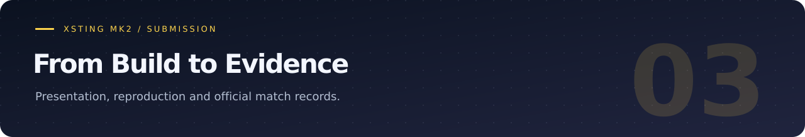

<div align="center">



<h1>팀원 재현 시험</h1>
<p>다른 팀원이 설치부터 실행까지 독립적으로 재현하는 시험 기록서.</p>
<p><a href="../README.md">Project 2</a> &nbsp; · &nbsp; <a href="../docs/architecture.md">시스템 설계</a> &nbsp; · &nbsp; <a href="../experiments/README.md">실험 기록</a> &nbsp; · &nbsp; <a href="presentation.md">발표 자료</a>
</p>

</div>

---

<table>
<tr>
<td width="33%" align="center"><h3>ENVIRONMENT</h3>장비와 소프트웨어</td>
<td width="33%" align="center"><h3>REPRODUCTION</h3>빌드 · 시험 · 실행</td>
<td width="33%" align="center"><h3>작성 양식</h3>실측값과 근거 입력</td>
</tr>
</table>

<details>
<summary><strong>이 문서의 목차</strong></summary>

01. [재현 시험 기본 정보](#chapter-01)
02. [재현 시험 장비 및 소프트웨어 실측 버전](#chapter-02)
03. [단계별 재현 실행 절차 및 결과](#chapter-03)
04. [재현 중 발견된 이슈 및 문서 보완 반영 내역](#chapter-04)

</details>

본 문서는 주 구현자가 아닌 **다른 팀원**이 [`README.md`](../README.md)의 설치·빌드·실행 안내만 보고 동일한 로봇 시스템(단위 테스트, 시뮬레이션 검증, 실물 기체 구동)을 독립적으로 재현한 기록입니다.

> **자동 기록 생성 방법**: 재현 시험을 수행하는 팀원은 터미널에서 아래 스크립트를 실행하면 날짜, 실행 계정, 실제 장비 연결 상태, 소프트웨어 버전, Git 커밋, 빌드·단위 테스트 결과가 자동 채취되어 Markdown 블록으로 출력됩니다(비밀번호·API 키 자동 제외).
> ```bash
> cd ~/mk2_ws
> bash src/xSting/project2/submission/scripts/collect_repro_info.sh --run-tests
> ```

---

<a id="chapter-01"></a>

## 1. 재현 시험 기본 정보

| 항목 | 기록 내용 |
|---|---|
| **재현 시험 일시** | `2026-11-__ __:__ (KST)` |
| **실행자 (재현 담당 팀원)** | `<팀원 성명 / 역할 기입>` *(주 작성자와 다른 팀원)* |
| **입회 · 교차 검증자** | `<입회 팀원 성명 기입>` |
| **대상 워크스페이스 경로** | `/home/pa03/Documents/FINAL/mk2_ws` (또는 클론된 신규 경로 기입) |
| **Git 저장소 브랜치 / 커밋 해시** | `main` (또는 `develop`) / `<git rev-parse HEAD 40자 또는 단축 해시 기입>` |
| **워킹트리 클린 여부 (`git status`)** | `[ ] Clean (수정사항 없음)` / `[ ] 로컬 보정 파일만 변경 (내역 하단 기재)` |

---

<a id="chapter-02"></a>

## 2. 재현 시험 장비 및 소프트웨어 실측 버전

### 2.1 실제 연결 장비 확인 내역

| 장비 항목 | 재현 시험 당시 인식 상태 / 장치 경로 | 확인 결과 |
|---|---|---|
| **연산 노트북 / GPU** | `x86_64 Laptop` / `NVIDIA GeForce RTX 5060 Laptop GPU` (또는 재현 PC GPU 모델명) | `[ ] 정상` |
| **OpenCR 보드 3종 (ID 200/201/202)** | `/dev/ttyACM0`, `/dev/ttyACM1`, `/dev/ttyACM2` (자동 Ping 매칭) | `[ ] 정상` |
| **Intel RealSense D435** | USB 3.x 직결 (`/camera/color/image_raw`, `/camera/depth/*` 수신) | `[ ] 정상` |
| **ArduCam (Eye-in-Hand)** | `/dev/arducam` udev 심볼릭 링크 매칭 (`/arducam/image_rect` 수신) | `[ ] 정상` |
| **COIN-D4 2D LiDAR** | `/dev/lidar` udev 심볼릭 링크 매칭 (`/scan_filtered` 수신) | `[ ] 정상` |

### 2.2 소프트웨어 및 주요 패키지 버전

| 구성 요소 | 기준 환경 버전 | 재현 환경 실측 버전 | 일치 여부 |
|---|---|---|---|
| **OS / Linux 커널** | Ubuntu `26.04.1 LTS` / `7.0.0-43-generic` | `<자동 수집값 또는 실측값 기입>` | `[ ]` |
| **NVIDIA Driver / CUDA** | `615.71.09` / CUDA `13.2` (`V13.2.86`) | `<자동 수집값 또는 실측값 기입>` | `[ ]` |
| **ROS 2 배포판** | `ros-lyrical-desktop 0.13.0` | `<자동 수집값 또는 실측값 기입>` | `[ ]` |
| **cuVSLAM / nvblox** | `5.0.0` / `5.0.0` | `<자동 수집값 또는 실측값 기입>` | `[ ]` |
| **MoveIt 2 / Foxglove Bridge** | `2.15.2` / `3.6.0` | `<자동 수집값 또는 실측값 기입>` | `[ ]` |
| **사용 설정 파일** | `nav.yaml`, `pick_place.yaml`, `sign_barcode.yaml`, `mission_bridge.yaml` 기본값 | 변경 없음 (또는 현장 변경 파라미터 명시) | `[ ]` |

---

<a id="chapter-03"></a>

## 3. 단계별 재현 실행 절차 및 결과

| 단계 | 실행 명령 요약 | 성공 여부 | 소요 시간 / 관측 결과 및 증빙 로그 |
|---|---|---|---|
| **1. 클린 빌드 (`colcon build`)** | `colcon build --symlink-install --cmake-args -DBUILD_TESTING=ON` | `[ ] 성공` / `[ ] 실패` | 전체 ROS 2 패키지 에러 0건 빌드 확인 |
| **2. 자동 단위 테스트 (`colcon test`)** | `colcon test --packages-select xsting_nav xsting_pick_place xsting_mission` | `[ ] 성공` / `[ ] 실패` | `colcon test-result --verbose` 실패 0건 통과 확인 |
| **3. TensorRT 엔진 생성** | `bash src/xsting_vision/scripts/build_engines.sh` | `[ ] 성공` / `[ ] 실패` | `rg_nano`, `sign_nano` FP16 `.engine` 2종 정상 생성 |
| **4. 무하드웨어 미션 시뮬레이션** | `ros2 launch xsting_bringup auto_drive.launch.py sim_fake:=true decider:=script start_paused:=false` | `[ ] 성공` / `[ ] 실패` | `signal.json`, `allocation.json`, `verification.json`, `phase=DONE` 생성 확인 |
| **5. 실물 하드웨어 통합 기동** | `ros2 launch xsting_bringup auto_drive.launch.py virtual_sign:=false start_paused:=true` | `[ ] 성공` / `[ ] 실패` | 4.5s 기립 + 팔 홈 복귀 + LiDAR-ESDF 초기 정합 완료 |
| **6. 실물 미션 주행 · 정지 · 초기화** | `/mission/start` 실행 → 단위 작업 확인 → `/nav/estop` 제동 → 재기동 초기화 | `[ ] 성공` / `[ ] 실패` | `~/xsting_logs/run_<시각>/` 로그 및 비상정지 정상 응답 확인 |

---

<a id="chapter-04"></a>

## 4. 재현 중 발견된 이슈 및 문서 보완 반영 내역

> 재현 시험 과정에서 팀원이 겪은 막힘 지점이나 환경 차이, 그리고 이를 `README.md`·스크립트에 어떻게 반영했는지 정직하게 기록합니다.

| 번호 | 재현 중 발생한 현상 / 막힘 지점 | 원인 | 조치 및 `README.md` 반영 사항 |
|---:|---|---|---|
| 1 | *(예시: 1회차 시험 후 런치 종료 없이 2회차 신호 인식 재시도 시 응답 대기 지속)* | `SignBarcodeNode`가 1회 성공 후 GPU 절약을 위해 컴포넌트를 자동 언로드함 | `README.md` **7. 경기 초기화 방법**에 회차 간 런치 프로세스 재시작 필수 안내 명시 |
| 2 | *(실제 팀원 재현 시 발생한 추가 사항 기입 — 없으면 '추가 특이사항 없음' 기입)* | — | — |
