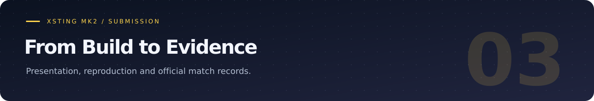

<h1>공식 경기 판정표</h1>

회차별 근거를 바탕으로 8개 항목을 채점합니다.

<a href="../README.md">Project 2</a> &nbsp; · &nbsp; <a href="../docs/architecture.md">시스템 설계</a> &nbsp; · &nbsp; <a href="../experiments/README.md">실험 기록</a> &nbsp; · &nbsp; <a href="presentation.md">발표 자료</a>

---

<table>
<tr>
<td width="33%" align="center"><h3>100</h3>회차별 원점수 만점</td>
<td width="33%" align="center"><h3>08</h3>평가 항목</td>
<td width="33%" align="center"><h3>02</h3>독립 경기 회차</td>
</tr>
</table>

<strong>이 문서의 목차</strong>

01. [공식 1회차 100점 판정표](#chapter-01)
02. [공식 2회차 100점 판정표](#chapter-02)
03. [회차 비교 및 최종 반영 점수 산출표](#chapter-03)

본 판정표는 발제 문서(`mission.pdf` 06 | 채점표) 기준에 따라 **공식 1회차**와 **공식 2회차**의 항목별 원점수, 자율 완주 여부, 실패 원인을 **회차별로 섞지 않고 각각 기록**하며, 두 회차 중 높은 단일 회차의 전체 점수로 최종 반영 점수를 산출합니다.

---

## 1. 공식 1회차 (Official Round 1) 100점 판정표

- **수행 일시**: `2026-11-__ __:__ (KST)`
- **검증 로그 경로**: [`submission/official_logs/round_1/`](official_logs/round_1/)
- **전체 영상 링크**: `[공식 1회차 공개 영상 링크 기입]`

| 번호 | 평가 항목 | 배점 | 세부 판정 기준 (`mission.pdf` 기준) | 1회차 달성 내역 | 1회차 원점수 | 실패 · 감점 원인 및 검증 근거 |
|---:|---|---:|---|---|---:|---|
| 1 | **신호 순서 기억** | **12** | 12개 시점별 색상 일치 각 `1점` (실제 센서 관측 기록 기준) | `_ / 12` 시점 일치 | **`__` / 12** | `round_1/signal.json` (`sequence`) / 불일치 시점 및 사유 기입 |
| 2 | **색상별 횟수** | **9** | `R`·`Y`·`G` 정답 횟수 일치 각 `3점` | `R:[ ] Y:[ ] G:[ ]` | **`__` / 9** | `round_1/signal.json` (`counts`) |
| 3 | **바코드 해석** | **4** | 실물 Code 128 문자열(`P2-01~04`)과 정렬 방향(`asc`/`desc`) 모두 일치 시 `4점` | 코드 `P2-0_`, 방향 `_` | **`__` / 4** | `round_1/signal.json` (`barcode`) |
| 4 | **장소 그룹 배정** | **9** | 동률 규칙(`R→Y→G`) 반영 정답 그룹을 `L1`·`L2`·`L3`에 배정 각 `3점` | `L1:[ ] L2:[ ] L3:[ ]` | **`__` / 9** | `round_1/allocation.json` |
| 5 | **색상 · 모양 선택** | **18** | 각 장소 개수 + (`R`/`G` 색상 조건 또는 `Y` 단일 모양 통일) 모두 충족 각 `6점` | `L1:[ ] L2:[ ] L3:[ ]` | **`__` / 18** | `round_1/allocation.json` (`y_shape_unified` 등) |
| 6 | **주사위 눈 배치** | **30** | 각 장소 정답 눈 방향·중심 오차 `≤10 mm`·`2초` 안정·빈 격자 추가 퍽 없음 각 `10점` | `L1:[ ] L2:[ ] L3:[ ]` | **`__` / 30** | 현장 실측 및 하차 스냅샷 / 이탈 격자·낙하 여부 기입 |
| 7 | **이동 후 검증** | **8** | **새 관측 기반** 장소별 ID·위치 기록 각 `2점`(`6점`) + 전체 중복/누락 판정 `2점` *(목표 상태 복사 불인정)* | `L1:[ ] L2:[ ] L3:[ ]` + 중복/누락:`[ ]` | **`__` / 8** | `round_1/verification.json` (`stamp`, `seen_puck_id`, `offset_mm`) |
| 8 | **복귀** | **10** | 차체 전체가 출발 구역(`HOME`) 안에서 `3초` 이상 완전 정지 | `[ ] 달성` / `[ ] 미달` | **`__` / 10** | 영상 종료 시점 및 `round_1/final_state.json` |
| — | **1회차 합계** | **100** | `12 + 9 + 4 + 9 + 18 + 30 + 8 + 10` | **자율 완주**: `[ ] 성공` / `[ ] 미달` | **`___` / 100** | *자율 완주는 1~8 전 항목 100% 성공 시에만 인정* |

- **1회차 종합 실패 원인 요약**:
  - *(감점 또는 미완료된 모든 항목의 직접 원인 기록 — 예: 신호 N번째 점멸 오인식, S_ 상자 파지 실패로 인한 수량 부족, L_ 격자 중심 오차 10 mm 초과 등)*

---

## 2. 공식 2회차 (Official Round 2) 100점 판정표

- **수행 일시**: `2026-11-__ __:__ (KST)`
- **검증 로그 경로**: [`submission/official_logs/round_2/`](official_logs/round_2/)
- **전체 영상 링크**: `[공식 2회차 공개 영상 링크 기입]`

| 번호 | 평가 항목 | 배점 | 세부 판정 기준 (`mission.pdf` 기준) | 2회차 달성 내역 | 2회차 원점수 | 실패 · 감점 원인 및 검증 근거 |
|---:|---|---:|---|---|---:|---|
| 1 | **신호 순서 기억** | **12** | 12개 시점별 색상 일치 각 `1점` (실제 센서 관측 기록 기준) | `_ / 12` 시점 일치 | **`__` / 12** | `round_2/signal.json` (`sequence`) / 불일치 시점 및 사유 기입 |
| 2 | **색상별 횟수** | **9** | `R`·`Y`·`G` 정답 횟수 일치 각 `3점` | `R:[ ] Y:[ ] G:[ ]` | **`__` / 9** | `round_2/signal.json` (`counts`) |
| 3 | **바코드 해석** | **4** | 실물 Code 128 문자열(`P2-01~04`)과 정렬 방향(`asc`/`desc`) 모두 일치 시 `4점` | 코드 `P2-0_`, 방향 `_` | **`__` / 4** | `round_2/signal.json` (`barcode`) |
| 4 | **장소 그룹 배정** | **9** | 동률 규칙(`R→Y→G`) 반영 정답 그룹을 `L1`·`L2`·`L3`에 배정 각 `3점` | `L1:[ ] L2:[ ] L3:[ ]` | **`__` / 9** | `round_2/allocation.json` |
| 5 | **색상 · 모양 선택** | **18** | 각 장소 개수 + (`R`/`G` 색상 조건 또는 `Y` 단일 모양 통일) 모두 충족 각 `6점` | `L1:[ ] L2:[ ] L3:[ ]` | **`__` / 18** | `round_2/allocation.json` (`y_shape_unified` 등) |
| 6 | **주사위 눈 배치** | **30** | 각 장소 정답 눈 방향·중심 오차 `≤10 mm`·`2초` 안정·빈 격자 추가 퍽 없음 각 `10점` | `L1:[ ] L2:[ ] L3:[ ]` | **`__` / 30** | 현장 실측 및 하차 스냅샷 / 이탈 격자·낙하 여부 기입 |
| 7 | **이동 후 검증** | **8** | **새 관측 기반** 장소별 ID·위치 기록 각 `2점`(`6점`) + 전체 중복/누락 판정 `2점` *(목표 상태 복사 불인정)* | `L1:[ ] L2:[ ] L3:[ ]` + 중복/누락:`[ ]` | **`__` / 8** | `round_2/verification.json` (`stamp`, `seen_puck_id`, `offset_mm`) |
| 8 | **복귀** | **10** | 차체 전체가 출발 구역(`HOME`) 안에서 `3초` 이상 완전 정지 | `[ ] 달성` / `[ ] 미달` | **`__` / 10** | 영상 종료 시점 및 `round_2/final_state.json` |
| — | **2회차 합계** | **100** | `12 + 9 + 4 + 9 + 18 + 30 + 8 + 10` | **자율 완주**: `[ ] 성공` / `[ ] 미달` | **`___` / 100** | *자율 완주는 1~8 전 항목 100% 성공 시에만 인정* |

- **2회차 종합 실패 원인 요약**:
  - *(감점 또는 미완료된 모든 항목의 직접 원인 기록)*

---

## 3. 회차 비교 및 최종 반영 점수 산출표

> **산출 규칙 (`mission.pdf` p.7)**:
> - 공식 2회 중 **더 높은 단일 회차의 전체 점수**를 사용하며, **1회차와 2회차의 부분 성공 항목을 절대 합산하지 않습니다.**
> - 프로젝트 종합 평가 내 **통합 경기 점수(25점 만점)** = `채택 회차 원점수 × 0.20` (최대 20점) + `자율 완주 점수` (신호·정렬·세 장소 정답·재검증·복귀 전부 성공 시 `5점`, 미달 시 `0점`).

| 구분 | 공식 1회차 | 공식 2회차 | 최종 반영 회차 (`max(1회차, 2회차)`) |
|---|---:|---:|---:|
| **경기 원점수 (100점 만점)** | `___` 점 | `___` 점 | **`___` 점** (`_회차` 단독 반영) |
| **자율 완주 달성 여부** | `성공 / 실패` | `성공 / 실패` | **`성공 (+5점) / 실패 (+0점)`** |
| **원점수 환산 (`원점수 × 0.20`, 20점 만점)** | `__._` 점 | `__._` 점 | **`__._` 점** |
| **통합 경기 최종 반영 점수 (25점 만점)** | `__._` 점 | `__._` 점 | **`__._` / 25.0 점** |
